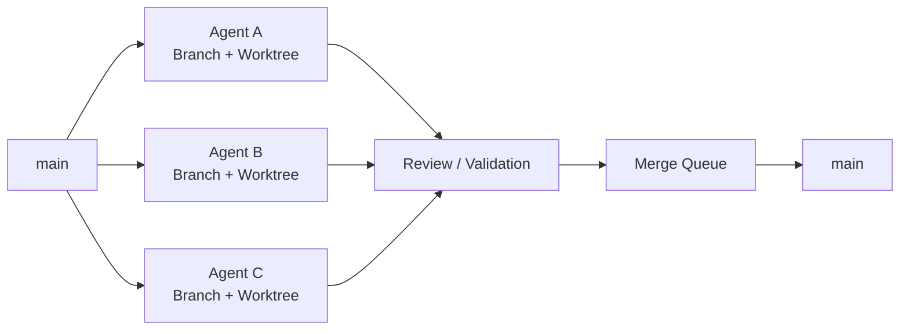
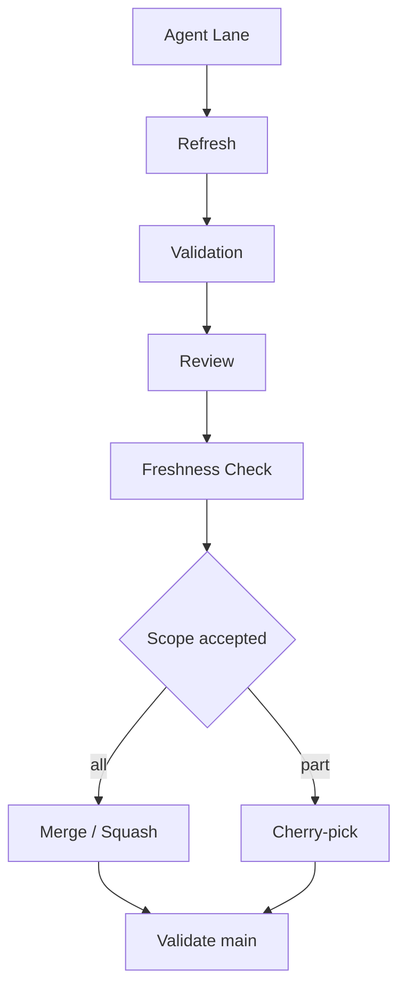
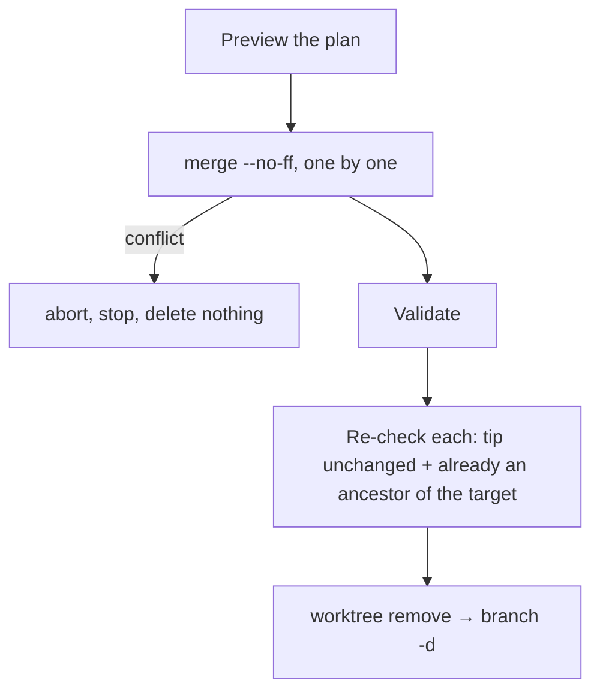
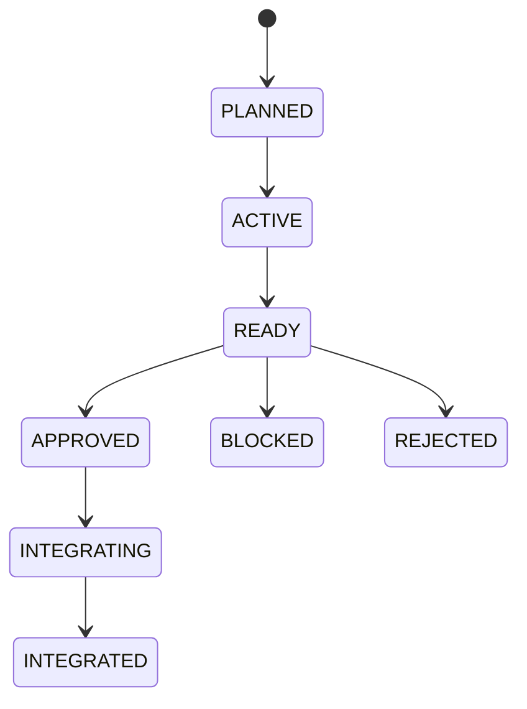

# Multi-Agent Git Orchestrator Skills

[English](README.en.md) | [中文](README.md) | [日本語](README.ja.md)

> **Let multiple AI agents safely develop the same Git repository in parallel.**

A Git workflow skill for coding agents — Claude Code, Codex, Cursor, OpenCode, Hermes, and any host that supports the Agent Skills format.

It actively inspects the current repository's **branch / worktree / commit / ahead-behind / dependency** state, then helps the agent decide:

- Which tasks can safely run in parallel
- Which worktrees can be reused or reclaimed
- Which branches should be rebased vs merged
- Which commits are worth cherry-picking
- Which branches are now safe to delete
- How to stop several agents from destroying `main`


---

## What it runs, sends and fetches

- **Runs.** In Claude Code the plugin turns on PreToolUse hooks (`hooks/hooks.json`). For shell commands, agent launches, worktree creation and the MCP tools that start sessions, shells or processes, `hooks/run-guard.cmd` starts Python on `scripts/magos_guard.py`; the script reads the tool call it is handed, answers allow or deny, and runs no program other than the local Git commands listed next.
- **Reads.** That tool call, and the Git state of the repository you are working in, through local Git commands only (`branch`, `check-ref-format`, `config`, `diff`, `for-each-ref`, `log`, `merge-base`, `rev-list`, `rev-parse`, `status`, `worktree`). It never runs a command that talks to a remote.
- **Writes.** Only inside `<git-common-dir>/magos/` of that repository: lane claims, plan records, override records and an audit log (the time, the Git user name and email and the login name of the account, the branch and its files, and the reason you typed for an override). Two things happen outside it, only when you run them yourself in a terminal: `install` copies the guard to `~/.magos/guard` and prints a configuration entry for you to merge, and `arm` adds one Git `reference-transaction` hook to that repository. The plugin changes no Claude Code setting and no permission rule.
- **Sends and fetches.** The guard sends nothing and fetches nothing: no network access, no telemetry, no credentials (the package tests check that the hook code opens no network connection and that its Git runner refuses every subcommand that talks to a remote). The slash commands are instructions for the agent: `/GitRecon`, `/GitAnalyze` and `/GitRecommend` only read; the five commands that write run only when you type them (Claude Code and Codex keep the model from starting them; Hermes has no such switch, so their adapters instruct the agent to run only on your explicit invocation), and where one has `--apply`, nothing changes without it. Network use is limited to what you ask: `--remote` runs `git fetch --prune` against your remote, `/GitSweep --apply` deletes merged remote branches and `/GitSweep --apply --push` pushes one branch.
- **Turning it off.** `git config --local magos.guard off` (one repository), `claude plugin disable magos` (the plugin) or `MAGOS_GUARD=off`; see **Lane guard** below.

---

## Plain-language primer (start here if you are new to Git)

> No Git background needed. Think of several people editing the same important document.

| Word you will see | In plain words | Office analogy |
|---|---|---|
| repository | The folder that holds the whole project and its full history | A filing cabinet of documents and every revision |
| commit | One recorded change, with an ID | A saved version of the document |
| branch | An independent line of changes; lines do not disturb each other | Each person's own revised draft |
| `main` | Usually the "official, stable" line | The finished, published version |
| merge | Bring the changes of one branch into another | Fold several drafts into the master copy |
| worktree | The folder where one branch is being edited | Each person's own desk |
| remote | The copy stored online (for example on GitHub) | The company's shared-drive backup |
| preview / apply | Look at the plan first, then decide to really do it | Read the renovation plan, then say "go" |

**Every command follows one rule: look first, act only when told.** The five commands that can change your repository (`/GitIntegrate`, `/GitCleanup`, `/GitConverge`, `/GitSweep`, `/GitPlan`) act only when you explicitly ask: `/GitCleanup`, `/GitConverge`, `/GitSweep` and `/GitPlan` only preview until you add `--apply` (the closing `--release` of `/GitPlan` writes too); `/GitIntegrate` has no preview mode, so typing it is the order to integrate, and it checks every gate first and writes only when all of them pass. They stop and explain whenever they are unsure instead of pushing on.

### How do I write a command?

Type the command in Claude Code, followed by optional "arguments" separated by spaces:

```text
/CommandName  required-thing  --switch  --switch-with-a-value value
```

- Things in `<angle brackets>` are **required**. Replace them with your own value, for example `<branch>` becomes `agent/release`.
- Things in `[square brackets]` are **optional**.
- Anything starting with `--` is a "switch". Some work on their own (`--apply`); some need a value after them (`--lang English`).
- If a value contains a space, put it in quotes: `--lang "Brazilian Portuguese"`.
- The order of switches does not matter.
- `--help` is always safe: it **only shows the instructions and never reads or changes your repository**.
- This README writes every command as `/GitRecon`. The name you type depends on the host and the install: after a plugin-marketplace install, for example, it is `/magos:GitRecon` in Claude Code, `$magos:git-recon` in Codex and `/magos:git-recon` in Hermes. The "Install" section lists them all.

---

## Three arguments that work everywhere

These three work the same way in every command that supports them. Learn them once and every command below gets easier.

### `--help`: just show the instructions

**How to write it**: `/CommandName --help`. It can go anywhere after the command and can be combined with other arguments; as soon as `--help` is present, only the instructions are shown.

```text
/GitConverge --help
/GitIntegrate agent/auth --strategy squash --help      ← other arguments are ignored; only the help is shown
/GitRecon --help --lang English                         ← show the help in English
```

| Item | Explanation |
|---|---|
| What it does | Shows how to write the command, what every argument means, what happens when you leave them out, and a few examples, then stops |
| What it never does | Never reads your repository, never runs Git, never changes anything |
| When to use it | You forgot the syntax, you are unsure what an argument means, or it is your first time with a command |
| Which commands | All eight |

> **When in doubt, add `--help` first. It is completely safe.**

---

### `--remote`: ask the internet for the latest state first

**How to write it**: `/CommandName --remote`. It is a plain switch; no value follows it.

```text
/GitRecon --remote
/GitAnalyze agent/auth --remote
/GitRecommend which branches should merge first --remote
```

**What is the difference with and without it?** Suppose your computer noted yesterday that "online `main` is at change #100", and today a colleague uploaded 3 more changes.

| Written as | How it judges | Likely consequence |
|---|---|---|
| Without `--remote` (default) | Uses only the records **already on your computer**: "online `main` is at #100" | Fast and needs no network, but the conclusion may be stale |
| With `--remote` | First updates the records, learns "online `main` is now at #103", then concludes | A fresher conclusion; needs the network and takes a little longer |

**What exactly does it do?** It asks Git to refresh the list of online branches and their latest positions (for example `git fetch --prune`), and to drop old records of branches that were deleted online.
**What it never does**: it never merges online changes into your branches, never changes your local branches or files, and never uploads anything.

| Item | Explanation |
|---|---|
| Which commands | Only the three read-only ones: `/GitRecon`, `/GitAnalyze`, `/GitRecommend`. `/GitSweep` has a different option with the same name, `--remote <name>`: it must be followed by a remote name, only selects which remote to sweep, and never refreshes anything. After any other command it counts as an unknown option, and you get an error and the help |
| No network or no access | It says the refresh failed and notes that its conclusions are based on the records already on your computer |
| When to add it | You just heard a colleague uploaded something, or you must decide based on how the online copy looks right now |

---

### `--lang <language>`: choose the language of the reply

**How to write it**: `--lang language`. A language **must** follow `--lang`, separated by a space.

```text
/GitRecon --lang English
/GitAnalyze agent/auth --lang 日本語
/GitConverge agent/release --lang "Brazilian Portuguese"
/GitRecommend which branches should merge first --lang en
```

**Which languages can I write?** A name or a common code; almost any language the model can write works:

| Language you want | Write it as |
|---|---|
| Chinese | `中文`, `简体中文`, `zh` (also the default when you write nothing) |
| English | `English`, `en` |
| Japanese | `日本語`, `ja` |
| Korean | `한국어`, `ko` |
| French / German / Spanish | `Français` / `fr`, `Deutsch` / `de`, `Español` / `es` |
| A name with a space | Put it in quotes: `"Brazilian Portuguese"` |

**What does it control?** All the text it writes back to you: explanations, reports, questions to you, error messages, and the text of `--help`.

**What is never translated?** Command names, option names, branch names, file paths, commit IDs, Git commands, and status codes such as `BLOCKED_DIRTY` or `MERGE`, because you may need to copy or search for them exactly. It may add a short gloss in your language next to them, for example `BLOCKED_DIRTY` (unsaved edits in its worktree).

| Item | Explanation |
|---|---|
| If you leave it out | **The reply is in Chinese**, even if you asked in English |
| Where to put it | Anywhere after the command. In `/GitRecommend which branches should merge first --lang English`, `--lang English` is taken out first, so your question is "which branches should merge first" |
| If you write it wrongly | If nothing follows `--lang`, or what follows is not a language (for example `--lang xyz123`), it tells you what is wrong in Chinese and shows the usage, **without running the command** |
| Does it change the result? | No. Only the language of the reply changes; the checks and judgments are identical |
| Which commands | All eight |

---

## Why

Multi-agent development usually collapses into this:

```text
Agent A ─┐
Agent B ─┼── one shared directory ── conflicts / overwrites / tangled history
Agent C ─┘
```

This skill turns it into this:



The core principle:

> **One Agent Lane = One Branch + One Worktree**

---

## Capabilities

| Capability | What it does |
|---|---|
| Repository Recon | Actively inspects branches, worktrees, HEAD, dirty state, ahead/behind |
| Dependency DAG | Works out which agent tasks block which |
| Worktree Isolation | Stops multiple agents from mutating the same checkout |
| Rewrite Safety | Decides when a rebase is allowed and when history is frozen |
| Selective Integration | Picks merge / squash / cherry-pick based on actual state |
| Freshness Gate | Blocks integration when `main` moved after your review |
| Merge Queue | Serializes writes into the shared integration branch |
| Safe Cleanup | Identifies completed branches and worktrees safely |
| Safe Rollback | `reset` for private history, `revert` for shared history |
| Branch Strategy | Identifies the branching model a repository actually follows, audits it against a parallel-agent safety checklist, proposes only the smallest change, and never edits branches as advice |
| Lane Planning | Before work starts, divides a task into lanes that own different files and registers the plan with an optimistic lock; when the work is done, merges the lanes into one whole in dependency order |

---

## The eight commands

| Command | In one sentence | Does it change your repository? |
|---|---|---|
| `/GitRecon` | A health check of the whole repository | No, look only |
| `/GitAnalyze` | A deep look at one branch or worktree | No, look only |
| `/GitRecommend` | Suggests what to do next, from real state | No, advice only |
| `/GitIntegrate` | Lands one agent's work behind a safety gate | Yes, after a series of checks |
| `/GitCleanup` | Removes finished branches and worktrees | Not by default; only with `--apply` |
| `/GitConverge` | Folds every branch into one and keeps only `main` and it | Not by default; only with `--apply` |
| `/GitSweep` | Runs `/GitConverge`, then also deletes merged remote branches | Not by default; only with `--apply` (includes remote deletion); `<branch>` is pushed once only when you also add `--push` |
| `/GitPlan` | Before any sub-agent starts, investigates Git and the code, writes the requirements, divides the task into lanes that own different files and prints the checklist as a requirements table and a lanes table; afterwards merges the lanes into one whole in dependency order and supplements the checklist with what each lane changed | Not by default; only with `--apply` (or the closing `--release`): registers the plan, with `--create` also creates the lane branches and worktrees, `--converge --apply` merges, `--land` adds one fast-forward; it never pushes and never deletes a branch or a worktree |

Every command accepts `--lang <language>` (reply language, Chinese by default) and `--help` (instructions only); the three read-only commands also accept `--remote` (`/GitSweep`'s `--remote <name>` is a different option; see its section). Their details are in "Three arguments that work everywhere" above, so each command below describes only the arguments **it alone** has.

> **Not sure which branches and worktrees you have?** Run `/GitRecon` first and it lists them. In a terminal, `git branch` lists the branches and `git worktree list` lists the worktrees.

---

### `/GitRecon` — read the room

**A health check of the whole repository. Look only.**

Use it when you have just taken over a project, several agents are editing at once, or you do not know which branches and worktrees exist.

```text
/GitRecon
/GitRecon --remote
/GitRecon --lang English
```

It reports on:

```text
Worktrees        how many, and which branch each one is on
Branches         their latest positions, and whether an online branch exists for each
HEAD             where you are standing right now
Dirty            which worktrees hold half-edited files
Ahead / Behind   how many changes more or fewer than the main line
Detached         which worktrees are not attached to any branch
Remote tracking  which online branch each local branch follows
Merge candidates which branches are already part of the main line
Risk             things you should look at
```

#### The arguments in detail

`/GitRecon` has no required argument; just type it. Optional arguments:

| Argument | How to write it | What it does |
|---|---|---|
| `--remote` | `/GitRecon --remote` | Refresh the online reference data first; see "Three arguments that work everywhere" |
| `--lang <language>` | `/GitRecon --lang English` | Reply in that language; Chinese if omitted |
| `--help` | `/GitRecon --help` | Show the instructions only |

---

### `/GitAnalyze <target>` — understand one lane

**A deep look at one branch or one worktree. Look only.** Use it to answer "can I merge or delete this?".

```text
/GitAnalyze agent/auth
/GitAnalyze ../wt-auth --remote
```

#### The arguments in detail

**`<branch or worktree path>` (required): what to inspect**

| Item | Explanation |
|---|---|
| What to write | Either works: a **branch name** (as `git branch` shows it, for example `agent/auth`) or the **folder path of a worktree** (for example `../wt-auth`; a full path is fine too) |
| Where to find names | Run `/GitRecon`; the list has every branch name and worktree path |
| If you leave it out | It does not guess; it asks which one to inspect and shows the help |
| If you get it wrong | It says it cannot find that branch or path and asks you to confirm; it does not inspect something else |
| A branch and a path share a name | It decides from the facts of the repository; if the answer would change the conclusion, it tells you about the ambiguity instead of picking one |

**`--remote` (optional)**: refresh the online reference data first; see "Three arguments that work everywhere". **`--lang <language>` (optional)**: reply language, Chinese by default.

#### What it checks, and how to read the report

It finds the common starting point with the main line, how far ahead or behind the branch is, its unique changes, the files it touches, whether other branches depend on it, and whether its history may be rewritten. It ends with a verdict for each of merge, rebase, cherry-pick, squash, and cleanup/delete: safe or not. Illustrative:

```text
agent/auth

Ahead:     3          ← 3 changes more than the main line
Behind:    2          ← 2 changes fewer (the main line has new changes it does not have yet)
State:     DIVERGED   ← each side has changes the other lacks: the lines have "forked"
Depends:   agent/core ← it is built on top of agent/core
Rewrite:   FROZEN     ← do not rewrite its history; branches that depend on it would break

Recommendation:
Do not rebase directly (that rewrites history)
Bring the main line in first, then validate again
```

---

### `/GitRecommend [goal]` — decide what happens next

**Advice from the real state of the repository. Advice only.**

Use it when you are unsure what to do next, for example "how should I split work between 3 agents?".

```text
/GitRecommend
/GitRecommend how should I arrange 3 agents
/GitRecommend which branches should merge first --remote
```

#### The arguments in detail

**`[goal]` (optional): your question or what you want to achieve**

| Item | Explanation |
|---|---|
| How to write it | Just write it in your own words after the command; **no quotes needed**, any length |
| If you leave it out | You get general next-step advice covering every branch and worktree |
| How to write a good one | **The more specific, the better**: say what you want to achieve, how many agents there are, and which branches matter most |
| Mixing with other arguments | Fine. `--remote` and `--lang English` are taken out first; the remaining text is your question |

Examples:

```text
/GitRecommend                                                ← general advice
/GitRecommend how should I arrange 3 agents                  ← work split
/GitRecommend agent/auth is done, how do I wrap it up        ← about one branch
/GitRecommend find the best worktree for a new task --lang ja ← reply in Japanese
```

**`--remote` (optional)**: refresh the online reference data first. **`--lang <language>` (optional)**: reply language, Chinese by default.

#### What the report looks like

It investigates first, then answers in this order: observed facts, the biggest risks, recommendations in order, the reason for each, and what could not be determined. Illustrative:

```text
Agent A → can keep going in parallel
Agent B → edits mostly the same files as A; queue it behind A
Agent C → depends on A; wait for A

agent/old-ui → looks safe to clean up
agent/auth   → others depend on it; do not rewrite it yet
```

---

### `/GitIntegrate <lane>` — land the work behind a gate

**Bring one agent's work (one "lane") into the main line safely.** An agent saying "Done" is never enough.

```text
/GitIntegrate agent/auth
/GitIntegrate agent/auth --strategy squash
/GitIntegrate agent/auth --strategy cherry-pick --lang English
```

#### The arguments in detail

**`<lane or branch>` (required): the branch to bring into the main line**

| Item | Explanation |
|---|---|
| What to write | A branch name such as `agent/auth` (`/GitRecon` shows every branch name) |
| If you leave it out | It asks which one to integrate; **it never picks one for you** |
| Where it lands | The repository's "integration branch", usually `main`; it works this out from the repository's conventions and tells you if it cannot, rather than guessing |

**`--strategy <how>` (optional): how to bring it in**

Write one of the four values after `--strategy`. Leaving it out is the same as `--strategy auto`.

| Value | Plain meaning | Good for |
|---|---|---|
| `auto` (default) | Pick the best way from the repository's habits and your review | When you are not sure which to choose |
| `merge` | Bring everything in and **keep** every change record (whether an extra "merge record" is added follows the repository's own merge policy) | You want the full history of how it was built |
| `squash` | Bring everything in as **one** combined record (only if the repository's rules allow it) | The changes are fiddly and you want a tidy main line |
| `cherry-pick` | Bring in **only the changes already confirmed safe** and leave the rest | Only part of the work is acceptable |

How the three differ in history (`A, B` are the main line's existing records; `C, D` are the branch's two changes):

```text
merge          A──B──────M       M is a new merge record; C and D stay as they were
                  \     /
                   C──D

squash         A──B──S           S is one new record holding all of C and D; they do not enter the main line separately

cherry-pick    A──B──C'          only C is copied over; D does not enter the main line
```

| If… | It will… |
|---|---|
| The value is wrong, for example `--strategy rebase` | Say only `auto`, `merge`, `squash`, `cherry-pick` are supported, show the help, and **not continue** |
| You write `--strategy` with no value | Same: it asks you to add one |
| You pick `cherry-pick` but it does not know which changes you approved | **Stop and ask**; you must say which changes passed review, and it will not guess |
| The way you chose breaks the repository's rules or is unsafe | Refuse and explain, even if you asked for it explicitly |

**`--lang <language>` (optional)**: reply language, Chinese by default.

#### What it checks before acting

It checks, one by one: is there evidence that the work was reviewed and accepted, are there unfinished dependencies, did the main line change after your review, did this branch gain new changes after your review, and do the repository's rules allow it. **If any check fails it stops and tells you; it never forces it.** After integrating, it validates the main line again and, when the lane guard is installed, releases the lane's registration (`magos_guard.py release --branch <branch> --reason integrated`).



---

### `/GitCleanup` — reclaim branches safely

**Find old branches and worktrees that are safe to remove.**

Use it when finished branches have piled up and you want to tidy up without deleting the wrong thing.

```text
/GitCleanup              # list candidates only; deletes nothing
/GitCleanup --apply      # actually delete
/GitCleanup --lang English
```

#### The arguments in detail

`/GitCleanup` has no required argument.

**`--apply` (optional): really clean up**

| Item | Explanation |
|---|---|
| How to write it | `/GitCleanup --apply`; a plain switch, no value |
| If you leave it out | **Preview only**: lists the objects that can be cleaned and the ones that cannot (with reasons); deletes nothing |
| What it does with it | For each object marked "can be cleaned", it **checks the current state again** and deletes only if it is still safe: first removes its worktree, then deletes the branch |
| An object changed between preview and apply | For example the branch got a new change after the preview: it **skips** that one and tells you, rather than deleting from the old list |
| What it never does | Force-delete; clean a worktree with unsaved edits, an operation half-way through, or ignored files; delete a branch that holds work found nowhere else; run a repository-wide `git worktree prune`; delete `main`, the target, or the worktree you are standing in; delete online (remote) branches (only `/GitSweep` deletes remote branches) |

Suggested habit: **read the list without `--apply` first; add it only when you are happy.**

**`--lang <language>` (optional)**: reply language, Chinese by default.

#### The status of each object in the preview

| Status | Plain meaning | Cleaned? |
|---|---|---|
| `SAFE_CANDIDATE` | All seven conditions hold; safe to clean | Only with `--apply` |
| `BLOCKED_DIRTY` | Its worktree has unsaved edits | No |
| `BLOCKED_UNIQUE_WORK` | It holds work that exists nowhere else | No |
| `BLOCKED_ACTIVE_OWNER` | Someone (or some agent) is using it: its worktree is locked, lies under an agent tool's worktree directory (`.claude/worktrees/`, `~/.codex/worktrees/`, or a directory the repository documents), is recorded as belonging to someone else, or the lane has an open registration in the lane guard (`planned` or `active`); clean does not mean unused | No |
| `BLOCKED_DEPENDENCY` | Another branch depends on it | No |
| `BLOCKED_NOT_INTEGRATED` | Its content is not fully in the main line yet | No |
| `BLOCKED_IN_PROGRESS` | Its worktree is half-way through an operation (for example a rebase stopped mid-way); it looks clean but is not | No |
| `BLOCKED_IGNORED_FILES` | Its worktree holds files Git ignores (such as a `.env` with passwords); removing the worktree would delete them | No (move or delete those files yourself, then run `/GitCleanup` again) |
| `UNKNOWN` | A key fact could not be established: for example a worktree with no recorded owner (someone may still be using it), or two branch names that differ only in case | No (no confidence, no action) |

A branch becomes a `SAFE_CANDIDATE` only when **all** seven hold:

```text
✓ fully integrated
✓ worktree clean
✓ nothing half-way through in its worktree
✓ no ignored files in its worktree
✓ no active owner (a worktree it has needs a recorded owner)
✓ no downstream dependents
✓ no unique unsaved work
```

`main`, the target, the remote default branch (the one `origin/HEAD` names), any branch the repository documents as long-lived or protected, and the worktree you are standing in (with its branch) never go on the list.

**Note: "untouched for a long time" does not mean safe to delete.** Age alone never puts a branch on the cleanup list.

---

### `/GitConverge <branch>` — fold every lane into one branch

**Collect the work of every branch into the branch you choose, then keep only `main` and that branch.**

Use it when several agents finished their branches and you want to "close the net": gather everything in one place and clear away the used branches.

#### An example

Suppose the repository has:

```text
main           the stable version (1 new change)
agent/release  where you want everything collected
agent/a        Ann made 2 changes
agent/b        Bob made 1 change (his worktree is ../wt-b, nothing unsaved)
agent/c        its content is already included; nothing new
```

After `/GitConverge agent/release --apply`:

```text
Before:  main  agent/release  agent/a  agent/b  agent/c      (5 branches)
After:   main  agent/release                                  (2 branches)
         └─ agent/release now contains the work of main, a, and b
         └─ a, b, c are deleted; Bob's worktree ../wt-b is cleaned up too
```

#### Before you start: check three things

1. **Run it from the folder that holds the target branch.** Whichever folder currently has the target (for example `agent/release`) checked out is where you open Claude Code. If another folder is using the target, it refuses and tells you to run it from there.
2. **That folder must have no unsaved edits and must not be "half-way through" something** (merging, rewriting history). Otherwise it refuses and explains.
3. **The target cannot be `main`.** To bring work into `main`, use `/GitIntegrate`.

#### How to use it: three steps

**Step 1: preview (changes nothing)**

```text
/GitConverge agent/release
```

You get a plan: which branches will be merged and in what order, which will be deleted, which will be **kept** and why, and what will be left at the end. Illustrative:

```text
Plan (preview; nothing was changed)
Target branch: agent/release

To merge (in this order)
  1. main        1 new change
  2. agent/a     2 new changes
  3. agent/b     1 new change (worktree ../wt-b is clean; deleted after merging)
Already included, delete only: agent/c

Branches that stay: none
After this only: main, agent/release
Untouched: online branches, tags, worktrees other people are using
```

**Step 2: read the plan**

Each branch in the preview has one merge status (`MERGE`, `CONTAINED`, `BLOCKED_UNRELATED_HISTORY`, `BLOCKED_IN_PROGRESS`, `UNKNOWN`) and may carry any number of keep reasons (the six codes from `BLOCKED_DIRTY` to `BLOCKED_UPSTREAM_OF_KEPT`). In plain words:

| Status | Plain meaning | Merged? | Deleted? |
|---|---|---|---|
| `MERGE` | Has new changes to bring in | Yes | Deleted after merging |
| `CONTAINED` | Its changes are already in the target | Not needed | Deleted |
| `BLOCKED_UNRELATED_HISTORY` | Shares no history with the target (for example a separate `gh-pages`) | No | Kept |
| `BLOCKED_IN_PROGRESS` | Someone is half-way through something (rewriting history, cherry-picking); its position is unreliable | No | Kept |
| `BLOCKED_DIRTY` | Its worktree has unsaved edits | Yes (saved part only) | Kept |
| `BLOCKED_LOCKED` | Its worktree is locked (someone or something is using it) | Yes | Kept |
| `BLOCKED_ACTIVE_OWNER` | The worktree belongs to another agent or tool, or is the main worktree | Yes | Kept |
| `BLOCKED_IGNORED_FILES` | The worktree holds files Git ignores (for example a `.env` with secrets) | Yes | Kept (deleted only with `--discard-ignored`) |
| `BLOCKED_SUBMODULE` | The worktree contains a sub-project that `git worktree remove` refuses to delete: its git directory holds a `modules` folder, or a sub-project folder of the worktree is populated. Deinitializing does not lift it, and this command cannot remove that worktree: after confirming that it holds nothing unique, remove it yourself with `git worktree remove --force <path>`, or keep it; the branch stays as long as the worktree does | Yes | Kept |
| `BLOCKED_UPSTREAM_OF_KEPT` | Another branch that stays depends on it | Yes | Kept |
| `UNKNOWN` | A key fact could not be established, or its name equals another branch's except for case (both stay untouched; the report says how to rename one safely), or its name is not safe to pass to a command (it holds a character outside ASCII letters, ASCII digits and `.` `_` `/` `+` `-`, or starts with `-` or `+`; it stays untouched, and the remedy is to rename it with `git branch -m <old> <new>`) | Untouched | Untouched |

Keep reasons only decide whether the branch is deleted; they never stop a merge. The "Merged?" column describes a branch that has new changes (`MERGE`); a `CONTAINED` branch has nothing to merge and is merely kept when it carries a reason.

In the preview a `MERGE` branch may carry `PREDICTED_CONFLICT`: when Git supports a trial merge (`git merge-tree --write-tree`), each branch is trial-merged once, and a conflict adds this marker. It may also carry `PREDICTED_IGNORED_OVERLAP`: a path the branch changed equals an ignored file or folder in the folder you run from, or lies under or over it, so the merge would overwrite ignored files and the apply would stop; the report names the branch, the path and the ignored entry. Both markers are only hints and change no branch and no worktree; a clash between two branches is not visible to either of them and appears when the second one merges. To clear a `PREDICTED_IGNORED_OVERLAP`, move or delete the ignored entries that the report names in the folder you run from (keep a copy first, because Git does not record them; `--discard-ignored` does not apply to them), then run again.

If any branch is kept, the plan says plainly that you will **not** end up with only `main` and the target, with the reason and the next step.

A clean worktree that has no lock, lies outside the agent worktree roots (`.claude/worktrees/`, `~/.codex/worktrees/`, or a directory the repository documents), has no recorded owner, and has no open lane-guard registration is removed together with its branch even though no owner is recorded; the plan lists each such worktree as "owner: not recorded". This differs from `/GitCleanup`, which never touches a worktree whose owner is not recorded.

**Step 3: happy with it? Run it**

```text
/GitConverge agent/release --apply
```

It re-checks the current state, records the plan it will act on, merges the sources one by one, deletes the merged branches and their clean worktrees, and ends with a report. The report has: the plan it acted on, what it did, what it skipped (and why), the target's start and end IDs, the branches that remain, the validation result, and the original ID of every deleted branch.

#### The arguments in detail

**`<branch>` (required): the branch that collects everything**

| Item | Explanation |
|---|---|
| What to write | The name of an existing **local** branch, for example `agent/release`. `/GitRecon` or `git branch` shows the names |
| It must match **exactly** | **Case matters.** `agent/release` is right; `Agent/Release` is rejected, and the right name is suggested |
| What you cannot write | `main` (it is never moved), a branch that does not exist, an online branch name such as `origin/xxx`, or a folder path |
| If you leave it out | It asks you and shows the help |
| Reminder | The target must already exist as a local branch; it will not create one for you |

**`--apply` (optional): really merge and delete**

| Item | Explanation |
|---|---|
| How to write it | `/GitConverge agent/release --apply`; a plain switch, no value |
| If you leave it out | **Preview only**; nothing changes. This is the default |
| What it does with it | Re-check the current state → record the plan → switch to the target branch (if you are not on it) → merge one by one in order → validate → delete one by one after re-checking → report |
| Merge order | `main` first; then the others, the one with the most new changes first, ties by name. So if A contains B, merging A already brings B along, and B is not merged twice |
| On a conflict | It undoes that merge right away and **stops completely, deleting nothing**; merges that already succeeded stay |
| Validation | Runs the repository's own checks (for example tests) only when they can be identified; if they fail because of the merge it stops before any deletion and reports; if none can be identified the report says "not validated" and it continues, with each deletion still gated by its re-check |
| Before each deletion | It re-confirms that the branch has no new changes, its content really is in the target, and its worktree is still clean |
| You previewed earlier | In the same conversation, it compares with that preview: if any branch has moved, it stops and gives you a new preview; branches or worktrees that appeared since the preview are left alone |

**`--discard-ignored` (optional): allow cleaning worktrees that hold "ignored files"**

What are "ignored files"? Some files (for example a `.env` holding passwords and keys, or a `node_modules/` folder) are not recorded by Git, so **once deleted they cannot be recovered**.

| Item | Explanation |
|---|---|
| How to write it | `/GitConverge agent/release --apply --discard-ignored`; a switch, no value |
| If you leave it out | A worktree that holds any ignored file is **kept** together with its branch (status `BLOCKED_IGNORED_FILES`), and the preview lists those files one by one |
| What it does with it | Such worktrees are cleaned up, and **the ignored files inside are gone for good** |
| Useful on its own? | No. It only matters together with `--apply` |
| When to use it | You have read the ignored files listed in the preview and none are needed (for example only temporary files that can be regenerated) |

> It **never** overwrites ignored files that already sit in your current folder: if a branch would bring files that overwrite them, the command stops before merging that branch and tells you, and deletes no branch; merges that already finished stay. This has nothing to do with `--discard-ignored`.

**`--lang <language>` (optional)**: reply language, Chinese by default. **`--help` (optional)**: instructions only.

Examples:

```text
/GitConverge agent/release                              just the plan
/GitConverge agent/release --apply                      run the plan
/GitConverge agent/release --apply --lang English       run it, reply in English
/GitConverge agent/release --apply --discard-ignored    also clear worktrees that hold .env
```

#### Situations where it refuses

In these cases it stops **before doing anything** and explains why; the repository is not changed. Every failed gate is listed at once, each with its remedy, so one run shows everything you must clear first:

| Situation | What it says | What you do |
|---|---|---|
| The target does not exist, or the case is wrong | It cannot find the branch; if only the case differs, it tells you the right name | Run it again with the exact existing name, and never create a branch that differs from an existing one only by case. To create a target that exists in no letter case, run `git branch <name> <start>` once `git for-each-ref --format=%(refname) refs/heads` shows that no branch has that name |
| The target is `main` | `main` cannot be a target | Use `/GitIntegrate`, or pick another branch |
| There is no local `main` | `main` is missing | Create `main` in the repository first (`git branch main <remote>/main` once the remote-tracking branch exists; a repository whose trunk has another name, such as `master`, needs a branch named `main`, so create it at the trunk's tip with `git branch main <trunk>`, or do not use this command) |
| The target or `main` has the same name as another branch except for case | The names collide, so it cannot tell them apart | Run `git pack-refs --all` first, then rename one with `git branch -m`, then check both tips (renaming without packing first can give the new name the other branch's tip and delete both) |
| Another folder is using the target | Run it from that folder | Go to the folder it names and run it there |
| The current folder has unsaved edits, is not on a branch, or is half-way through something | The current folder is not safe | Save or finish what is pending, then run it again |
| The target or `main` exists only in the record of a folder that was deleted | The record is broken and cannot be switched to | Clear that broken record as it explains, then run again |

#### Rules it always follows

```text
✓ Preview by default: without --apply nothing changes
✓ main is only read: never moved, reset, or deleted
✓ Online branches, tags, and detached worktrees are never touched; nothing is uploaded for you
✓ On a merge conflict it undoes that merge and stops, deleting no branch; finished merges stay
✓ Worktrees with unsaved edits, locks, work in progress, or another owner keep their branch
✓ Ignored files (such as .env) are never overwritten; worktrees holding them are kept by default
✓ No forced deletion, no forced worktree removal, no repository-wide pruning
✓ Before deleting each branch it re-checks: unchanged, and its content really is in the target
```

#### If something goes wrong

- **"Merge conflict"**: two branches changed the same place in different ways, and a machine cannot choose for you. It undoes that merge, stops, and **deletes nothing**, and tells you which branch conflicts. Resolve it (or delete the branch you do not need) and run the same command again; branches that already merged count as "included" and are only deleted.
- **Get a deleted branch back**: the report lists each deleted branch's original ID (a short string such as `8eccc62`). With the ID you can restore it any time:

  ```text
  git branch agent/a 8eccc62
  ```

- **Undo the whole thing**: the report has the target's "start ID". Someone with Git experience can reset the target to it; if that is not you, send the report to a colleague or an AI who knows Git.
- **Not sure whether to go ahead**: you can always leave `--apply` off and just read the plan.

#### FAQ

- **Could it delete my unsaved edits?** No. A worktree with unsaved edits is kept together with its branch.
- **Does it affect branches on GitHub?** No. It uploads nothing and deletes nothing online. Whether to push afterwards is up to you.
- **Why was a branch not deleted?** Look at its status in the plan; every kept branch has a reason and a next step.
- **What if it was interrupted?** Run the same command again. It re-checks the current state first; branches already merged are only deleted, never merged twice.
- **I want the reply in English.** Add `--lang English` at the end of the command.



---

### `/GitSweep <branch>` — converge, then clear merged remote branches

**`/GitConverge` plus a guarded sweep of the remote branches that are already merged.**

Two phases, and nothing happens without `--apply`:

1. **Local converge**: identical to `/GitConverge` (same gates, same merge order). A conflict or failed check stops everything; nothing is deleted locally or remotely.
2. **Remote sweep**: deletes only remote branches whose tip is already contained in a branch the remote keeps: its default branch or its own `<branch>`. "Already contained" is judged with `<branch>` as it will be once the local converge has finished (your local `<branch>` plus the branches that will be merged into it), so a preview and the run after it classify a remote branch alike. A branch merged only on your machine is `PUSH_THEN_DELETE` while the push of `<branch>` is predicted to run (a preview shows this with or without `--push`): with `--push` it is cleared in the same run (see `--push` below); without `--push` the run leaves it, and the report says it was kept because `--push` was not typed, until you rerun with `--push`, or, once local `<branch>` holds its tip, push `<branch>` yourself and run `/GitSweep` again.

```text
/GitSweep agent/release                              just the plan (no network)
/GitSweep agent/release --apply                      run the plan
/GitSweep agent/release --apply --push               run the plan and push agent/release to the remote once
/GitSweep agent/release --apply --remote upstream    sweep upstream instead of origin
```

**Arguments**: `<branch>` (required, the local branch that receives everything), `--apply` (actually run), `--discard-ignored` (passed to phase 1: also clear worktrees that hold `.env`), `--push` (optional, written together with `--apply`: after the local converge and before the remote deletions, push `<branch>` to the remote once), `--remote <name>` (the remote to sweep, `origin` by default; it must be listed by `git remote`, otherwise a gate fails; unlike the read-only commands' `--remote` switch it takes a value and never fetches).

**What does `--push` do?** It adds one step, and the command is fixed: `git push --recurse-submodules=no --no-follow-tags <remote> refs/heads/<branch>:refs/heads/<branch>`. It is a fast-forward push: never forced, never `--no-verify`, no tags; when the remote does not have `<branch>` yet, the push creates it, and the plan and the report say so. What goes out is the commits of the converged local `<branch>` that no branch of the remote holds yet, and the preview lists them (the existing commits, which it counts, and the branches that will be merged); the run adds at most one merge commit per branch it merges, so it publishes at most that many commits more, and its report gives the exact range and count. With or without `--push`, the preview predicts the push from your local records: whether it would run, which commits it would publish, whether it would create the remote branch, and which `PUSH_THEN_DELETE` branches depend on it; when it would not run, it names the condition that fails (for example, `<branch>` is the remote default). So remote branches merged only into your local `<branch>` are cleared in the same run, with no manual push and no second run. When the remote's `<branch>` already sits at the local tip there is nothing to publish: no push is made and the report says `PUBLISH_NOT_NEEDED`. Otherwise the push runs even when no remote branch depends on it, because `--push` is your request to publish `<branch>`.

In each of these cases the push is skipped and the report says why (`PUSH_SKIPPED`): the remote's `<branch>` is not an ancestor of the local `<branch>` (someone pushed new commits; run `git fetch <remote>` and merge them first); `<branch>` is `main` or the remote's default branch; the local converge stopped midway, or its validation failed; the whole remote sweep is `UNKNOWN`. In the first two cases the remote deletions that do not depend on the push go on; in the last two no remote branch is deleted at all. When the push is rejected or fails (a protected branch, a hook, the network), the command does not retry and does not rewrite it, and reports `PUSH_FAILED`; after a successful push it checks that the remote's `<branch>` now sits at the local tip, and otherwise reports `PUSH_UNCONFIRMED` and treats the push as failed. Once a push has happened, undoing it takes a force push, which this command never makes: `--push` is a publication you authorize explicitly. Without `--push`, or without `--apply`, the command publishes nothing (`--apply` alone still deletes the merged remote branches described below).

**The end of the preview: one-shot readiness.** Besides the plan, the preview tells you whether this command can finish in one run. "Finished" means: only `main` and `<branch>` remain as local branches, the worktrees of the deleted branches are removed, and every remote branch is either deleted or protected. A worktree the command never touches (a detached one, or one that holds `main` or another kept branch) is not part of that state; the report lists it. The verdict judges the recommended command (below), not the command as you typed it. A preview shows the state that command reaches (for example, a worktree whose only blocker is ignored files counts as cleared when `--discard-ignored` is recommended, so the remote branch of the same name is not held back); an apply uses the flags you gave it, and without `--discard-ignored` such a worktree and its branch stay, and the remote branch of the same name is `KEPT_LOCAL`. There are three verdicts:

| Verdict | Meaning |
|---|---|
| `ONE_SHOT` | No gate fails; every branch can be merged or is already contained, and the only blocker left is one that `--discard-ignored` lifts; there is no predicted conflict or predicted ignored-file overlap and the remote sweep is not `UNKNOWN`; every remote branch is `SAFE_CANDIDATE`, `PUSH_THEN_DELETE` or `NOT_TOUCHED`. One run of the recommended command is enough (as far as the local records can show; the apply rechecks the live remote) |
| `PARTIAL` | No gate fails, but something remains that no flag lifts (another delete blocker, an operation in progress, a branch with unrelated history, `UNKNOWN`, a predicted conflict, a predicted ignored-file overlap, a remote branch that is not merged, a remote branch whose name cannot be passed to a command, a `PENDING_PUSH` whose push is not predicted to run, and so on). The recommended command still does everything it can, and the rest is listed item by item: its evidence, its remedy, and whether you must rerun afterwards |
| `BLOCKED` | A gate fails, so nothing can run (a `--remote` that `git remote` does not list is one of the gates). Every failed gate is listed at once, each with its remedy |

The **recommended command** is the full line `/GitSweep <branch> --apply` (spelled the way you wrote it, with `--remote <name>` and `--lang <language>` as given), carrying only the flags that lift something: `--discard-ignored` only when a worktree's only blocker is ignored files, with every ignored file that would be deleted listed next to the line; `--push` only when at least one remote branch would be `PUSH_THEN_DELETE` (whether or not you wrote `--push`), or when you wrote `--push` and the push is predicted to run, with the number of commits it would publish and whether it would create the remote branch next to the line. A `--push` that you wrote and whose push will not run is dropped from the line, and the report says why. Apart from a `--push` that you wrote and that will run, a flag that lifts nothing is never recommended, and a flag that discards files or publishes commits is never added silently. The flags come in the order `--apply`, `--discard-ignored`, `--push`, `--remote`, `--lang`.

**The end of the apply report: the run state.** `COMPLETE` means the end state was reached; `PARTIAL` means something remains: the report lists each item with its remedy and ends with two lines, in this order. A remedy changes the repository, and an apply whose plan is older than the repository stops with a new preview, so after a remedy the first run is a preview: `Next preview:` is the same line without `--apply`, to run once the remedies are done so that the preview becomes the earlier plan, and `Next command:` is the line to run after that preview (when that preview recommends another line, run the recommended one). Both lines are built by the same rules as the recommended command and in the same flag order, so they carry `--remote` and `--lang` as given. The `Next command:` line carries `--push` when some remote branch ended `PUSH_THEN_DELETE` or `PENDING_PUSH` for a reason that a rerun with `--push` can clear, or when `--push` was typed and the publish prediction says the push would still run; it never carries `--push` when the only reason is that `<branch>` is the remote default; with phase 2 `UNKNOWN` it carries `--push` only when it was typed. Both lines are left out when no rerun would change anything.

**What stays on the remote** (each one is reported with its reason):

| Status | Meaning |
|---|---|
| `PUSH_THEN_DELETE` | Merged only into your local `<branch>`, and the push of `<branch>` is predicted to run (a preview shows this with or without `--push`). With `--push` the run pushes `<branch>` first and then deletes this branch; without `--push` the run leaves it, and the report says it was kept because `--push` was not typed. Two ways forward: run again with `--push` (the `Next preview:` line, then the `Next command:` line), or, once local `<branch>` holds its tip (after an `--apply` without `--push` when a branch that is still to be merged covers it), `git push <remote> refs/heads/<branch>:refs/heads/<branch>` yourself and run again |
| `PENDING_PUSH` | Merged only into your local `<branch>` and not on the remote yet, and no push of this run clears it: the push is not predicted to run (for example `<branch>` is the remote default, or the remote's `<branch>` is not an ancestor of the local `<branch>`), or in the run it was skipped, failed or was not confirmed (the report names the condition). Clear that condition, then rerun |
| `KEPT_NOT_MERGED` | Holds commits the remote does not keep elsewhere |
| `KEPT_LOCAL` | The local branch of the same name is still kept after the local converge (blocked, unrelated history, in progress, `UNKNOWN`, or appeared after the preview), so the remote one stays too |
| `STALE` | At apply time the remote branch has new commits or is gone from the remote; skipped |
| `NOT_TOUCHED` (protected) | The remote default, `main`, `<branch>`, `HEAD`, refs written by another fetch refspec (for example `refs/remotes/<remote>/pr/*`), and branches the repository documents as long-lived or protected or that show evidence of a long-lived role (integration, staging, release, archive): a policy file, CI trigger filters, matching release tags, or at least two merge commits between the branch and a branch the remote keeps (one merge is a lane merge, and a role guessed only from the name does not count) |
| `BLOCKED_UPSTREAM` | A local branch that stays tracks it |
| `BLOCKED_BAD_NAME` | The name holds a character outside ASCII letters, ASCII digits and `.` `_` `/` `+` `-` (a Chinese or Japanese name, for example), starts with `-` or `+`, or fails `git check-ref-format --branch`; it is never passed to a command |
| `UNKNOWN` | A key fact could not be established: two remote branches whose names differ only by case both stay; an unknown remote default (no `refs/remotes/<remote>/HEAD`; run `git remote set-head <remote> --auto`), a missing `refs/heads/*:refs/remotes/<remote>/*` fetch mapping, a remote with several URLs or a push URL different from the fetch URL (a push goes to every URL), or, when `--apply` checks the live remote, a live `HEAD` that names no branch makes the whole remote sweep `UNKNOWN` (the local converge still completes) |

Only a `SAFE_CANDIDATE` (merged into a branch the remote keeps, and none of the above applies) is deleted.

For every item that stays, the report gives the remedy (after a remedy, run again: the preview first, then the apply): for a `--remote` that `git remote` does not list, name a listed remote (`git remote -v`) or add it with `git remote add <name> <url>`; for `UNKNOWN`, complete the missing fact as the table says (when the remote has several URLs, or a push URL that differs from the fetch URL, leave exactly one URL, the same for fetch and push: `git remote set-url --delete <remote> <extra-url>` for each extra URL, and `git config --unset-all remote.<remote>.pushurl` for a separate push URL; when the live remote `HEAD` names no branch, set the remote's default branch on the remote or its host, because `git remote set-head <remote> --auto` cannot fix it); for a `PUSH_THEN_DELETE` kept because `--push` was not typed, run again with `--push` (the `Next preview:` line, then the `Next command:` line), or, once local `<branch>` holds its tip, `git push <remote> refs/heads/<branch>:refs/heads/<branch>` yourself and run again; for `PENDING_PUSH`, clear the condition the report names (when `<branch>` is the remote default, publish it by hand or through your review process, because the command never pushes the remote default; when the remote's `<branch>` is not an ancestor of the local one, `git fetch <remote>` and merge it into `<branch>`, then rerun with `--push`; when the push failed or was refused, satisfy the host's rule (branch protection, a hook) and rerun with `--push`, or publish by hand; when the whole remote sweep is `UNKNOWN`, complete the missing fact) and rerun; for `PUSH_SKIPPED`, `PUSH_FAILED` and `PUSH_UNCONFIRMED`, clear the named condition (fetch and merge a newer remote tip, or satisfy the host's branch protection) or publish by hand, then rerun; for `KEPT_LOCAL`, clear that local branch's blocker first; for `BLOCKED_UPSTREAM`, run `git branch --unset-upstream <branch>` on the local branch that tracks it; for `KEPT_NOT_MERGED`, review it and merge it into `<branch>`, or delete it on the host yourself (the command never deletes it; after the merge, the preview lists the branch as `PUSH_THEN_DELETE` and recommends `--apply --push`, or as `PENDING_PUSH` with its condition when the push is not predicted to run); for `BLOCKED_BAD_NAME`, delete or rename it on the host.

After the local converge phase, `--apply` checks the live remote once. If the remote's default branch differs from what was recorded (a live `HEAD` that names no branch counts as differing), or a branch it relies on (the remote default, the remote's `<branch>`) differs from what was recorded, the whole remote sweep is skipped and no remote branch is deleted (the local convergence stays); run `git fetch <remote>` (plus `git remote set-head <remote> --auto` if the default changed) and rerun. If only a candidate branch differs from the record or is gone from the remote, only that branch is skipped as `STALE`. With `--push`, the same check records where the remote's `<branch>` sits now, and the push is made only when that is an ancestor of the local `<branch>`.

It never pushes commits or tags (the one exception is the fast-forward push of `<branch>` that `--push` makes), never force-pushes, never publishes without `--push`, and never deletes the remote default branch, `main`, or `<branch>` itself. Each remote branch is deleted on its own with a lease on its recorded SHA, so the remote refuses if the branch moved meanwhile. A push never reaches a repository other than the remote you name and never recurses into submodules: both push commands carry `--recurse-submodules=no`, and a remote with several URLs makes the sweep `UNKNOWN`. Every git command runs as an argument list, never as a shell string, and the name of a source branch, or of a remote branch that is not `NOT_TOUCHED`, that holds a character outside ASCII letters, ASCII digits and `.` `_` `/` `+` `-` (or starts with `-` or `+`) is never passed to one. Deleting a remote branch closes open pull requests that use it as their head; on some hosts it also closes or retargets pull requests that use it as their base; the preview cannot see them. The report lists every deleted branch with its SHA (`git push <remote> <sha>:refs/heads/<name>` restores it).

---

### `/GitPlan <set>` — plan the lanes, then converge them

**Before any sub-agent starts, investigate Git and the code, write down the requirements of the task, divide it into lanes that own different files, and give you a short checklist in two tables: which requirement is served by which lane, and which outcome each lane delivers; when the work is done, merge the lanes back into one whole in dependency order and supplement that first checklist with what each lane changed.**

Use it when: you want several AIs to work on one task in parallel, you want "what is to be achieved, who does it, who changes which files" settled first, and you want a checklist to merge against at the end, with a summary of the changes of every lane once the merge is done.

The checklist does three jobs. Before work starts it is **the plan you review**; when the work is done and merged it is **the TODO reference for the merge**: `--status` and `--converge` print the two tables again from the record, show the state of every lane and list what remains; once lanes are merged it is **the summary of the result**: every row and column of the plan is kept and the changes of each lane are added. It only previews by default; only `--apply` (and the closing `--release`) writes, and the writes go only through the lane guard's `set-plan`, `set-update` and `set-release` (`magos_guard.py`). It never pushes, never force-pushes, never deletes a branch or a worktree, and never touches `main`.

A few words first:

| Word | In plain words |
|---|---|
| set | The name of one task division, for example `sweep-readiness`: `[a-z0-9][a-z0-9-]{0,23}`, case-sensitive, and not a Windows device name (`con`, `nul`, `com1`, ...). The plan record and the claims of its lanes carry this name, and it is part of the name of every lane's branch and worktree |
| requirement | One result the task must achieve, written as one sentence and numbered `R1`, `R2`, ... Every requirement is served by at least one lane, and every lane serves at least one requirement; a requirement that no lane serves is refused by the guard (exit code 24) |
| lane | The branch and worktree of one sub-agent, plus a list of the files it may change (its manifest) and the outcome it delivers. The manifests of the lanes never overlap, so the lanes cannot overwrite each other. The id, the branch and the worktree of a lane are named after the topic of its change (see "Naming rules" below) |
| sheet | The checklist, at most 8192 characters: a requirements table (the requirement, the lanes that serve it, the planned outcome) and a lanes table (branch, worktree, the files it owns, dependencies, acceptance), then one merge line, the owner of each shared file and at most 5 risks |
| integration branch | `agent/<set>/integration`, where the whole lands after the lanes are merged |
| revision and base | The version number of the plan and the target-branch commit it was made against; they are how a stale plan is detected (see "The optimistic lock" below) |

#### How to use it: four steps

**Step 1: preview first (nothing is changed)**

```text
/GitPlan sweep-readiness --into develop
```

It investigates Git (branches, worktrees, open lane claims, the tip of the target branch; remote freshness only as the local records show it, with no network) and the code (layout, entry points, build and test commands, shared files, the files that change most, imports across boundaries), writes the requirements of the task (`R1`, `R2`, ...), divides the task, and proves with `magos_guard.py set-plan --dry-run` that the file lists of the lanes are pairwise disjoint and that every requirement is served by a lane. It ends with the requirements table, the lanes table and the verdict `READY` or `BLOCKED`, and every gate that fails comes with its remedy; the report also has a "Naming" part that says which requirement and which files each lane's name comes from, and a "Repairs" part that lists what the executor corrected in the spec after a refusal of the guard. The preview's only write is a scratch spec file outside every worktree. The tables come from the spec the guard proved, and the checklist looks like this:

```text
# Plan sweep-readiness -> develop  base 3fa9c21
## Requirements
| Req | Requirement | Lane(s) | Planned outcome |
|---|---|---|---|
| R1 | Claims are read from one store | claim-store | claim-store: src/claims reads every claim |
| R2 | The readiness verdict of a sweep is documented | sweep-docs | sweep-docs: docs/sweep.md explains the verdict |
| R3 | The sweep tests and the documented examples still pass | claim-store, sweep-docs | claim-store: src/claims reads every claim; sweep-docs: docs/sweep.md explains the verdict |
## Lanes
| Lane | Branch | Worktree | Owns | Needs | Acceptance |
|---|---|---|---|---|---|
| claim-store | agent/sweep-readiness/claim-store | `/work/app-sweep-readiness-claim-store` | `src/claims/`, `tests/claims/`, `pyproject.toml` | - | tests/claims passes |
| sweep-docs | agent/sweep-readiness/sweep-docs | `/work/app-sweep-readiness-sweep-docs` | `docs/` | claim-store | the examples in docs/sweep.md run |
- [ ] merge claim-store -> sweep-docs into agent/sweep-readiness/integration; run pytest -q; land on develop
Shared: pyproject.toml -> claim-store ; post-merge: update CHANGELOG.md -> merge step
Risks: docs/sweep.md quotes the interface of src/claims, so sweep-docs needs claim-store
```

**Step 2: register**

```text
/GitPlan sweep-readiness --into develop --apply
/GitPlan sweep-readiness --into develop --apply --create
```

What is registered is the spec the preview just showed, byte for byte; when there was no preview, when you asked for a change after it, or when the target branch has moved on, it previews again and stops instead of registering. Registering writes the claim of every lane, the claim of the integration branch (it holds no files and limits no lane's manifest; it only lets the guard allow a plain `git switch -c` to create that branch) and the plan record (with the requirements of the task and the requirements and outcome of every lane), all or nothing. With `--create` it also creates the branches and worktrees of the lanes (from the recorded `base`, at the registered paths); without it, it prints the `git worktree add` commands for you to run. The report after registering lists the result in the same two tables, rendered from the record read back; every lane comes with a handoff: title, branch, worktree, manifest, dependencies, outcome, acceptance, and the two commands its owner uses to record progress.

**Step 3: work, and record progress**

The owner of each lane (a sub-agent) changes only the files in its own manifest. It records `active` when it starts, and `ready` with its latest commit when it has committed:

```text
magos_guard.py set-update --repo /work/app-sweep-readiness-claim-store --set sweep-readiness --expect-revision <rev> --lane claim-store --state active
magos_guard.py set-update --repo /work/app-sweep-readiness-claim-store --set sweep-readiness --expect-revision <rev> --lane claim-store --state ready --head <tip>
```

`<rev>` is `record.revision` of `magos_guard.py set-show --repo /work/app-sweep-readiness-claim-store --set sweep-readiness --json` (the owner runs these lines in the lane's worktree, which `--repo` names; any worktree of the repository works); exit code 19 means it has changed, so read it again. When `ready` is recorded the guard checks that the commit really is the tip of the branch and that every file the lane changed lies inside its manifest (a file outside is exit code 22, with the files listed). You can look at the progress at any time with `--status`:

```text
/GitPlan sweep-readiness --status
```

It prints the two tables again from the record: the lanes table gains `State` and `Head`, lanes that are `ready` or `integrated` are ticked and show their recorded commit, and at the end comes what remains. As soon as a lane is `integrated`, what it prints is the checklist supplemented with the changes (see step 4): the lanes table gains a `Changes` column, the requirements table a `Result` column, and below them come the changes summary and the total. The header of the report names the revision (5 in this example); the checklist itself carries none.

```text
# Plan sweep-readiness -> develop  base 3fa9c21
## Requirements
| Req | Requirement | Lane(s) | Planned outcome | Result |
|---|---|---|---|---|
| R1 | Claims are read from one store | claim-store | claim-store: src/claims reads every claim | claim-store: Add claim_store module |
| R2 | The readiness verdict of a sweep is documented | sweep-docs | sweep-docs: docs/sweep.md explains the verdict | pending: sweep-docs |
| R3 | The sweep tests and the documented examples still pass | claim-store, sweep-docs | claim-store: src/claims reads every claim; sweep-docs: docs/sweep.md explains the verdict | claim-store: Add claim_store module; pending: sweep-docs |
## Lanes
| Lane | Branch | Worktree | Owns | Needs | Acceptance | State | Head | Changes |
|---|---|---|---|---|---|---|---|---|
| claim-store | agent/sweep-readiness/claim-store | `/work/app-sweep-readiness-claim-store` | `src/claims/`, `tests/claims/`, `pyproject.toml` | - | tests/claims passes | [x] integrated | 8b1d4e0 | 3 commits, 7 files, +212/-48 |
| sweep-docs | agent/sweep-readiness/sweep-docs | `/work/app-sweep-readiness-sweep-docs` | `docs/` | claim-store | the examples in docs/sweep.md run | [ ] active | - | active |
- [ ] merge claim-store -> sweep-docs into agent/sweep-readiness/integration; run the repository checks; land on develop

Changes summary
- claim-store - 3 commits, 7 files (+212/-48): Add claim_store module; Read every claim through src/claims; Test the claim store [paths: `src/claims`, `tests/claims`]
- sweep-docs - active, not integrated
Total: 1 of 2 lanes integrated, 3 commits, 7 files, +212/-48

Remaining TODO
1. finish sweep-docs: active; accept the examples in docs/sweep.md run
2. run the repository checks on agent/sweep-readiness/integration
3. post-merge: update CHANGELOG.md
```

To change the plan, use `--amend`: `/GitPlan sweep-readiness --amend --expect-revision 5` investigates again and previews the amended plan (lanes that remain keep their branch, worktree, state and changes summary, and `base` moves to the current tip of the target branch; requirements can be added, reworded or deleted, but every requirement stays served by a lane, and a lane that has started is never renamed); add `--apply` when you are satisfied; an amendment that changes nothing says so, registers nothing, and the revision stays. A lane that holds commits that are not merged cannot be removed, and its manifest cannot shrink below the files it has already changed (the guard refuses, exit code 16).

**Step 4: merge, land, close**

```text
/GitPlan sweep-readiness --converge
/GitPlan sweep-readiness --converge --apply --expect-revision 6
/GitPlan sweep-readiness --converge --apply --land
/GitPlan sweep-readiness --release
```

Preview the merge first. The verdict is `READY` (every lane is already `READY` or `INTEGRATED`, so one run merges them all), `PARTIAL` (some lane is not done: this run merges only the `READY` ones and says what each of the others still needs) or `BLOCKED` (a gate fails). `READY` speaks for the merges only; the preview also predicts whether the same run could land (every lane done, the target branch still where the integration branch starts or will start, and checked out in no other worktree). The next command it recommends is `/GitPlan <set> --converge --apply --expect-revision <the revision the preview shows>`, with `--land` added only when that prediction holds; otherwise the report names the land condition that fails and what lifts it, and Remaining TODO keeps it. Run it in the worktree that is on the target branch (or on the integration branch once that exists), with no change to a tracked file and no merge, rebase or similar operation half-way there; files that are not tracked (for example files the checks of an earlier run wrote) block neither the preview nor the run, and the report lists them. When git refuses to overwrite one of them on a switch or a merge, the run stops: remove or move the listed files, then run again.

`--converge --apply` is your acceptance of the plan the report shows: it first investigates again and records this run's plan (the lane order, the commit each lane registered, the tip of the target branch, the revision); when that differs from a preview you saw earlier it stops and gives you a new one. Then:

1. Only with `--include-active` does it record an `active` lane that holds changes of its own against the target branch as `ready` at its current commit (that is your acceptance of those commits), and the guard checks that every file the lane changed lies inside its manifest. A lane that only took in commits of the target branch holds no change of its own and is not included. The preview shows the current commit of an included lane in the Head column, marked `(--include-active)`; when that commit has moved since the preview, the run stops and gives you a new preview.
2. When the integration branch does not exist, it creates it with a plain `git switch -c agent/<set>/integration <current commit of the target branch>` in the worktree you ran the command in (which must be on the target branch, with no change to a tracked file).
3. In dependency order, it merges the commit registered for each `READY` lane with `git merge --no-ff`, and records each lane `integrated` with `set-update` as it goes.
4. On the integration branch it runs the repository's own checks (build, test, lint); a failed check stops the run before any land, and when the checks cannot be identified the report says "not validated" and the run goes on.
5. Only with `--land`: when every lane is `integrated` and the target branch still sits where the integration branch was cut from, one `git merge --ff-only` fast-forwards the target branch to the integration branch; otherwise it reports `LAND_REFUSED` and stops, doing nothing more. Files that are not tracked in your worktree (for example files the checks wrote) do not block the land and are listed in the report; a change to a tracked file does. When git refuses to overwrite one of those untracked files, that is `LAND_REFUSED` too: remove or move the listed files, then run again with `--land`.

After the merge the checklist is not replaced but **supplemented**: what the report of `--converge --apply`, a later `--status` and `--release` print is still the first two tables (every row and column is kept) plus the changes that the guard computed from git and stored in the record at the moment it recorded each lane `integrated`. The lanes table gains a `Changes` column (a cell such as `3 commits, 7 files, +212/-48`; a lane that is not merged shows its state), the requirements table gains a `Result` column (the first commit subject of each lane that serves the requirement, and the lanes not merged yet after `pending`), and below the tables come the `Changes summary` (one line per lane: commits, files, lines added and removed, the commit subjects and the paths the changes cluster in) and a `Total` line. This is what `--status` or `--release` prints after `--land` (the merge line is ticked), with only the CHANGELOG update and the release left:

```text
# Plan sweep-readiness -> develop  base 3fa9c21
## Requirements
| Req | Requirement | Lane(s) | Planned outcome | Result |
|---|---|---|---|---|
| R1 | Claims are read from one store | claim-store | claim-store: src/claims reads every claim | claim-store: Add claim_store module |
| R2 | The readiness verdict of a sweep is documented | sweep-docs | sweep-docs: docs/sweep.md explains the verdict | sweep-docs: Document the readiness verdict |
| R3 | The sweep tests and the documented examples still pass | claim-store, sweep-docs | claim-store: src/claims reads every claim; sweep-docs: docs/sweep.md explains the verdict | claim-store: Add claim_store module; sweep-docs: Document the readiness verdict |
## Lanes
| Lane | Branch | Worktree | Owns | Needs | Acceptance | State | Head | Changes |
|---|---|---|---|---|---|---|---|---|
| claim-store | agent/sweep-readiness/claim-store | `/work/app-sweep-readiness-claim-store` | `src/claims/`, `tests/claims/`, `pyproject.toml` | - | tests/claims passes | [x] integrated | 8b1d4e0 | 3 commits, 7 files, +212/-48 |
| sweep-docs | agent/sweep-readiness/sweep-docs | `/work/app-sweep-readiness-sweep-docs` | `docs/` | claim-store | the examples in docs/sweep.md run | [x] integrated | c04a7f2 | 2 commits, 3 files, +36/-4 |
- [x] merge claim-store -> sweep-docs into agent/sweep-readiness/integration; run the repository checks; land on develop

Changes summary
- claim-store - 3 commits, 7 files (+212/-48): Add claim_store module; Read every claim through src/claims; Test the claim store [paths: `src/claims`, `tests/claims`]
- sweep-docs - 2 commits, 3 files (+36/-4): Document the readiness verdict; Add runnable examples [paths: `docs/sweep.md`, `docs/sweep-examples.md`, `docs/index.md`]
Total: 2 of 2 lanes integrated, 5 commits, 10 files, +248/-52

Remaining TODO
1. post-merge: update CHANGELOG.md
2. release the set
```

`--release` prints the final checklist, supplemented with the changes summary, first, then removes the claims of the lanes and the plan record; the lane branches, the worktrees and the integration branch are not touched. With the claims gone, `/GitCleanup` no longer sees them as in use and can clean up the merged ones. When a lane is not merged, is not in the target branch yet, or its worktree has unsaved changes, or when the integration branch is not in the target branch yet or a worktree on it has unsaved changes, the guard refuses (exit code 16) and names the lane or the integration branch.

#### The two tables: requirements, lanes and outcomes

The checklist is two tables and a few lines of text. Everything in the tables comes from data the guard stores (a preview takes it from the result of `set-plan --dry-run`, everything afterwards from the record read back with `set-show`) and is never written from memory; a pipe `|` in a cell is written `∣`, and manifest entries and paths are written as code, in backticks, for example `src/claims/`. The headings, the column headings, the labels and the fixed words (commits, files, paths, the merge line, the repository checks) are written in the reply language, and so is the stored checklist, in the language of the preview. The checklist carries no revision: the revision stands in the header of each report (lane ids, branch names, paths, commands, SHAs and status codes are not translated).

| Table | One row is | Columns |
|---|---|---|
| Requirements table | one requirement of the task | `Req`, `Requirement`, `Lane(s)`, `Planned outcome`; after the merge also `Result` |
| Lanes table | one lane | `Lane`, `Branch`, `Worktree`, `Owns`, `Needs`, `Acceptance`; `--status` and `--converge` add `State` and `Head`, and after the merge also `Changes` |
| Changes summary | one lane (a lane that is not merged shows its state) | commits, files, lines added and removed, the commit subjects and the paths the changes cluster in; a total line follows the list |

When it plans, the executor writes the requirements of the task as `R1`, `R2`, ... for you. Every requirement is served by at least one lane, and every lane serves at least one requirement and states the outcome it delivers; otherwise the guard refuses the plan (exit code 24) and names the field. At the moment a lane is recorded `integrated`, the guard computes what the lane changed from git, against the local target branch of that moment, and stores it in the record: the number of commits (merge commits not counted), at most 8 commit subjects (oldest first), the files, the lines added and removed, and at most 12 paths the changes cluster in; when the same lane is recorded `integrated` again only the note is updated and this summary is kept.

#### Naming rules: the name is the topic of the change

- **A lane id is a topic slug**: `[a-z0-9][a-z0-9-]{0,23}`, one to three lowercase words joined by hyphens that name the **subject** of the lane's change, for example `claim-store`, `sweep-readiness`, `launcher-exit-codes`, `readme-gitplan`. The executor derives the topic from the requirement the lane mainly serves and the files it owns; two lanes that would get the same topic get the distinguishing noun (`claim-store-api`, `claim-store-docs`).
- **The branch and the worktree follow the id**: the branch is exactly `agent/<set>/<id>` and the name of the worktree directory ends with `-<set>-<id>` (by default `<parent of the main worktree>/<repository directory name>-<set>-<id>`, for example `/work/app-sweep-readiness-claim-store`), so `git branch` and `git worktree list` read as a list of topics. The integration branch stays `agent/<set>/integration`.
- **The guard refuses ordinal and generic ids** (exit code 24, with a hint to name the topic): ids of only digits, of one letter, and ones like `l1`, `lane-2`, `task3`, `worker-1`, `step-4` (`l`, `lane`, `task`, `agent`, `worker`, `wt`, `t`, `n`, `w`, `work`, `part`, `step` or `item` followed by a number), and the reserved `integration`. A branch or worktree name that is not of the form above is also exit code 24, and the message gives the compliant name. The requirement ids `R1`, `R2` and the name of the set are not subject to this rule.

#### The arguments in detail

| Form | What it does |
|---|---|
| `<set>` (required, except with `--help`) | The name of the plan; its format is in the table of words above |
| `--into <branch>` | Required to plan: the local branch the plan is made against and that `--land` fast-forwards later. Write it exactly (case-sensitive); it must not be `main`. The other forms read it from the plan record |
| `--apply` | With `--into`: register the plan the preview showed. With `--amend`: register the amended plan. With `--converge`: merge the lanes. Without it, only a preview |
| `--create` | With the `--apply` of a plan or an amendment: also create the branches and worktrees of the registered lanes that do not exist yet. Without it, the `git worktree add` commands are printed |
| `--status` | Read-only: the two tables, the state of every lane (and the changes summary once a lane is merged), what remains |
| `--amend` | Re-plan a registered set; needs `--expect-revision`, and registers only with `--apply [--create]` |
| `--expect-revision <n>` | The revision of the plan record that you read (a positive integer): required with `--amend`, optional with `--converge --apply`; a record at another revision stops the command |
| `--converge` | Preview the merge of the lanes, in dependency order, into `agent/<set>/integration`; runs only with `--apply` |
| `--include-active` | With `--converge`: treat an `active` lane that holds changes of its own against the target branch as `ready` at its current commit, which the preview shows as its Head; in an apply, that is your acceptance of those commits |
| `--land` | With `--converge --apply`: after the merges and the checks, fast-forward `<branch>` to the integration branch |
| `--release` | Close the set once its lanes are merged: print the checklist supplemented with the changes summary, then remove their claims and the plan record |
| `--lang <language>`, `--help` | The language of the reply (Chinese by default); show the instructions only |

The "selecting" option (`--into`, `--status`, `--amend`, `--converge` or `--release`) decides what this run does. Two of them together, or an option the form does not take, is a usage error: it explains, shows the usage and runs nothing.

Examples:

```text
/GitPlan sweep-readiness --into develop                              just the plan
/GitPlan sweep-readiness --into develop --apply --create             register, and create the branches and worktrees of every lane
/GitPlan sweep-readiness --status                                    progress, and what remains
/GitPlan sweep-readiness --converge --apply --land --lang English    merge, land on develop, reply in English
/GitPlan --help                                                      instructions only
```

#### The state of each lane at merge time

| Status | In plain words | Merged this time? |
|---|---|---|
| `INTEGRATED` | The record already says `integrated`: its commit was merged | Done; never merged again |
| `READY` | The owner recorded `ready`, and everything is consistent | Yes, in dependency order |
| `NOT_READY`, `BLOCKED`, `WAITING` | The record still says `planned` or `active`; the record says `blocked`; a lane it depends on is neither merged nor `READY` | No: only this lane sits this run out, and the others are not held back (with `--include-active`, an `active` lane that holds changes of its own against the target branch takes part at its current commit) |
| `MISSING_BRANCH`, `DIRTY`, `IN_PROGRESS`, `NO_MERGE_BASE` | The branch is gone; the worktree has unsaved changes; the worktree has a merge, rebase or similar operation half-way; the branch shares no history with the target branch | Fails: the whole command stops |
| `OUT_OF_LANE`, `SHARED_CHANGE`, `MOVED`, `CLAIM_DRIFT` | A file outside the manifest was changed; two lanes changed the same file; new commits arrived after `ready` was recorded; the claim of the lane does not match the plan record | Fails: the whole command stops |
| `STALE_PLAN` | The target branch moved on, and the files changed by its new commits overlap a lane's manifest, so the lanes are no longer independent of what landed (the plan's own lanes, once merged or landed, never count) | Fails: the whole command stops |
| `PREDICTED_CONFLICT` | The trial merge (`git merge-tree --write-tree`) predicts a conflict; only a hint, and it cannot see a conflict between two lanes | A hint; it still tries |

A waiting status only makes that one lane sit this run out; a failing status stops the whole command, because a lane that is `ready` but inconsistent must never be merged around. Every item comes with its remedy, which the command never performs itself: the lane owner (or you) does it, then you run again.

#### The optimistic lock: nobody holds a lock, a stale plan is only detected

A registered plan carries a revision and the commit of the target branch it was made against (`base`), and nobody holds a lock while the lanes work. Every change is compared with the revision you read and stops when it does not match, so a stale plan is only detected and never overwritten.

| You see | In plain words | What to do |
|---|---|---|
| Exit code 19, `kind` is `base` | The target branch moved on after the preview, so the commit the plan was made against is not where it is now | Run again: the new preview investigates the new position |
| Exit code 19, `kind` is `revision`, or `--expect-revision` does not match | The plan record changed after you read it, for example because a lane owner recorded progress | Run `--status` first, then redo with the revision it shows; an amendment is previewed again from the current record before it registers, so nothing recorded in the meantime is lost |
| `STALE_PLAN` | See the table above: what landed on the target branch overlaps a lane's manifest | `--amend --expect-revision <n>`: the new preview is based on the new position, and the amendment moves `base` there; after that, the owner of each overlapping lane that is not yet `integrated` merges the target branch's new commit into its own branch and records `ready` again (a `blocked` lane, and a `planned` lane whose branch exists, is first recorded `active`, because the guard lets neither go to `ready` directly); this is required even though the amendment clears the finding, because otherwise the merge stops at the conflict. An overlapping lane that is already `integrated` keeps its branch as it is: you merge the target branch's new commit into the integration branch `agent/<set>/integration` and resolve the clash there, otherwise the land stops |
| Exit code 20 or 21 | A plan of that name already exists; or there is no plan of that name | Look with `--status`, change with `--amend`, close with `--release`, or pick another name; check the name, or plan first with `--into` |
| Exit code 22, `OUT_OF_LANE` | A lane changed files outside its manifest, so the guard refuses to record it `ready` | The owner reverts those changes, or `--amend` gives the files to the one lane that should own them by design, and then `ready` is recorded again |
| Exit code 23 | The plan record was written by a newer MAGOS | Upgrade the guard (see "Lane guard"); until then the record is neither read nor changed |
| Exit code 24 or 12 | The plan is invalid: a wrong field (for example a lane id that is an ordinal or generic, a branch or worktree name that does not carry the topic, a requirement that no lane serves), or a clash with a branch or path that already exists in the repository; the message names the field | Fix that field and prove it again (the executor renames the lane after its topic, gives a requirement that nobody serves a lane, and previews again); a plan of more than 12 requirements, more than 12 lanes or a sheet over 8192 characters must be made smaller |

While the plan exists, every open lane claim (`planned` or `active`) makes `/GitCleanup`, `/GitConverge` and `/GitSweep` report that lane as `BLOCKED_ACTIVE_OWNER`: that is intended, and `--release` lifts it.

#### Rules it always follows

```text
✓ Preview by default. Without --apply (or --release) nothing is registered, created or merged, and the network is not used
✓ What is registered is the plan the preview showed; when there was no preview, it previews first and stops
✓ Registration and progress go only through the guard's set-plan, set-update and set-release; .git/magos is never edited by hand and override is never used
✓ Only the commit registered for a lane is merged, and only into the integration branch; --land adds one --ff-only fast-forward, and only when the target branch still sits where the integration branch was cut from
✓ On a conflict it runs git merge --abort and stops; it never uses ours or theirs and never resolves by hand; the merges already made stay on the integration branch only
✓ Never pushes, never force-pushes, never uses the network; never deletes a branch or a worktree, never runs git worktree prune
✓ Never touches main and never takes main as the target; never rebases, squashes, cherry-picks or resets
✓ Never writes inside a lane's worktree; --create creates only registered lanes (at the registered path, from the recorded base)
✓ The id, the branch and the worktree of a lane are named after the topic of its change and never by ordinal; every requirement is served by at least one lane, and every lane serves at least one requirement
✓ The tables come from the spec the guard proved or from the record the guard stores, never from memory; after the merge the original checklist is supplemented with the changes summary, not replaced
```

#### FAQ

- **What if the guard is too old?** `/GitPlan` checks the version of the guard first and needs 1.0.4 or later; an older guard has no `set-*` subcommands, so the command stops and tells you to refresh the guard copy (run `doctor`, then the `install --host <host>` commands it prints).
- **Does it detect semantic coupling between files?** No. The guard only proves that the file lists do not overlap and knows nothing of the dependencies between pieces of code; files that refer to each other should go into the same lane when the plan is made.
- **Where does the plan record live?** In the git directory of this clone (`<git-common-dir>/magos/sets/<set>.json`), readable and writable only through the guard; it is not synchronized to other clones by fetch or push.
- **What if the merge stopped half-way?** Run the same command again: it investigates afresh and carries on on the same integration branch, and the lanes that are already `integrated` are skipped.
- **Why can a lane not be called `l1` or `task3`?** When `git branch` and `git worktree list` show only ordinals, nobody can tell which lane changes what. A lane is named after the topic of its change (`claim-store`, `sweep-docs`); the guard refuses ordinal and generic ids (exit code 24), and the executor renames the lane and previews again.
- **Where does the "Changes" of the checklist come from after the merge?** The guard computes it from git at the moment it records a lane `integrated` and stores it in that lane's record (commits, commit subjects, files, lines added and removed, paths); it is measured against the local target branch of that moment, so it does not change when the target branch moves on later, and it is not something the executor writes from memory.
- **I want the reply in English.** Add `--lang English` at the end of the command.

---

## Agent lane lifecycle



Every lane tracks: task, owner, branch, worktree, base branch, base SHA, current HEAD, dependencies, acceptance criteria, validation evidence, integration decision.

---

## Git decision rules

```text
whole agent result needed
        ↓
      Merge

only some commits needed
        ↓
   Cherry-pick

agent's private branch fell behind main
        ↓
  Rewrite-safe?
    ↓       ↓
   YES      NO
 Rebase    Merge target into lane

private history went wrong
        ↓
      Reset

error already in shared history
        ↓
      Revert
```

---

## Safety principles

```text
Observe first.
Advise second.
Mutate only when needed.
```

Denied by default:

- Multiple agents mutating the same checkout
- Concrete branch/worktree advice without inspecting the repository first
- Rebasing a branch other agents depend on
- Destructive reset on shared history
- Force push by default
- Cherry-picking without a dependency check
- Continuing integration after review has gone stale
- Deleting a branch just because it is old

---

## Lane guard

MAGOS ships a lane guard (`scripts/magos_guard.py`). Before a branch or worktree is created, the files the new lane will change must be registered as a manifest (`plan`); a creation whose planned files overlap another branch, worktree or registered lane is denied, and every conflicting lane is named. Existing lanes are only read: no hook stops a write, commit or merge inside one. The contract agents follow is `references/lane-split.md`; installing, upgrading and the known limits are in `references/installation.md`.

- **Where it runs.** The Claude Code plugin turns on PreToolUse hooks (`hooks/hooks.json`, which runs `hooks/run-guard.cmd`, which runs `scripts/magos_guard.py`) in every repository you open in Claude Code. The Codex and Hermes plugin installs do not: in your own terminal, run `py -3 scripts/magos_guard.py install --host codex` (or `--host hermes`; `python3` on macOS and Linux) and merge the entry it prints into the host's configuration (trust it in Codex's `/hooks`; approve it in Hermes on first use). In one repository, `arm` adds a Git `reference-transaction` backstop that vetoes an unclaimed new branch whatever tool runs git.
- **Modes.** AUTO (the default): a named worktree creation always needs a manifest, a branch-only creation only when another lane exists, so in a repository with one worktree and nothing unmerged, branch-only creations are unaffected. ARMED (after `arm`): every new branch needs one, in the hooks and in Git. OFF: `git config --local magos.guard off`, which switches off the host hooks of that repository; in an armed repository the Git backstop is unaffected.
- **Opting out.** `git config --local magos.guard off` (one repository), `claude plugin disable magos` (the whole Claude Code plugin), or `MAGOS_GUARD=off` in the environment of the host process. All three switch off the host hooks only and leave the Git backstop in place: in an armed repository, run `disarm` in your own terminal to remove it.
- **Requirements.** Python 3.9+ (the hook launcher looks for `python3`, `py -3`, `python` in that order on POSIX and in Git Bash, and for `py -3`, `python`, `python.bat`, `python.cmd` in that order under Windows cmd) and Git 2.36+ (the other MAGOS commands need Git 2.30+); `magos_guard.py doctor` checks both, and `magos_guard.py version` prints the running guard's version.
- **Set subcommands.** `/GitPlan` registers and maintains its plans through four subcommands of the guard: `set-plan` (proves that the file lists of the lanes are pairwise disjoint, then registers), `set-show` (read-only), `set-update` (a lane's owner records progress) and `set-release` (closes the set). None of them is user-only: like `plan` and `release` they pass through the host hooks. Registering writes the claim of every lane (with `set=` and `lane=`), the claim of the integration branch `agent/<set>/integration` (it holds no files) and the plan record (`<git-common-dir>/magos/sets/<set>.json`); exit codes 19 to 24 belong to these subcommands (stale, exists, unknown, out of lane, written by a newer version, invalid plan). The plan record holds the requirements of the task, the requirements and the outcome of every lane, and the changes the guard computes when a lane is recorded `integrated`; the guard also checks names and correspondences: a lane id must be a topic slug (ordinal and generic ids are refused), the branch is exactly `agent/<set>/<id>`, the worktree directory name ends with `-<set>-<id>`, and every requirement is served by at least one lane. While a set exists, a plain `plan` refuses to write the claim of one of its lanes or of its integration branch (`--amend` and the re-plan after an `override` included) and a plain `release` refuses its claims: a set is changed only through `/GitPlan`.
- **Only you** run `override`, `arm`, `disarm` and `install`, from a real terminal, and only you write `magos.*` git configuration (for example `magos.guard`); the hooks deny an agent that tries, and the hook launcher runs nothing but the hook. A command started in a new console window passes the console check, so neither that check nor an override is access control.
- **After every upgrade.** Restart the running Claude Code sessions. Re-run `install` for each host `doctor` lists (`doctor` prints the exact command; for a copy installed with `install --home <dir>`, run `doctor --home <dir>`), and replace the entry merged into the host's configuration when the printed one differs (trust it again in Codex's `/hooks`; approve it again in Hermes). In an armed repository, run `doctor` and, when it prints an `arm` command, re-run that command in your own terminal. From 1.0.4 on, `/GitPlan` needs the guard's `set-*` subcommands, which an older guard copy lacks: run `doctor`, then the `install --host <host>` commands it prints, to refresh the copy; otherwise `/GitPlan` checks the version first and stops.
- **Limits.** The hooks read command text, and they let a call through when Python or the guard script is missing (Claude Code's `EnterWorktree` hook blocks the call instead); the Git backstop does not see a branch rename or copy (`git branch -m/-c`), which the hooks deny in every option spelling. `references/lane-split.md` section 12 lists every limit.

---

## Install

The repository is laid out as follows (only the main files; it also holds `tests/`, `.github/`, `.quality/`, and the documentation, license and configuration files at the root). A Claude Code clone install uses the whole directory; the sync script copies only `SKILL.md`, `references/` and the eight command skills from `skills/` to Codex and Hermes. The sections below give each host's install:

```text
multi-agent-git-orchestrator/
├── SKILL.md              # root skill — triggers semantically
├── plugin.json           # Agent Plugins manifest, used when the whole repository is imported as a plugin
├── .claude-plugin/
│   ├── plugin.json       # Claude Code plugin manifest
│   └── marketplace.json  # plugin marketplace for Claude Code and Codex
├── plugin.yaml + __init__.py  # Hermes native plugin manifest: registers /magos:git-*
├── CHANGELOG.md          # every version, with security notes and upgrade steps
├── commands/             # Claude Code slash commands
├── skills/               # Codex / Hermes command adapters, plus the plugin entry git-orchestrator
├── hooks/
│   ├── hooks.json        # Claude Code plugin hooks: the lane guard
│   └── run-guard.cmd     # launcher (cmd and sh) that runs the guard with Python
├── scripts/
│   ├── magos_guard.py    # the lane guard
│   └── sync_hosts.py     # copies the skill package to Codex and Hermes, or the commands to Claude Code
└── references/
    ├── commands.md
    ├── reconnaissance.md
    ├── branch-strategy.md
    ├── decision-matrix.md
    ├── handoff-and-state.md
    ├── design-rationale.md
    ├── pressure-tests.md
    ├── lane-split.md     # the lane guard contract
    └── installation.md   # install, pin, upgrade and roll back per host; the lane guard
```

The root skill triggers on its own through semantic matching. The eight commands are optional explicit entry points. Besides multi-agent coordination and symptoms such as agents overwriting each other or branch sprawl, it also triggers when you choose, audit, or change the branch strategy (分支策略, ブランチ戦略) of a specific repository, above all one that agents, worktrees, or several developers share. A pure concept question such as "gitflow vs trunk-based" does not trigger it. It only advises: execution still goes through the matching `/Git...` command with its gates, and **Strategy Changes** in `references/branch-strategy.md` says which command does what. No command renames a branch, so a rename stays a manual step after dependents are coordinated. Note that with the sync-script install Hermes shows only about the first 57 characters of a skill description in its index, so there load the skill by name (or use `/git-recommend`) for branch-strategy advice; the Hermes plugin install passes its own index line, which names branch strategy.

### Install with the sync script (Codex and Hermes packages)

```bash
python -X utf8 scripts/sync_hosts.py --host codex --host hermes --apply --create-roots
python -X utf8 scripts/sync_hosts.py --host codex --host hermes --verify
```

`--verify` compares every installed file with the repository and exits nonzero when one is missing or differs, without starting an AI host. The script never deletes files.

### Install from a plugin marketplace (recommended, all three hosts)

All three hosts install the plugin `magos` straight from this repository, with no files to copy and no script to run:

| Host | Install | Update |
|---|---|---|
| Claude Code | in a session: `/plugin marketplace add UlyssesLeoLee/MAGOS`, then `/plugin install magos@magos` | `/plugin marketplace update magos`, then `/plugin update magos@magos`, then restart every running Claude Code session |
| Codex | `codex plugin marketplace add UlyssesLeoLee/MAGOS`, then `codex plugin add magos@magos` | `codex plugin marketplace upgrade magos`, then `codex plugin add magos@magos` again, then restart Codex and refresh the guard copy (`install --host codex`) |
| Hermes | `hermes plugins install UlyssesLeoLee/MAGOS --enable` | `hermes plugins update magos` (when its security scan asks for confirmation: `hermes plugins install UlyssesLeoLee/MAGOS --force --enable`; a pinned install moves its pin instead, see Pin a version), then restart Hermes |

Claude Code also works from a shell: `claude plugin marketplace add UlyssesLeoLee/MAGOS && claude plugin install magos@magos`.

After a new session the names line up across hosts:

| Purpose | Claude Code | Codex | Hermes |
|---|---|---|---|
| The eight commands | `/magos:GitRecon` … `/magos:GitPlan` | `$magos:git-recon` … `$magos:git-plan` | `/magos:git-recon` … `/magos:git-plan` |
| The orchestrator (triggers when you describe a problem) | `magos:git-orchestrator` | `magos:git-orchestrator` | `magos:git-orchestrator` (Hermes lists it in the system prompt's `<available_skills>`; the model loads it from the description) |

- Claude Code lists only the eight `/magos:GitXxx` commands: the lowercase `/magos:git-recon` and so on are the Codex and Hermes adapters, which the plugin hides there. The orchestrator `magos:git-orchestrator` is not in the `/` menu either; Claude loads it on its own when you describe a problem.
- Plugin hosts load only the skills under `skills/`, never the root `SKILL.md`, so the plugin carries an entry skill, `git-orchestrator`, that reads the root `SKILL.md`. A clone into `~/.claude/skills/magos` loads it too; only the Codex and Hermes packages installed by the sync script do not need it, and the sync script does not copy it.
- The manifests pin a version, so Claude Code updates an installed plugin only when the version changes. A running session keeps the hooks of the version it started with, so restart every session after an update.
- The Claude Code install also turns on the lane guard hooks; the Codex and Hermes installs do not (see Lane guard). Upgrade details per host, including the guard copy and rollback, are in `references/installation.md`; what changed in each version is in `CHANGELOG.md`.
- Hermes warns "custom (unreviewed) source": MAGOS is not in the official Hermes plugin catalog. Listing it takes a pull request to NousResearch/hermes-agent by the repository owner, pinned to a commit SHA; a listed plugin installs with `hermes plugins install magos`.
- A machine can hold several Hermes installs, each with its own home (for example, another Hermes instance sits first on your PATH). The `hermes` command acts only on the one it resolves to: when `hermes plugins update magos` answers "No plugin named 'magos'", that install does not have magos. Check with `hermes plugins list`; on Windows `Get-Command hermes -All` lists every `hermes`, and the one that holds magos is run by its full path. Each install is installed and updated on its own.
- If you installed an older way, remove it first so each command exists once: `~/.claude/commands/Git*.md`, `~/.claude/skills/magos`, Codex `~/.agents/skills/MAGOS` and the legacy `$CODEX_HOME/skills/MAGOS` (default `~/.codex/skills/MAGOS`), Hermes `<Hermes home>/skills/multi-agent-git-orchestrator` and `<Hermes home>/skills/MAGOS`.

### Pin a version

Every release from 1.0.1 on is tagged `v<version>` (`CHANGELOG.md`); 1.0.0 has no tag, so do not install or pin it, and the tag `v1.0` is the skill release 3.4.0 from before the package became a plugin, not a plugin version, so do not pin it either. The commands above follow the default branch; to stay on one release:

```bash
claude plugin marketplace add UlyssesLeoLee/MAGOS@v1.0.5    # then: claude plugin install magos@magos
git clone --branch v1.0.5 https://github.com/UlyssesLeoLee/MAGOS ~/.claude/skills/magos
hermes plugins install UlyssesLeoLee/MAGOS --ref <40-character commit SHA of v1.0.5> --enable    # add --force when MAGOS is already installed
```

A pinned install receives no later fixes, guard security fixes included: follow `CHANGELOG.md` and move the pin. The commit SHA of a tag is the `refs/tags/v1.0.5^{}` line of `git ls-remote https://github.com/UlyssesLeoLee/MAGOS refs/tags/v1.0.5 "refs/tags/v1.0.5^{}"` (the `refs/tags/v1.0.5` line when there is no `^{}` line). Hermes records a `--ref` install as pinned: `hermes plugins update magos` refuses it, and `hermes plugins install UlyssesLeoLee/MAGOS --force` without `--ref` reinstalls the pinned commit. Move the pin with `--ref <new SHA> --force --enable`; to follow the default branch again, run `hermes plugins remove magos` and then `hermes plugins install UlyssesLeoLee/MAGOS --enable`. `references/installation.md` has the details, including how to pin Codex and the sync-script installs.

### Claude Code (clone into the skills folder)

Without the marketplace, clone the repository straight into Claude Code's skills directory. It works the same and updates with `git pull`:

```bash
git clone https://github.com/UlyssesLeoLee/MAGOS ~/.claude/skills/magos
```

```powershell
git clone https://github.com/UlyssesLeoLee/MAGOS "$HOME\.claude\skills\magos"
```

The repository root carries `.claude-plugin/plugin.json`, so Claude Code loads the folder as the plugin `magos@skills-dir` in every session, with no `/plugin install` step. Start a new session and you get:

- the eight commands `/magos:GitRecon`, `/magos:GitAnalyze`, `/magos:GitRecommend`, `/magos:GitIntegrate`, `/magos:GitCleanup`, `/magos:GitConverge`, `/magos:GitSweep`, `/magos:GitPlan` (type `/magos:` to complete);
- the orchestrator entry `magos:git-orchestrator`, which triggers on its own;
- the eight cross-host adapters from `skills/` (`/magos:git-recon` and so on in Hermes, `$magos:git-recon` and so on in Codex). They do the same as the commands above and are hidden in Claude Code, which lists only `/magos:GitXxx`.

To update, run `git pull` in that folder (a clone pinned to a tag runs `git fetch --tags` and `git checkout v<new version>` instead), then restart every running Claude Code session; commands, rules and the lane guard update together. `claude plugin list` should show `magos@skills-dir` as loaded.

If you copied `~/.claude/commands/Git*.md` the old way, delete those eight files, or you keep a second, older set of `/GitXxx` commands.

### Claude Code (copied commands, older way)

Without the plugin, copy the command files to `~/.claude/commands/` (all projects) or a project's `.claude/commands/`; the commands are then named `/GitRecon` without a prefix. From the repository root:

```bash
python -X utf8 scripts/sync_hosts.py --host claude --apply --create-roots
python -X utf8 scripts/sync_hosts.py --host claude --verify
```

Or copy the files by hand:

```bash
mkdir -p ~/.claude/commands && cp commands/Git*.md ~/.claude/commands/
```

```powershell
New-Item -ItemType Directory -Force "$HOME\.claude\commands"; Copy-Item commands\Git*.md "$HOME\.claude\commands\"
```

The copies do not follow later updates. After every `git pull` or new version, run the sync (or the copy) again; `--verify` reports copies that are missing or out of date. `--host claude` covers only `~/.claude/commands`; the skill the commands load (for example `~/.claude/skills/MAGOS`) must be updated separately. When the plugin is already installed, the sync script prints a `NOTE` and the copies are not needed. Start a new session, then type `/Git`.

You can also call them explicitly:

```text
/GitRecon
/GitAnalyze <branch>
/GitRecommend [goal]
/GitIntegrate <lane-or-branch>
/GitCleanup
/GitConverge <branch>
/GitSweep <branch>
/GitPlan <set> --into <branch>
```

### Codex

The user-level install location is `~/.agents/skills/MAGOS`. If MAGOS is already installed at the old location `$CODEX_HOME/skills/MAGOS` (by default `~/.codex/skills/MAGOS`), the sync script keeps updating the old location; do not keep both, or Codex sees duplicate skills.

```bash
python -X utf8 scripts/sync_hosts.py --host codex --apply --create-roots
```

Or copy by hand. The last line of each snippet deletes the entry skill `git-orchestrator`: it is for plugin installs only and the sync script does not copy it, and keeping it adds a second skill with the root skill's description.

Windows PowerShell:

```powershell
$codexPackage = Join-Path $HOME ".agents\skills\MAGOS"
New-Item -ItemType Directory -Force $codexPackage | Out-Null
Copy-Item -Path .\SKILL.md, .\references, .\skills -Destination $codexPackage -Recurse -Force
Remove-Item (Join-Path $codexPackage "skills\git-orchestrator") -Recurse -Force -ErrorAction SilentlyContinue
```

macOS / Linux:

```bash
mkdir -p "$HOME/.agents/skills/MAGOS"
cp -R SKILL.md references skills "$HOME/.agents/skills/MAGOS/"
cd "$HOME/.agents/skills/MAGOS" && rm -r skills/git-orchestrator
```

Restart Codex, press `$` to pick a command skill, or call `$git-recon`, `$git-analyze`, `$git-recommend`, `$git-integrate`, `$git-cleanup`, `$git-converge`, `$git-sweep`, `$git-plan` directly. `/skills` opens the skill browser. Arguments go after the skill name, e.g. `$git-analyze agent/auth --remote`; `--help` prints full usage.

> Codex's `/` menu only contains built-in commands, so custom `/git-*` slash commands cannot be registered. The skill selector (`$` / `/skills`) is the entry point on Codex.

### Hermes

Hermes's home directory is `HERMES_HOME`, else `%LOCALAPPDATA%\hermes` on Windows, else `~/.hermes`; when it does not come from `HERMES_HOME`, an `active_profile` that names a non-`default` profile whose directory exists selects `profiles/<name>`. Skills live in `<Hermes home>/skills/`. The sync script follows the same rules; the manual copy below does not handle `active_profile`, so with a non-default `active_profile` use the sync script. If `<Hermes home>/skills/MAGOS` already exists (for example from a direct `git clone`), the script keeps using it; if it is a git checkout, the script refuses to copy files, so update it with git instead.

```bash
python -X utf8 scripts/sync_hosts.py --host hermes --apply --create-roots
```

Or copy by hand. The last line of each snippet deletes the entry skill `git-orchestrator`: it is for plugin installs only and the sync script does not copy it, and keeping it adds a second skill with the root skill's description, plus `/git-orchestrator`.

Windows PowerShell:

```powershell
$hermesHome = if ($env:HERMES_HOME) { $env:HERMES_HOME } else { Join-Path $env:LOCALAPPDATA "hermes" }
$hermesSkills = Join-Path $hermesHome "skills\multi-agent-git-orchestrator"
New-Item -ItemType Directory -Force $hermesSkills | Out-Null
Copy-Item -Path .\SKILL.md, .\references, .\skills -Destination $hermesSkills -Recurse -Force
Remove-Item (Join-Path $hermesSkills "skills\git-orchestrator") -Recurse -Force -ErrorAction SilentlyContinue
```

macOS / Linux:

```bash
mkdir -p "${HERMES_HOME:-$HOME/.hermes}/skills/multi-agent-git-orchestrator"
cp -R SKILL.md references skills "${HERMES_HOME:-$HOME/.hermes}/skills/multi-agent-git-orchestrator/"
cd "${HERMES_HOME:-$HOME/.hermes}/skills/multi-agent-git-orchestrator" && rm -r skills/git-orchestrator
```

Restart Hermes, then `hermes skills list`, then `/git-recon`, `/git-analyze`, `/git-recommend`, `/git-integrate`, `/git-cleanup`, `/git-converge`, `/git-sweep`, `/git-plan`. Hermes has no per-skill auto-invoke switch, so the adapter layer specifies that `/git-integrate`, `/git-cleanup`, `/git-converge`, `/git-sweep`, and `/git-plan` never write to the repository unless you invoke them explicitly.

### Hosts without custom slash commands

Just type the command name:

```text
GitRecon
GitAnalyze agent/auth
GitRecommend
```

### Import as an Agent Plugin

`plugin.json` at the repository root is a plugin manifest that follows the [Agent Plugins 1.0.0 specification](https://agent-plugins.org/specification). A tool that supports it (for example a Codex plugin install) can import the whole repository as one plugin named `magos`; the Codex marketplace install above goes through it.

| Question | Answer |
|---|---|
| Which commands do I get? | The eight command skills under `skills/`: `git-recon`, `git-analyze`, `git-recommend`, `git-integrate`, `git-cleanup`, `git-converge`, `git-sweep`, `git-plan`, plus the entry skill `git-orchestrator`. Some tools add the plugin name as a prefix; Codex shows `magos:git-recon`. |
| What about the root `SKILL.md` (the shared rules)? | It is not a plugin skill, because the specification only looks inside `skills/`. That is why the plugin has the entry skill `git-orchestrator`: it carries the same description (so it triggers on its own) and reads the root `SKILL.md`; the eight commands read it and `references/` too. Verified in Claude Code, Codex, and Hermes: the plugin installs and enables, with the skill names in the table above; running each command end to end in each host has not been tested one by one. |
| Does Claude Code use it? | No. Claude Code reads `.claude-plugin/plugin.json` and `.claude-plugin/marketplace.json`; install it from the marketplace as described above. |
| Which way for Hermes? | Either. `hermes plugins install UlyssesLeoLee/MAGOS --enable` reads the Hermes native manifest `plugin.yaml` (not this `plugin.json`), names the commands `/magos:git-recon` and so on, and passes the `[Skill directory: …]` path hint. Every plugin skill is listed in the system prompt's `<available_skills>` with the line from `INDEX_DESCRIPTIONS` in `__init__.py` (Hermes does not read a plugin skill's SKILL.md description, so without this line the model would see only the bare name): the orchestrator line names the situations that should trigger it, and the lines of the commands that write to a repository tell the model to leave them to the user. The five commands that modify the repository act only on an explicit `/magos:git-*`, `/git-*`, `$magos:git-*`, or `$git-*` invocation typed by the user (in Claude Code, the `/magos:Git*` command of the same name is one as well). |

The repository root carries `.claude-plugin/` (the Claude Code `plugin.json` and the `marketplace.json` that Claude Code and Codex share) and the Hermes `plugin.yaml` and `__init__.py`, and deliberately no `.codex-plugin/` or `.cursor-plugin/`. Codex treats `.claude-plugin/`, `.codex-plugin/` and `.cursor-plugin/` alike as a plugin root and prefixes the skill names; the repository carries `.claude-plugin/`, so **a `git clone` straight into a Codex skills directory gives `$magos:git-recon` instead of `$git-recon`**. Install Codex and Hermes with the sync script: it copies `SKILL.md`, `references/*.md`, and the eight command skills (each one's `SKILL.md` and `agents/openai.yaml`), never `.claude-plugin/` or the entry skill `git-orchestrator`, so the names stay `$git-recon` and `/git-recon`. A root `plugin.json` alone does not trigger the prefix.

One known deviation: section 8 of the specification asks for files meant for a single tool to live in a reverse-domain folder (such as `com.example.client/`). `commands/` serves only Claude Code, and `plugin.yaml` and `__init__.py` only Hermes, but they sit at the top level. Plugin tools ignore them, so importing is unaffected; the install script and the tests address them at the top level.

When you change the version, update together `version` in `plugin.json`, `.claude-plugin/plugin.json` and `plugin.yaml`, `metadata.version` in `SKILL.md` and `skills/git-orchestrator/SKILL.md`, `GUARD_VERSION` in `scripts/magos_guard.py`, and line 3 of `references/commands.md` (the source contracts and the guard suite check that they agree), and add the version's section to `CHANGELOG.md`. The release gate needs pytest and PyYAML (the supply-chain checks fail without PyYAML): install them with `python -m pip install --require-hashes --only-binary :all: -r .github/requirements/tests-py314.txt` (Python 3.9 uses `.github/requirements-py39/tests-py39.txt`); the fifth command also needs `.github/requirements/coverage.txt`. Then run:

```bash
python -X utf8 tests/codex/contracts/run_contract_cases.py --check
python -X utf8 tests/claude/scripts/run_claude_contracts.py --check
python -X utf8 tests/codex/contracts/test_agent_plugin.py
python -m pytest tests/codex/guard -q -p no:cacheprovider
python -X utf8 tests/codex/coverage_gate.py
```

The first two run every source-contract case (including `package/agent-plugin`, the plugin format) and write nothing; they exit 1 on any failure. The third plants many kinds of defects (a wrong manifest, mismatched versions, a stray link, and more) and confirms the checks catch each one. The fourth runs the lane guard suite; the fifth is the coverage gate, described under "Coverage gate" below.

CI is made of three workflows and the Dependabot configuration, all under `.github/`:

- `.github/workflows/test.yml`: runs the first four on Windows and Linux with Python 3.9 and 3.14, runs the fifth on Windows with Python 3.14, and checks that a release tag `v<version>` names the package version.
- `.github/workflows/security.yml`: runs on pushes and pull requests to `main`, `develop` and `develop_codex`, on `v*` tags, and weekly: on Windows and Linux with Python 3.14 it replays the confirmed findings of the 1.0.2 audit (`tests/codex/guard/data/security_regressions.jsonl`, each case with its verdict and, for a deny, its reason), runs the hardening and review suites and the supply-chain checks (actions pinned by commit SHA; read-only permissions for every job but CodeQL's upload of its results; installs pinned by version and sha256 and wheels only; no credential in a tracked file; no network module in the guard and the launcher, no program but git started by the guard, whose git runner refuses every subcommand but the local ones it uses; in a partial clone, git itself fetches missing objects from the promisor remote when the guard reads a diff), and a workflow may run only listed command lines and set only listed environment variables; zizmor audits the workflows and the Dependabot configuration with inline ignores and configuration files disabled and every input collected, failing on any finding or any file it cannot parse.
- `.github/workflows/codeql.yml`: runs on pushes and pull requests to `main` and weekly, and analyses the Python sources and the workflows with CodeQL.
- `.github/dependabot.yml`: opens weekly pull requests that move the actions pinned by commit SHA in `.github/workflows` and the hash-pinned packages in `.github/requirements` (Python 3.14) to their newest release, once that release is seven days old; `.github/requirements-py39` is not updated.

**Hash-pinned installs.** Every CI install takes hash-pinned wheels from `.github/requirements` (Python 3.14) or `.github/requirements-py39` (frozen at the last releases that support 3.9).

**Coverage gate.** The fifth command runs the coverage commands of `.quality/qguard.json` and exits 1 when a source file or the whole project has 90 percent line coverage or less.

---

## Command matrix

| Command | Claude Code | Hermes | Codex | Purpose |
|---|---|---|---|---|
| GitRecon | `/GitRecon` | `/git-recon` | `$git-recon` | Inspect branch/worktree state, produce a snapshot |
| GitAnalyze | `/GitAnalyze` | `/git-analyze` | `$git-analyze` | Analyze diffs, dependencies, and rewrite risk for a target |
| GitRecommend | `/GitRecommend` | `/git-recommend` | `$git-recommend` | Recommend the next Git/multi-agent move from real state |
| GitIntegrate | `/GitIntegrate` | `/git-integrate` | `$git-integrate` | Integrate a lane through safety gates |
| GitCleanup | `/GitCleanup` | `/git-cleanup` | `$git-cleanup` | Preview cleanups; `--apply` required to delete |
| GitConverge | `/GitConverge` | `/git-converge` | `$git-converge` | Merge every local branch into one and keep only `main` and it; preview by default, `--apply` to run |
| GitSweep | `/GitSweep` | `/git-sweep` | `$git-sweep` | `/GitConverge`, then delete merged remote branches; preview by default (no network), `--apply` to run, `--push` (with `--apply`) to push `<branch>` once |
| GitPlan | `/GitPlan` | `/git-plan` | `$git-plan` | Investigate first and divide a task into lanes that own different files, list requirements, lanes and outcomes in tables, register the plan, then merge the lanes in dependency order and supplement the list with the changes; preview by default, `--apply` (or `--release`) to write |

```bash
python -X utf8 tests/codex/contracts/run_contract_cases.py
```

Runs the source contract checks and records each case's inputs and results in `tests/codex/contracts/cases/<group>/<case>/evidence/`; with `--check` it runs them without writing anything. No AI host is started. The `package/install-layout` case installs the Codex and Hermes packages into a temporary home and confirms every file the adapters reference exists, and that each skill is discovered exactly once under a replica of the two hosts' discovery rules (not the real hosts), also for a `git clone` straight into a skills directory. The `package/agent-plugin` case checks the Agent Plugins 1.0.0 package format (see Import as an Agent Plugin).

---

## Who it's for

- Multi-agent development in Claude Code / Codex / Cursor
- Parallel development across git worktrees
- AI-assisted task decomposition
- Managing a large number of agent branches
- Human-in-the-loop review
- Agent worktree visualization
- Automated merge queues
- Selective integration of AI-generated code

---

## Philosophy

Git is not only version control. In multi-agent software engineering it also becomes:

```text
Isolation Layer
+
Dependency Graph
+
Review Boundary
+
Integration Protocol
+
Rollback System
```

**Let agents develop boldly. Keep the main branch under control.**

---

## License

Apache-2.0
