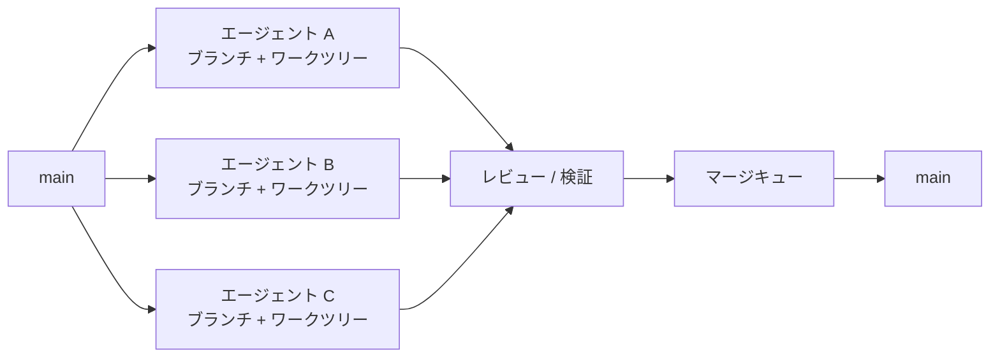
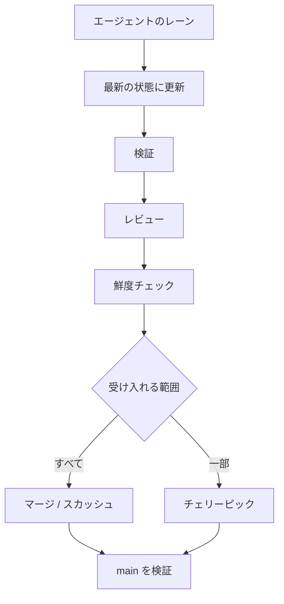
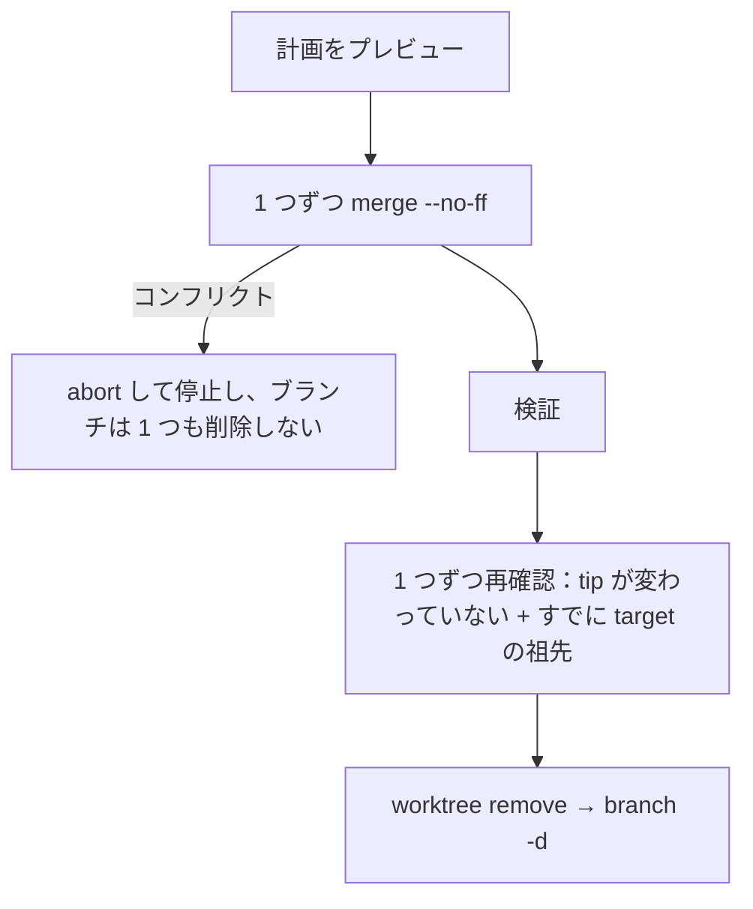
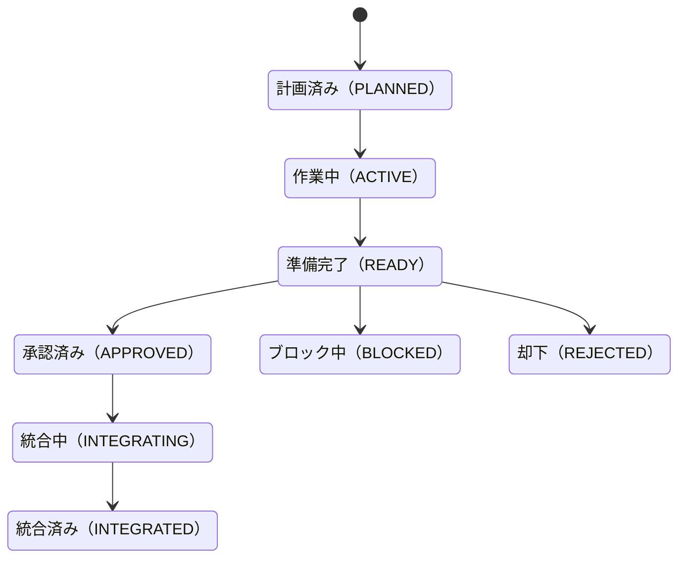

# Multi-Agent Git Orchestrator Skills

[English](README.en.md) | [中文](README.md) | [日本語](README.ja.md)

> **複数の AI エージェントが同じ Git リポジトリを安全に並行開発できるようにします。**

`Multi-Agent Git Orchestrator` は、Claude Code、Codex、Cursor、OpenCode、Hermes などのコーディングエージェント（および Agent Skills 形式に対応するあらゆるホスト）向けの Git ワークフロースキルです。

このスキルは、現在のリポジトリの **Branch / Worktree / Commit / Ahead-Behind / Dependency** の状態を自ら調査し、エージェントが次の点を判断できるよう支援します：

- どのタスクを並行して進められるか
- どのワークツリーを再利用できるか
- どのブランチをリベースまたはマージすべきか
- どのコミットがチェリーピックに向いているか
- どのブランチがすでに安全にクリーンアップできるか
- 複数のエージェントが同時に `main` を壊す事態をどう防ぐか


---

## 何を実行し、何を送り、何を取得するか

- **実行するもの。** Claude Code では、プラグインが PreToolUse フック（`hooks/hooks.json`）を有効にします。シェルコマンド、サブエージェントの起動、worktree の作成、およびセッション・シェル・プロセスを起動する MCP ツールの呼び出しのたびに、`hooks/run-guard.cmd` が Python で `scripts/magos_guard.py` を実行します。スクリプトは渡されたツール呼び出しを読み、許可か拒否かを答え（Bash か PowerShell のツールで直接呼び出された `override`、`arm`、`disarm`、`install` のガードコマンド 1 つには、確認を求める答えを返します。そのとき Claude Code が権限ダイアログを表示し、実行されるコマンドにはフックが付けた 1 回限りの `--approval` トークンが含まれます。`auto-safe` では、`arm` と、デフォルトのガードホームへの `install`（`--allow-downgrade` なし）に対して、確認ではなく許可を答えます）、次に挙げるローカルの Git コマンド以外のプログラムは実行しません。
- **読むもの。** そのツール呼び出しと、作業中のリポジトリの Git の状態です。読むのはローカルの Git コマンド（`branch`、`check-ref-format`、`config`、`diff`、`for-each-ref`、`log`、`merge-base`、`rev-list`、`rev-parse`、`status`、`worktree`）だけで、リモートと通信するコマンドは実行しません。
- **書くもの。** そのリポジトリの `<git-common-dir>/magos/` の中だけです。レーンの登録、計画の記録、上書き（override）の記録、拒否の記録（`<git-common-dir>/magos/denials/<fp>.json`：拒否された作成が衝突したブランチで、上書きのダイアログだけが表示に使い、1 時間有効）、監査ログ（時刻、そのリポジトリの Git のユーザー名とメールアドレスとアカウントのログイン名、ブランチとそのファイル、上書きの理由、各実行を承認した経路。上書きの理由は、端末であなたが入力したか、エージェントが書いてあなたのクリックで承認されたもので、その区別も記録します）が入ります。Claude Code では、フックがユーザー専用のガードコマンドの承認を求めるとき、あなたがクリックする前に承認記録も `<git-common-dir>/magos/approvals/` に書きます。ファイル名は 1 回限りのトークンの SHA-256 で（トークン自体は記録に含まれません）、2 分間有効で、期限から 10 分過ぎた記録は次の承認が削除します。`install` はどのリポジトリにも属さないため、その記録は代わりに `<guard home>/approvals/` に置かれます（ガードホームは `MAGOS_HOME`、未設定なら `~/.magos`）。これはクリックの前にこのディレクトリの外へ書かれる唯一のものです。これとは別に、外で行うのは、あなたが承認したとき（端末で実行する、または Claude Code の権限ダイアログで承認する）の 2 つだけです。`install` はガードを `~/.magos/guard` にコピーして設定のエントリを表示し（統合はあなたが行います）、`arm` はそのリポジトリに Git の `reference-transaction` フックを 1 つ追加します。プラグインは Claude Code の設定も権限ルールも変更しません。
- **送信と取得。** ガードは何も送らず、何も取得しません。ネットワークアクセスも、テレメトリも、認証情報の取り扱いもありません（パッケージのテストが、フックのコードがネットワーク接続を開かないこと、その Git ランナーがリモートと通信するサブコマンドをすべて拒否することを確認します）。スラッシュコマンドはエージェントへの指示です。`/GitRecon`、`/GitAnalyze`、`/GitRecommend` は読むだけです。書き込む 5 つのコマンドは、あなたが自分で入力したときだけ動きます（Claude Code と Codex はモデルが自分で起動するのを止めます。Hermes にはそのスイッチがないため、アダプターが、あなたが明示的に呼び出したときだけ実行するよう指示しています）。`--apply` を持つコマンドは、それを付けなければ何も変更しません。通信が起きるのはあなたが求めたときだけです。`--remote` はあなたのリモートに対して `git fetch --prune` を実行し、`/GitSweep --apply` はマージ済みのリモートブランチを削除し、`/GitSweep --apply --push` は 1 つのブランチをプッシュします。
- **無効にする方法。** `git config --local magos.guard off`（1 つのリポジトリ）、`claude plugin disable magos`（プラグイン全体）、`MAGOS_GUARD=off`。下の「レーンガード」の節も参照してください。

---

## まず平易な言葉で説明します（初心者の方は最初にここをご覧ください）

> Git をまったく学んだことがなくても大丈夫です。以下では「何人かで同時に 1 つの原稿を修正する」場面にたとえて、これから使う言葉を説明します。

| 目にする言葉 | 平易な言葉で | オフィスのたとえ |
|---|---|---|
| リポジトリ（repository） | プロジェクト全体とその全履歴を収めておくフォルダ | 原稿とその改訂履歴でいっぱいの書類キャビネット |
| コミット（commit） | 番号が付いた、記録済みの 1 回分の変更 | 原稿の 1 回分の「保存版」 |
| ブランチ（branch） | 互いに干渉しない、独立した変更のライン | 一人ひとりが手元に持つ自分用の「改訂稿」 |
| `main` | 通常は「正式な安定版」にあたるライン | すでに決定稿となり、外部に公開されたバージョン |
| マージ（merge） | あるブランチの変更を別のブランチに取り込むこと | いくつかの改訂稿をマスター原稿にまとめること |
| ワークツリー（worktree） | あるブランチを編集中のフォルダ | 一人ひとり自分の机 |
| リモート（remote） | ネット上（たとえば GitHub）に置かれているリポジトリ | 会社の共有ドライブにあるバックアップ |
| プレビュー / 実行 | まず「どうするつもりか」だけを見て、納得してから実際に行う | まず改装プランを確認し、了承してから工事を始める |

**このコマンド群には共通のルールがあります：まず見て、あなたが指示したときだけ動く。** リポジトリを実際に変更する 5 つのコマンド（`/GitIntegrate`、`/GitCleanup`、`/GitConverge`、`/GitSweep`、`/GitPlan`）は、あなたが明確に指示したときにだけ動きます。`/GitCleanup`、`/GitConverge`、`/GitSweep`、`/GitPlan` はデフォルトではプレビューのみで、`--apply` を付けたときに初めて実行します（`/GitPlan` の締めくくりに使う `--release` も書き込みます）。`/GitIntegrate` にはプレビューモードがなく、入力すること自体が統合の指示になります。このコマンドは、まず項目ごとにチェックを行い、すべて通過した場合にだけ書き込みます。確信が持てないときは、いずれのコマンドも、無理に進めずに停止して理由を伝えます。

### コマンドの書き方は？

Claude Code にコマンドを直接入力します。後ろに「引数」を続けることができ、引数どうしはスペースで区切ります：

```text
/コマンド名  必須の項目  --オプション  --値付きオプション 値
```

- `<山括弧>` の中は**必須**の項目です。ご自身の値に置き換えてください。たとえば `<ブランチ名>` を `agent/release` にします。
- `[角括弧]` の中は**任意**の項目で、書かなくてもかまいません。
- `--` で始まるものを「オプション」と呼びます。単独で書くだけで効くもの（たとえば `--apply`）と、後ろに値を続ける必要があるもの（たとえば `--lang English`）があります。
- 値の中にスペースがある場合は、半角の引用符で囲みます。たとえば `--lang "Brazilian Portuguese"` のようにします。
- オプションの順序は関係ありません：`/GitConverge agent/release --apply --lang English` と `/GitConverge --lang English agent/release --apply` は同じ意味です。
- `--help` を入力すれば、いつでも説明を見られます。**説明を表示するだけで、リポジトリを調べたり変更したりすることはありません**。
- この文書では、コマンドを `/GitRecon` の形に統一して書いています。実際に入力する名前はホストとインストール方法によって異なります：たとえばプラグインマーケットプレースからインストールした場合、Claude Code では `/magos:GitRecon`、Codex では `$magos:git-recon`、Hermes では `/magos:git-recon` です。完全な対応表は「インストール」の節を参照してください。

---

## 3 つの共通引数

以下の 3 つの引数は、対応しているコマンドであれば、どのコマンドでも書き方と意味が同じです。先にこれらを理解しておけば、あとに出てくる各コマンドが理解しやすくなります。

### `--help`：説明書だけを見る

**書き方**：`/コマンド名 --help`。コマンドの後ろならどこに置いてもかまいません。ほかの引数と一緒に書くこともできます。`--help` が含まれていれば、説明だけを表示します。

```text
/GitConverge --help
/GitIntegrate agent/auth --strategy squash --help      ← 前にほかの引数があってもかまいません。説明だけが表示されます
/GitRecon --help --lang English                         ← 説明を英語で表示します
```

| 項目 | 説明 |
|---|---|
| 何をするか | 次の内容を表示します：このコマンドの書き方、各引数の意味、引数を書かなかったときのデフォルトの動作、いくつかの例。表示したあと、すぐに停止します |
| 何をしないか | リポジトリを読み取らず、Git コマンドを一切実行せず、何も変更しません |
| どんなときに使うか | 書き方を忘れたとき、ある引数の意味に自信がないとき、あるコマンドを初めて使うとき |
| 対応するコマンド | 8 つのコマンドすべてが対応しています |

> 覚えておいてください：**迷ったときは、まずコマンドの後ろに `--help` を付けましょう。完全に安全です。**

---

### `--remote`：先にネットワークに問い合わせて最新の状況を確認する

**書き方**：`/コマンド名 --remote`。単なるオプションで、後ろに値は続きません。

```text
/GitRecon --remote
/GitAnalyze agent/auth --remote
/GitRecommend どのブランチを先にマージすべきか --remote
```

**付けない場合と付けた場合で、何が違うのでしょうか？** 例を挙げます。昨日、あなたのパソコンは「ネット上の `main` は 100 番目の変更」と記録しました。今日、同僚がさらに 3 つの新しい変更をアップロードしました。

| 書き方 | 判断のしかた | 起こりうる結果 |
|---|---|---|
| `--remote` を付けない（デフォルト） | あなたのパソコンに**すでにある**記録だけを見ます。つまり「ネット上の `main` は 100 番目」という記録です | 速く、ネットワークも不要ですが、結論がすでに古くなっている可能性があります |
| `--remote` を付ける | 先にネットワークに接続して記録を更新し、「ネット上の `main` は今 103 番目」と把握してから結論を出します | より新しい結論が得られますが、ネットワークが必要で、少し遅くなります |

**具体的には何をするのでしょうか？** Git に「リモートブランチの一覧とその最新の位置」を更新させるのと同じことを行い、あわせて、ネット上ではとっくに削除されたブランチの古い記録があなたのパソコンに残っていれば、それも削除します。
**何をしないか**：ネット上の変更をあなたのブランチにマージせず、ローカルのブランチやファイルを一切変更せず、何もアップロードしません。

| 項目 | 説明 |
|---|---|
| 対応するコマンド | 「見るだけ」の 3 つのコマンドにだけあります：`/GitRecon`、`/GitAnalyze`、`/GitRecommend`。`/GitSweep` には同名でも別物の引数 `--remote <名前>` があります：後ろには必ずリモート名を続ける必要があり、どのリモートをクリーンアップするかを指定するためだけに使い、記録を更新することは決してありません。ほかのコマンドの後ろに書くと「不明な引数」として扱われ、その旨を知らせたうえで説明を表示します |
| ネットワークがない、またはアクセス権がない | ネットワーク接続に失敗したことを説明し、「今回の結論はパソコンにすでにある記録だけに基づいています」と明記します |
| 付けるべきとき | 同僚が新しいものをアップロードしたと聞いたばかりのとき、または「ネット上の今の状態」に基づいて判断したいとき |

---

### `--lang <言語>`：どの言語で回答するかを指定する

**書き方**：`--lang 言語`。`--lang` の後ろには言語を**必ず** 1 つ続けます。間はスペースで区切ります。

```text
/GitRecon --lang English
/GitAnalyze agent/auth --lang 日本語
/GitConverge agent/release --lang "Brazilian Portuguese"
/GitRecommend どのブランチを先にマージすべきか --lang en
```

**どんな言語を書けますか？** 名前でも、よく使われる言語コードでもかまいません。モデルが書ける言語であれば、ほぼ何でも使えます：

| 希望する言語 | 書き方 |
|---|---|
| 中国語 | `中文`、`简体中文`、`zh`（何も書かなかったときのデフォルト値でもあります） |
| 英語 | `English`、`en` |
| 日本語 | `日本語`、`ja` |
| 韓国語 | `한국어`、`ko` |
| フランス語 / ドイツ語 / スペイン語 | `Français` / `fr`、`Deutsch` / `de`、`Español` / `es` |
| 名前にスペースが含まれるもの | 半角の引用符で囲みます：`"Brazilian Portuguese"` |

**どこまで効くのでしょうか？** 返信するあらゆる文章に効きます：説明、チェックレポート、あなたへの質問、エラーメッセージ、そして `--help` の説明。

**翻訳されないものは何でしょうか？** コマンド名、引数名、ブランチ名、ファイルパス、コミット番号、Git コマンド、そして `BLOCKED_DIRTY`、`MERGE` のようなステータスコードです。そのままコピーして実行したり検索したりすることがあるためです。その横に、選んだ言語で平易な短い説明を添えることもあります。たとえば英語の返信では `BLOCKED_DIRTY` (unsaved edits in its worktree) のように書かれます。

| 項目 | 説明 |
|---|---|
| 書かなかった場合 | **中国語で返信します**。英語で質問した場合でも、中国語です |
| 置く場所 | コマンドの後ろならどこでもかまいません。`/GitRecommend どのブランチを先にマージすべきか --lang English` では、先に `--lang English` が取り除かれるので、質問は「どのブランチを先にマージすべきか」になります |
| 書き間違えた場合 | `--lang` の後ろに何も書かなかった場合や、言語ではないものを書いた場合（たとえば `--lang xyz123`）は、どこが間違っているかを中国語で伝えて使い方を表示し、**コマンドの実行には進みません** |
| チェック結果に影響しますか？ | いいえ。変わるのは返信の言語だけで、チェックと判断の方法はまったく同じです |
| 対応するコマンド | 8 つのコマンドすべてが対応しています |

---

## Why?

マルチエージェント開発は、気づくと次のような状態になりがちです：

```text
Agent A ─┐
Agent B ─┼── 同じディレクトリ ── コンフリクト / 上書き / 履歴の混乱
Agent C ─┘
```

このスキルは、これを次のように変えます：



中核となる原則：

> **One Agent Lane = One Branch + One Worktree**

---

## コア機能

| 機能 | 説明 |
|---|---|
| Repository Recon | ブランチ / ワークツリー / HEAD / Dirty / Ahead-Behind を自分から調べます |
| Dependency DAG | エージェントのタスク同士の依存関係を判断します |
| Worktree Isolation | 複数のエージェントが同じチェックアウトを変更してしまうのを防ぎます |
| Rewrite Safety | どんな場合ならリベースしてよいか、どんな場合は履歴の書き換えを禁止するかを判断します |
| Selective Integration | マージ / スカッシュ / チェリーピックを実際の状況に応じて選びます |
| Freshness Gate | レビュー後に `main` が変わっているのに、そのまま誤って統合してしまうのを防ぎます |
| Merge Queue | 共有の統合ブランチへの書き込みを直列に行います |
| Safe Cleanup | 完了済みのブランチ / ワークツリーを安全に見分けます |
| Safe Rollback | 自分専用の履歴にはリセットを使い、共有されている履歴ではリバートを優先します |
| Branch Strategy | リポジトリが実際に従っているブランチモデル（分支策略 / ブランチ戦略）を見分け、「マルチエージェントの並行作業は安全か」のチェックリストに沿って監査し、最小限の変更だけを提案します。あなたに代わってブランチを変更することは決してありません |
| Lane Planning | 作業を始める前にタスクをファイルが重ならない lane に分けて楽観ロックで登録し、完了後に依存関係の順で 1 つの全体にまとめます |

---

## 8 つのコアコマンド

| コマンド | ひとことで言うと | リポジトリを変更しますか？ |
|---|---|---|
| `/GitRecon` | リポジトリ全体の「健康診断」を行います | いいえ、見るだけです |
| `/GitAnalyze` | 特定のブランチ / ワークツリーを詳しく調べます | いいえ、見るだけです |
| `/GitRecommend` | 実際の状況に基づいて、次に何をすればよいかを提案します | いいえ、提案するだけです |
| `/GitIntegrate` | ある AI の成果を安全にメインラインへマージします | はい、ただしその前に一連のチェックを通過する必要があります |
| `/GitCleanup` | 完了済みの古いブランチとワークツリーをクリーンアップします | デフォルトでは変更しません。`--apply` を付けたときだけ変更します |
| `/GitConverge` | すべてのブランチの成果を 1 つのブランチにまとめ、`main` とそのブランチだけを残します | デフォルトでは変更しません。`--apply` を付けたときだけ変更します |
| `/GitSweep` | まず `/GitConverge` を行い、そのあと、リモートでマージ済みのブランチもまとめて削除します | デフォルトでは変更しません。`--apply` を付けたときだけ変更します（リモートブランチの削除を含みます）。さらに `--push` を付けたときだけ、`<branch>` を一度プッシュします |
| `/GitPlan` | 作業を始める前に Git とコードを調べ、要件を書き出してタスクをファイルが重ならないレーンに分け、要件の表とレーンの表でチェックリストを出し、そのあと依存関係の順に 1 つの全体へまとめ、チェックリストに各レーンの変更内容の概要を補います | デフォルトでは変更しません。`--apply`（または締めくくりの `--release`）を付けたときだけ変更します：計画を登録し、さらに `--create` でレーンのブランチとワークツリーを作成し、`--converge --apply` でマージし、`--land` で一度だけ早送りします。プッシュも、ブランチやワークツリーの削除もしません |

どのコマンドにも `--lang <言語>`（返信の言語。省略すると中国語になります）と `--help`（説明だけを表示）を付けられます。見るだけの 3 つのコマンドには `--remote` もあります（`/GitSweep` の `--remote <名前>` は別の引数です。そのコマンド自身の説明をご覧ください）。これらの詳しい使い方は上の「3 つの共通引数」にあります。以下の各コマンドの節には、**そのコマンド固有の**引数だけを載せます。

> **自分にどんなブランチとワークツリーがあるのか分からないときは？** まず `/GitRecon` を実行してください。一覧を表示してくれます。ターミナルで `git branch`（ブランチの一覧）と `git worktree list`（ワークツリーの一覧）を実行する方法もあります。

---

### `/GitRecon`

**リポジトリ全体の「健康診断」を行います。見るだけで、変更はしません。**

こんなときに向いています：プロジェクトを引き継いだばかりのとき、複数の AI が同時にコードを変更しているとき、今いったいどんなブランチとワークツリーがあるのか分からないとき。

```text
/GitRecon
/GitRecon --remote
/GitRecon --lang English
```

次の項目を調べます：

```text
ワークツリー（Worktrees）          何個あるか、それぞれどのブランチを使っているか
ブランチ（Branches）               それぞれの最新の位置、対応するネット上のブランチがあるか
現在位置（HEAD）                   今どこにいるか
未保存の変更（Dirty）              どのワークツリーに途中まで編集したファイルがあるか
先行 / 遅れ（Ahead/Behind）        メインラインより何回分の変更が多く、何回分の変更が少ないか
デタッチ（Detached）               どのワークツリーがどのブランチにも属していないか
ネット上の記録（Remote tracking）  ローカルブランチがどのリモートブランチに対応しているか
マージ済み（Merge candidates）     どのブランチの内容がすでにメインラインに入っているか
リスク（Risk）                     注意が必要な点
```

#### 引数の詳細

`/GitRecon` には必須の引数はなく、そのまま入力すれば使えます。追加できる引数：

| 引数 | 書き方 | 動作 |
|---|---|---|
| `--remote` | `/GitRecon --remote` | 先にネットワークに接続して「リモートの最新の記録」を更新してから健康診断を行います。詳しくは上の「3 つの共通引数」をご覧ください |
| `--lang <言語>` | `/GitRecon --lang English` | 指定した言語で返信します。省略すると中国語です |
| `--help` | `/GitRecon --help` | 説明だけを表示します |

---

### `/GitAnalyze`

**特定のブランチまたはワークツリーを詳しく調べます。見るだけで、変更はしません。**

こんなときに向いています：「このブランチは今マージしてよいか、削除してよいか」を知りたいとき。

```text
/GitAnalyze agent/auth
/GitAnalyze ../wt-auth --remote
```

#### 引数の詳細

**`<ブランチ名またはワークツリーのパス>`（必須）：調べる対象**

| 項目 | 説明 |
|---|---|
| 何を書くか | どちらでも構いません：**ブランチ名**（ターミナルで `git branch` を実行すると表示される名前。例：`agent/auth`）、または**ワークツリーのフォルダパス**（例：`../wt-auth`。フルパスでも構いません） |
| 名前の調べ方 | `/GitRecon` を実行すると、一覧にすべてのブランチ名とワークツリーのパスが載っています |
| 省略するとどうなるか | 推測はせず、どれを調べるのかを尋ね、あわせて説明を表示します |
| 書き間違えるとどうなるか | 指定されたブランチまたはパスが見つからないと表示し、もう一度確認するよう求めます。ほかの対象を調べることはありません |
| ブランチ名とパスが同名の場合 | リポジトリの実際の状況から判断します。どちらと判断するかで結論が変わる場合は、適当にどちらかを選ばず、あいまいであることを伝えます |

**`--remote`（任意）**：先にネットワークに接続して「リモートの最新の記録」を更新してから分析します。詳しくは「3 つの共通引数」をご覧ください。**`--lang <言語>`（任意）**：返信の言語。デフォルトは中国語です。

#### 何をチェックし、レポートをどう読むか

次のことを調べます：このブランチとメインラインの共通の起点、先行と遅れがそれぞれどれだけあるか、このブランチだけにある変更、変更しているファイル、このブランチに依存している別のブランチがあるか、このブランチの履歴を書き換えてよいか。最後に、マージ、リベース、チェリーピック、スカッシュ（squash）、クリーンアップ（削除）のそれぞれについて「安全かどうか」の結論を出します。例：

```text
agent/auth

Ahead:     3          ← メインラインより 3 回分の変更が多い
Behind:    2          ← メインラインより 2 回分の変更が少ない（メインラインに、このブランチがまだ取り込んでいない新しい変更がある）
State:     DIVERGED   ← 双方に、相手にない変更があり、すでに「分岐」している
Depends:   agent/core ← agent/core を土台にしている
Rewrite:   FROZEN     ← 履歴を勝手に書き換えてはいけない。書き換えると、依存しているブランチまで巻き込まれる

提案：
直接リベース（履歴の書き換え）はしない
先にメインラインを取り込んでから、あらためて検証する
```

---

### `/GitRecommend`

**リポジトリの実際の状態に基づいて、次の進め方を提案します。提案するだけで、実際の操作は行いません。**

こんなときに向いています：次の進め方に迷っているとき。たとえば「3 つの AI でどう分担すればよいか」。

```text
/GitRecommend
/GitRecommend 次に 3 つのエージェントをどう割り振るか
/GitRecommend どのブランチを先にマージすべきか --remote
```

#### 引数の詳細

**`[聞きたいこと]`（任意）：質問、または達成したい目標**

| 項目 | 説明 |
|---|---|
| 書き方 | コマンドの後ろに自分の言葉でそのまま書きます。**引用符は不要**で、どれだけ長くても構いません |
| 書かなかった場合 | 汎用の「次のステップの提案」を出します。現在のすべてのブランチとワークツリーが対象です |
| 上手な書き方 | **具体的なほど良い**：何を達成したいか、AI をいくつ使っているか、どのブランチが最も重要かをはっきり書きましょう |
| 他の引数と一緒に書く場合 | できます。`--remote` や `--lang English` が先に取り出され、残った文章があなたの質問になります |

書き方の比較：

```text
/GitRecommend                                                             ← 汎用の提案
/GitRecommend 次に 3 つのエージェントをどう割り振るか                     ← 分担の提案
/GitRecommend agent/auth が終わったので、このあとどう仕上げればよいか     ← 特定のブランチ向け
/GitRecommend 新しいタスクに一番合うワークツリーを探したい --lang English ← 英語で返信
```

**`--remote`（任意）**：先にネットワークに接続して「リモートの最新の記録」を更新します。**`--lang <言語>`（任意）**：返信の言語です。デフォルトは中国語です。

#### レポートの見た目

まず調査し、そのうえで次の構成で回答します：確認できた事実、最大のリスク、順番に並べた提案、各提案の理由、そして確定できない事項。例：

```text
Agent A → そのまま並行して進めてよい
Agent B → A と変更するファイルが大きく重なっているため、順番待ちにして A の完了を待つのがおすすめ
Agent C → A に依存しているため、A の完了を待つ

agent/old-ui → クリーンアップしてよさそう
agent/auth   → ほかのブランチが依存しているため、当面は履歴を書き換えられない
```

---

### `/GitIntegrate`

**ある AI（ある「レーン」）の成果を、安全にメインラインへ取り込みます。**

こんなときに向いています：ある AI が「終わりました」と言い、その成果を正式に取り込みたいとき。**AI が「Done」と言っただけでは動きません。**

```text
/GitIntegrate agent/auth
/GitIntegrate agent/auth --strategy squash
/GitIntegrate agent/auth --strategy cherry-pick --lang English
```

#### 引数の詳細

**`<レーンまたはブランチ名>`（必須）：メインラインに取り込むブランチ**

| 項目 | 説明 |
|---|---|
| 書く内容 | ブランチ名です。たとえば `agent/auth`（`/GitRecon` を使うとすべてのブランチ名を確認できます） |
| 書かなかった場合 | どのブランチを統合するかを尋ねます。**自分で選ぶことはありません** |
| 取り込み先 | リポジトリの「統合ブランチ」に取り込みます。通常は `main` です。リポジトリの実際の取り決めから判断し、判断できないときはその旨を正直に伝えます。推測はしません |

**`--strategy <方式>`（任意）：どの方式で取り込むか**

書き方：`--strategy` の後ろに、下の四つの値のどれか一つを付けます。書かなければ `--strategy auto` と同じ扱いです。

| 値 | 平易な言葉で | どんなときに向いているか |
|---|---|---|
| `auto`（デフォルト） | リポジトリの慣習とあなたのレビュー結果から、最も適した方式をお任せで選んでもらう | どれを選べばよいか分からないとき |
| `merge` | 全体を取り込み、相手の変更ごとの記録を**残す**（さらに「マージ記録」を足すかどうかは、リポジトリ独自のマージルールに従う） | 変更の経過をすべて残したいとき |
| `squash` | 全体を取り込むが、相手のすべての変更を**一つの記録にまとめる**（リポジトリのルールが許す場合のみ） | 相手の変更が細かく分かれていて、メインラインをすっきり保ちたいとき |
| `cherry-pick` | 問題ないと確認できた変更**だけを選んで**取り込み、残りは取り込まない | 相手の成果のうち一部だけが受け入れられるとき |

三つの方式で「変更記録」がどう違うか（`A、B` はメインラインにもともとあった記録、`C、D` はこのブランチの二回の変更です）：

```text
merge          A──B──────M       M は新しく追加されるマージ記録で、C、D の記録はそのまま残る
                  \     /
                   C──D

squash         A──B──S           S は新しい一つの記録で、C と D のすべての変更を含む。C、D は単独ではメインラインに入らない

cherry-pick    A──B──C'          C だけをコピーしてくる。D はメインラインに入らない
```

| もし… | こうなります… |
|---|---|
| 値が間違っている（例：`--strategy rebase`） | 対応しているのは `auto`、`merge`、`squash`、`cherry-pick` だけだと伝え、説明を表示して、**実行を続けません** |
| `--strategy` を書いたのに値がない | 同上です。値を付け足すよう求めます |
| `cherry-pick` を選んだが、あなたがどの変更を確認したのかが分からない | **止まって質問します**。どの変更がレビューを通ったのかをあなたが説明する必要があります。あなたの代わりに推測することはありません |
| 指定した方式がリポジトリのルールに違反している、または安全でない | 拒否して、理由を説明します。あなたがはっきり指定していても同じです |

**`--lang <言語>`（任意）**：返信の言語です。デフォルトは中国語です。

#### 実行する前に何をチェックするか

一つずつチェックします：レビューを通過した根拠があるか、依存先に未完了の部分がないか、あなたのレビュー後にメインラインが変わっていないか、あなたのレビュー後にこのブランチへ新しい変更が加わっていないか、リポジトリのルールが許可しているか。**どれか一つでも通らなければ、そこで止まってあなたに知らせます。無理に進めることはありません。** 取り込んだ後は、メインラインをもう一度検証します。レーンガードがインストールされている場合は、このレーンの登録も解放します（`magos_guard.py release --branch <ブランチ> --reason integrated`）。



---

### `/GitCleanup`

**安全にクリーンアップできる古いブランチとワークツリーを見つけます。**

向いている場面：プロジェクトに、すでに作業が終わったブランチがたくさん溜まっていて、整理したいけれど、間違えて削除してしまうのが怖いとき。

```text
/GitCleanup              ← 一覧を表示するだけで、何も削除しない
/GitCleanup --apply      ← 実際に削除する
/GitCleanup --lang English
```

#### 引数の詳細

`/GitCleanup` に必須の引数はありません。

**`--apply`（任意）：実際にクリーンアップする**

| 項目 | 説明 |
|---|---|
| 書き方 | `/GitCleanup --apply`。オン・オフを切り替えるだけのオプションで、後ろに値は付けません |
| 書かないとどうなるか | **プレビューのみ**：「クリーンアップできる対象」と「クリーンアップできない対象とその理由」を一覧にして、何も削除しません |
| 書くと何をするか | 一覧の中の「クリーンアップできる」対象について、**一つずつ現状をもう一度チェック**し、まだ安全な場合だけ削除します：先にそのワークツリーを取り除き、次にブランチを削除します |
| プレビューと実行の間に対象が変わったら | たとえばそのブランチにプレビューの後で新しい変更が加わった場合：その対象は**スキップ**して知らせ、古い一覧のとおりに無理に削除することはありません |
| 絶対にしないこと | 強制削除。未保存の変更がある、やりかけの操作が残っている、または無視されているファイルを含むワークツリーのクリーンアップ。「他では見つからない成果」を含むブランチの削除。リポジトリ全体を対象にした `git worktree prune` の実行。`main`、ターゲットブランチ、あなたが今いるワークツリーの削除。ネット上（リモート）のブランチも削除しません（リモートブランチを削除するのは `/GitSweep` だけです） |

おすすめの使い方：**まず `--apply` を付けずに一覧を見て、納得してから付けてください。**

**`--lang <言語>`（任意）**：返信の言語です。デフォルトは中国語です。

#### プレビューに出てくる各対象のステータス

| ステータス | 平易な言葉での意味 | クリーンアップされるか |
|---|---|---|
| `SAFE_CANDIDATE` | 七つの条件がすべて満たされていて、安全にクリーンアップできる | `--apply` を付けたときだけ |
| `BLOCKED_DIRTY` | ワークツリーに未保存の変更がある | されない |
| `BLOCKED_UNIQUE_WORK` | そのブランチには、ここにしか存在せず他では見つからない成果がある | されない |
| `BLOCKED_ACTIVE_OWNER` | 今、誰か（または何らかの AI）が使っている：ワークツリーがロックされている、エージェントツールのワークツリーディレクトリ（`.claude/worktrees/`、`~/.codex/worktrees/`、またはリポジトリのドキュメントが指定するディレクトリ）の下にある、記録上は他の人の担当になっている、またはこのレーンにレーンガード上で終了していない登録（`planned` / `active`）がある。クリーンだからといって、誰も使っていないとは限らない | されない |
| `BLOCKED_DEPENDENCY` | 他のブランチがこのブランチに依存している | されない |
| `BLOCKED_NOT_INTEGRATED` | 内容がまだ完全にはメインラインにマージされていない | されない |
| `BLOCKED_IN_PROGRESS` | ワークツリーにやりかけの操作がある（たとえば履歴の書き換えが途中で止まっている）。クリーンに見えても実はそうではない | されない |
| `BLOCKED_IGNORED_FILES` | ワークツリー内に Git に無視されているファイル（たとえばパスワードを保管している `.env`）があり、ワークツリーを削除するとそれらも一緒に消えてしまう | されない（先にこれらのファイルを自分で移動するか削除してから、もう一度 `/GitCleanup` を実行してください） |
| `UNKNOWN` | 重要な情報を確認しきれていない：たとえばワークツリーに担当者の記録がない（誰かが使っているか分からない）、または名前が大文字と小文字しか違わない二つのブランチがある | されない（確信が持てないものには手を付けません） |

ブランチが `SAFE_CANDIDATE` になるには、次の七つをすべて同時に満たす必要があります：

```text
✓ 内容がすでに完全にメインラインにマージされている
✓ ワークツリーに未保存の変更がない
✓ ワークツリーにやりかけの操作がない
✓ ワークツリー内に Git に無視されているファイルがない
✓ 今このブランチを使っている人がいない（ワークツリーがある場合は、そのワークツリーに担当者の記録が必要）
✓ 他のブランチがそれに依存していない
✓ そのブランチにしか存在せず、他では見つからない成果がない
```

`main`、ターゲットブランチ、リモートのデフォルトブランチ（`origin/HEAD` が指すブランチ）、リポジトリのドキュメントで長期保持または保護と明記されているブランチ、あなたが今いるワークツリーとそのブランチは、クリーンアップの一覧に載ることが決してありません。

**注意：ブランチが「長い間更新されていない」からといって、削除してよいとは限りません。** 「古い」というだけの理由で、ブランチをクリーンアップの一覧に入れることはありません。

---

### `/GitConverge`

**リポジトリ内のすべてのブランチの成果を、あなたが指定した一つのブランチにまとめ、`main` とそのブランチだけを残します。**

向いている場面：複数の AI がそれぞれたくさんのブランチを作って作業を終え、「取りまとめ」として全員の成果を一か所に集め、使い終わったブランチを削除したいとき。

#### まず例を見てみましょう

リポジトリに今、次のブランチがあるとします：

```text
main           正式な安定版（新しい変更が 1 件ある）
agent/release  すべての成果をここにまとめたい
agent/a        太郎さんが 2 件の変更をした
agent/b        花子さんが 1 件の変更をした（ワークツリーは ../wt-b にあり、未保存のものはない）
agent/c        内容はすでに含まれていて、新しいものはない
```

`/GitConverge agent/release --apply` を実行すると：

```text
実行前： main  agent/release  agent/a  agent/b  agent/c      （ブランチ 5 本）
実行後： main  agent/release                                 （ブランチ 2 本）
         └─ agent/release にはすでに main、a、b のすべての成果が入っている
         └─ a、b、c は削除され、花子さんのワークツリー ../wt-b も一緒にクリーンアップされる
```

#### 始める前に：まず確認すべき三つのこと

1. **「ターゲットブランチが置かれているフォルダ」の中で実行してください。** ターゲットブランチ（たとえば `agent/release`）が今使われているフォルダで、Claude Code を開きます。ターゲットブランチが別のフォルダで使われている場合は、実行を拒否して「そのフォルダで実行してください」と伝えます。
2. **このフォルダに未保存の変更があってはならず、「途中」の状態であってもいけません**（たとえばマージの途中や履歴の書き換えの途中）。そうなっている場合は、実行を拒否して理由を説明します。
3. **ターゲットブランチを `main` にすることはできません。** `main` に成果をマージするには `/GitIntegrate` を使ってください。

#### 使い方：三つのステップ

**ステップ 1：まずプレビュー（何も変更しません）**

```text
/GitConverge agent/release
```

次のような「計画」が表示されます：先にどのブランチをどの順番でマージするか、どのブランチが削除されるか、どのブランチがどんな理由で**保持**されるか、最後にどのブランチが残るか。イメージは次のとおりです：

```text
計画（これはプレビューで、何も変更していません）
ターゲットブランチ：agent/release

マージする予定（この順番で）
  1. main        新しい変更 1 件
  2. agent/a     新しい変更 2 件
  3. agent/b     新しい変更 1 件（ワークツリー ../wt-b はクリーン、マージ後に削除）
すでに含まれていて、削除するだけ：agent/c

保持されるブランチ：なし
実行後に残るのは次だけ：main、agent/release
触らないもの：ネット上のブランチ、タグ、他の人が使用中のワークツリー
```

**ステップ 2：計画を読み解く**

プレビューでは、各ブランチの後ろにマージのステータスが一つ付きます（`MERGE`、`CONTAINED`、`BLOCKED_UNRELATED_HISTORY`、`BLOCKED_IN_PROGRESS`、`UNKNOWN`）。さらに、「保持の理由」がゼロ個以上付くことがあります（`BLOCKED_DIRTY` から `BLOCKED_UPSTREAM_OF_KEPT` までの六つ）。平易な言葉に言い換えると次のとおりです：

| ステータス | 平易な言葉での意味 | マージされるか | 削除されるか |
|---|---|---|---|
| `MERGE` | 新しい変更があり、ターゲットブランチにマージする | される | マージ後に削除 |
| `CONTAINED` | 変更はすでにターゲットブランチに入っている | 不要 | 削除 |
| `BLOCKED_UNRELATED_HISTORY` | ターゲットブランチとまったく関係がない（たとえば Web ページ専用の `gh-pages`） | されない | 保持 |
| `BLOCKED_IN_PROGRESS` | 誰かが作業の途中（履歴の書き換え、チェリーピックなど）で、このブランチの位置は当てにならない | されない | 保持 |
| `BLOCKED_DIRTY` | ワークツリーに未保存の変更がある | される（保存済みの部分だけマージ） | 保持 |
| `BLOCKED_LOCKED` | ワークツリーがロックされている（誰かまたはプログラムが使用中） | される | 保持 |
| `BLOCKED_ACTIVE_OWNER` | ワークツリーが別の AI / ツールのもの、またはメインワークツリーである | される | 保持 |
| `BLOCKED_IGNORED_FILES` | ワークツリー内に Git に無視されているファイルがある（たとえばパスワードを保管している `.env`） | される | 保持（`--discard-ignored` を付けたときだけ削除） |
| `BLOCKED_SUBMODULE` | ワークツリーに「サブプロジェクト」が含まれていて、`git worktree remove` が削除を拒否する：その git ディレクトリに `modules` フォルダがあるか、ワークツリー内のサブプロジェクトのフォルダに中身がある。初期化を解除しても外れず、このコマンドはそのワークツリーを削除できません。固有のものが入っていないことを確認してから、ご自身で `git worktree remove --force <path>` を実行して削除するか、そのままにします。ワークツリーが残る間は、ブランチも残ります | される | 保持 |
| `BLOCKED_UPSTREAM_OF_KEPT` | 保持される別のブランチがこのブランチに依存している | される | 保持 |
| `UNKNOWN` | 重要な情報を確認しきれていない、または別のブランチと名前が大文字小文字しか違わない（どちらにも手を付けない。安全に名前を変更する方法はレポートに書かれる）、またはその名前をコマンドに安全に渡せない（ASCII の英字、ASCII の数字と `.` `_` `/` `+` `-` 以外の文字を含む、または `-` か `+` で始まる。手を付けず、対処は `git branch -m <old> <new>` での名前の変更） | 触らない | 触らない |

保持の理由が決めるのは削除するかどうかだけで、マージは止めません。「マージされるか」の列に書かれているのは、そのブランチに新しい変更がある（`MERGE`）場合の扱いです。`CONTAINED` のブランチにはマージできる内容がないので、保持の理由が付いている場合は、ただ削除されないだけです。

プレビューでは、`MERGE` のブランチの後ろに `PREDICTED_CONFLICT` が付くことがあります：Git がマージの予行演習（`git merge-tree --write-tree`）に対応している場合、各ブランチを一度ずつ試しにマージし、コンフリクトが出ればこのマークを付けます。このほかに `PREDICTED_IGNORED_OVERLAP` が付くこともあります：そのブランチが変更したパスが、コマンドを実行するフォルダ内の無視されたファイルやフォルダと同じ、またはその下か上にあるため、マージすると無視されたファイルが上書きされ、実行時に停止します。レポートにはブランチ、パス、無視されたエントリが書かれます。どちらのマークもあくまでヒントであり、ブランチもワークツリーも一切変更しません。ブランチ同士がコンフリクトする場合はどちらの予行演習でも分からず、二つ目のブランチをマージするときに初めて現れます。`PREDICTED_IGNORED_OVERLAP` を解消するには、レポートに書かれた、コマンドを実行するフォルダ内の無視されたエントリを移動または削除してから（Git は記録していないので、先にコピーを残してください。`--discard-ignored` はこれには効きません）、もう一度実行します。

ブランチが一つでも保持される場合、計画にははっきりと「最後に残るのは `main` とターゲットブランチだけではありません」と書かれ、その理由と次にやるべきことも明記されます。

次のすべてに当てはまるクリーンなワークツリーは、担当者が記録されていなくても、そのブランチと一緒にクリーンアップされます：ロックされていない、エージェントのワークツリーディレクトリ（`.claude/worktrees/`、`~/.codex/worktrees/`、またはリポジトリのドキュメントが指定するディレクトリ）の下にない、担当者が記録されたことがない、レーンガードに終了していない登録がない。計画には一つずつ「担当者：未記録」と明記されます。この点が `/GitCleanup` との違いです：`/GitCleanup` は、担当者が記録されていないワークツリーには一切手を付けません。

**ステップ 3：納得できたら実行する**

```text
/GitConverge agent/release --apply
```

現状をもう一度チェックし、今回実行する計画を記録してから、計画に沿って一つずつマージします。その後、マージ済みのブランチとそれらのクリーンなワークツリーを削除し、最後にレポートを出します。レポートには次の内容が入っています：根拠にした計画、実行した内容、スキップした内容（と理由）、ターゲットブランチの開始時と終了時のコミット番号、最後に残ったローカルブランチ、検証結果、削除した各ブランチの元のコミット番号。

#### 引数の詳細

**`<ブランチ名>`（必須）：すべての成果をどのブランチに集約するか**

| 項目 | 説明 |
|---|---|
| 書く内容 | **ローカル**ブランチの名前です（例：`agent/release`）。名前は `/GitRecon` かターミナルの `git branch` で確認できます |
| **完全に同じ**に書くこと | **大文字と小文字は区別されます**。`agent/release` は正しく、`Agent/Release` は間違いです：コマンドは実行を拒否し、正しい名前を教えてくれます |
| 書けないもの | `main`（決して移動されません）、存在しないブランチ、ネット上のブランチ名（`origin/xxx` など）、フォルダのパス |
| 書かないとどうなるか | 入力を求められ、説明が表示されます |
| 注意 | ターゲットブランチは既存のローカルブランチでなければなりません。コマンドが代わりに新規作成することはありません |

**`--apply`（任意）：実際にマージと削除を行う**

| 項目 | 説明 |
|---|---|
| 書き方 | `/GitConverge agent/release --apply`。値を取らないオプションなので、後ろに値は付けません |
| 書かないとどうなるか | **プレビューだけ**で、何も変更しません。これがデフォルトの動作です |
| 書くと何をするか | 現在の状態を再チェック → 計画を記録 → まずターゲットブランチに切り替え（現在そのブランチにいない場合） → 順番に一つずつマージ → 検証 → 一つずつ再確認してから削除 → レポートを出力 |
| マージの順番 | `main` が最初です。残りは「新しい変更が多いものを優先」し、同じ数のものは名前順に並べます。こうすると、A が B を含んでいる場合、A をマージした時点で B はすでに取り込まれているので、重複してマージされません |
| コンフリクトが起きたら | そのマージをただちに取り消し、**全体を止めて何も削除しません**。すでに成功したマージはそのまま残します |
| 検証 | リポジトリ自身のチェック（テストなど）を検出できたときだけ実行します。このマージが原因でチェックが失敗した場合は、削除の前に停止してレポートします。検出できないときは、レポートに「未検証」と書いて続行しますが、削除には引き続き、ブランチごとの再確認に通ることが必要です |
| 削除の前 | ブランチごとに再確認します：新しい変更がないこと、内容が確かにターゲットブランチに入っていること、そのワークツリーがまだクリーンであること |
| 事前にプレビューした場合 | 同じ会話の中で先にプレビューしていれば、実行時にそのプレビューと比較します。ブランチの位置が一つでも変わっていたら、停止してあらためてプレビューを表示します。プレビューの後に新しく現れたブランチやワークツリーには一切触れません |

**`--discard-ignored`（任意）：「無視されたファイル」を含むワークツリーのクリーンアップを許可する**

「無視されたファイル」とは何でしょうか。パスワードやシークレットキーを置く `.env` や、一時フォルダの `node_modules/` のように、Git に記録されないファイルがあります。そのため、**一度削除すると取り戻せません**。

| 項目 | 説明 |
|---|---|
| 書き方 | `/GitConverge agent/release --apply --discard-ignored`。オプションで、値は付けません |
| 書かないとどうなるか | ワークツリーに無視されたファイルが一つでもあれば、そのワークツリーとブランチは**保持されます**（ステータスは `BLOCKED_IGNORED_FILES`）。プレビューには、これらのファイルが一つずつ一覧表示されます |
| 書くと | そのようなワークツリーはクリーンアップされ、**中にある無視されたファイルも一緒に永久に消えます** |
| 単独で書いても意味はあるか | ありません。`--apply` と一緒に書いたときにだけ意味があります |
| 書くべきとき | プレビューに列挙された無視されたファイルに目を通し、どれも不要だと確認できたとき（たとえば、再生成できる一時ファイルだけの場合） |

> コマンドは、現在のフォルダにすでにある無視されたファイルを**決して**上書きしません。あるブランチが持ち込むファイルがそれらを上書きしてしまう場合、コマンドはそのブランチをマージする前に停止して知らせ、ブランチは何も削除しません。それ以前に完了したマージは残ります。これは `--discard-ignored` とは関係ありません。

**`--lang <言語>`（任意）**：返信の言語です。デフォルトは中国語です。**`--help`（任意）**：説明だけを表示します。

例：

```text
/GitConverge agent/release                              計画を見るだけ
/GitConverge agent/release --apply                      計画どおりに実行
/GitConverge agent/release --apply --lang English       計画どおりに実行し、英語で返信
/GitConverge agent/release --apply --discard-ignored    .env を含むワークツリーもまとめてクリーンアップ
```

#### 実行を拒否する主なケース

次のような場合、コマンドは**作業を始める前**に停止して理由を説明し、リポジトリには一切変更を加えません。失敗したゲートはすべて一度に列挙され、それぞれに対処方法が付くので、一回の実行で、先に解消すべきことがすべて分かります：

| 状況 | コマンドの返答 | どうすればよいか |
|---|---|---|
| ターゲットブランチが存在しない、または大文字と小文字が違う | そのブランチが見つかりません。大文字と小文字が違うだけの場合は、正しい名前が示されます | 既存の正確な名前でもう一度実行します。大文字と小文字しか違わないブランチを新しく作ってはいけません。どの大文字小文字でも存在しないターゲットを作るときは、`git for-each-ref --format=%(refname) refs/heads` でその名前のブランチがないことを確認してから、`git branch <name> <start>` を実行します |
| ターゲットブランチが `main` | `main` はターゲットにできません | `/GitIntegrate` を使うか、別のブランチに変える |
| ローカルに `main` ブランチがない | `main` がありません | 先にリポジトリで `main` を作っておく（リモート追跡ブランチがあるときは `git branch main <remote>/main`。幹のブランチが `master` など別の名前のリポジトリでも `main` という名前のブランチが必要なので、幹の先端に `git branch main <trunk>` で作るか、このコマンドを使いません） |
| ターゲットブランチまたは `main` が、別のブランチと大文字と小文字だけが違う名前になっている | 名前が衝突していて、どちらを指すのか区別できません | 先に `git pack-refs --all` を実行し、次に `git branch -m` でどちらかの名前を変え、それから両方のブランチのコミットを突き合わせる（先に pack せずに名前を変えると、もう一方のブランチのコミットが移動してきて、両方のブランチが削除されるおそれがあります） |
| ターゲットブランチが別のフォルダで使われている | そのフォルダで実行してください | 示されたフォルダで実行し直す |
| 現在のフォルダに保存されていない変更がある、どのブランチにも属していない、または作業の途中である | 現在のフォルダは安全ではありません | 先に保存するか対処してから、もう一度実行する |
| ターゲットブランチまたは `main` が、すでに削除されたフォルダの記録にしか存在しない | 記録が欠けていて、切り替えられません | 案内に従ってその欠けた記録をクリーンアップしてから実行する |

#### コマンドが必ず守るルール

```text
✓ デフォルトはプレビューだけ。--apply を付けなければ何も変更しません
✓ main は「読み取り」だけ：移動、リセット、削除されることはありません
✓ ネット上のブランチ、タグ、どのブランチにも属さないワークツリーには一切触れません。あなたに代わってネット上にアップロードすることもありません
✓ マージでコンフリクトが起きたら、そのマージをただちに取り消して停止し、ブランチは何も削除しません。完了済みのマージは残ります
✓ 保存されていない変更がある、ロックされている、作業の途中、他の人のものであるワークツリー：そのワークツリーとブランチは保持します
✓ お使いのパソコンにある無視されたファイル（.env など）は決して上書きしません。こうしたファイルを含むワークツリーはデフォルトで保持します
✓ 「強制削除」も「ワークツリーの強制クリーンアップ」も使わず、リポジトリ全体の「宙に浮いた記録のクリーンアップ」も行いません
✓ ブランチを削除する前に毎回もう一度確認します：変更されていないこと、内容が確かにターゲットブランチに入っていること
```

#### 予期しないことが起きたら

- **「マージのコンフリクト」と表示された場合**：2 つのブランチが同じ場所を別々のやり方で変更していて、機械にはどちらを選ぶか決められない、という意味です。コマンドはそのマージを取り消して停止し、**何も削除せず**、どのブランチでコンフリクトしたかを知らせます。対処し終えたら（または不要なほうのブランチを削除したら）、もう一度実行してください。すでにマージに成功したブランチは「取り込み済み」として扱われ、削除だけが行われます。
- **削除したブランチを取り戻したい場合**：レポートには、削除された各ブランチの元のコミット番号（英数字の文字列、たとえば `8eccc62`）が載っています。この番号があれば、いつでも復元できます：

  ```text
  git branch agent/a 8eccc62
  ```

- **今回の集約全体を取り消したい場合**：レポートには、ターゲットブランチの「起点のコミット番号」が載っています。Git の基礎がある人なら、ターゲットブランチを起点に戻せます。基礎がない場合は、このレポートを Git に詳しい同僚や AI に送って、対応してもらってください。
- **実行してよいか迷う場合**：いつでも、まず `--apply` を付けずに計画だけを見ることができます。

#### よくある疑問

- **まだ保存していない変更が削除されてしまうことはありますか？** ありません。保存されていない変更があるワークツリーは、そのブランチごと保持されます。
- **GitHub 上のブランチに影響しますか？** いいえ。何もアップロードせず、ネット上のものを削除することもありません。集約が終わった後でアップロードするかどうかは、ご自身で決めてください。
- **なぜ削除されなかったブランチがあるのですか？** 計画の中の「ステータス」の表を見てください。保持されたブランチにはすべて、理由と次にすべきことが書かれています。
- **実行の途中で中断したら、どうすればよいですか？** 同じコマンドをもう一度実行するだけで大丈夫です。毎回、先に現在の状態を再チェックし、すでにマージされたブランチは削除されるだけで、重複してマージされることはありません。
- **返信を英語にしたい場合は？** コマンドの最後に `--lang English` を付けます。



---

### `/GitSweep`

**`/GitConverge` の処理に加えて、リモートでマージ済みのブランチもまとめて削除します。**

向いている場面：ローカルの「取りまとめ」はすでに終わっていて、GitHub などのリモートにある使い終わったブランチも一緒に片付けたいとき。手作業で一つずつ削除する必要がなくなります。

2 つのステップで進み、`--apply` を付けたときだけ実際に実行します：

1. **ローカルの収束**：`/GitConverge` とまったく同じです（同じチェック、同じマージの順番）。コンフリクトやチェックの失敗が起きたら全体が停止し、ローカルでもリモートでも何も削除しません。
2. **リモートの削除**：リモートブランチのうち、「そのコミットがすでにリモート自身が保持しているブランチに含まれているもの」だけを削除します。つまり、リモートのデフォルトブランチ、またはリモートの `<branch>` にすでに取り込まれているものです。「取り込み済み」の判断では、`<branch>` をローカルの収束が終わった後の姿（ローカルの `<branch>` に、これからマージされる各ブランチを加えたもの）として計算します。そのため、プレビューとその後の実行は、同じ分類になります。ローカルでマージしただけでまだプッシュしていないブランチは、`<branch>` のプッシュが実行される見込みであれば `PUSH_THEN_DELETE` になります（プレビューでは `--push` の有無にかかわらずこう表示されます）。`--push` を付けた場合は、同じ実行の中で削除されます（下の `--push` を参照）。`--push` を付けない場合は、実行はそのブランチを残し、レポートには `--push` を付けていないため残したと書かれます。`--push` を付けてもう一度実行するか、ローカルの `<branch>` がそのコミットを含むようになってから、ご自身で `<branch>` をプッシュしてもう一度 `/GitSweep` を実行するまで残ります。

```text
/GitSweep agent/release                          計画を見るだけ（ネットワークに接続しません）
/GitSweep agent/release --apply                  計画どおりに実行
/GitSweep agent/release --apply --push           計画どおりに実行し、agent/release をリモートへ一度プッシュ
/GitSweep agent/release --apply --remote upstream   origin ではなく upstream をクリーンアップ
```

**引数**：`<branch>`（必須。すべての成果を受け取るローカルブランチ）、`--apply`（これを付けたときだけ実際に実行）、`--discard-ignored`（そのまま最初のステップに渡され、`.env` を含むワークツリーのクリーンアップを許可）、`--push`（任意。`--apply` と一緒に書きます。ローカルの収束の後、リモートブランチを削除する前に、`<branch>` をリモートへ一度プッシュします）、`--remote <名前>`（クリーンアップするリモート。デフォルトは `origin`。`git remote` に載っている名前でなければならず、載っていなければゲートが失敗します。見るだけのコマンドの `--remote` オプションとは別物で、後ろに名前を付ける必要があり、fetch も行わない点に注意してください）。

**`--push` は何をするのか？** 手順を一つだけ増やします。コマンドは固定で、変わりません：`git push --recurse-submodules=no --no-follow-tags <リモート> refs/heads/<branch>:refs/heads/<branch>`。これは「早送り（fast-forward）」のプッシュです。強制プッシュは決して行わず、`--no-verify` も使わず、タグも送りません。リモートにまだ `<branch>` がないときは、このプッシュで作成され、計画とレポートにそのことが書かれます。送られるのは、収束後のローカルの `<branch>` のうち、リモートのどのブランチにもまだないコミットで、プレビューにそれが列挙されます（すでにあるコミット。その数も示されます。そして、これからマージされるブランチ）。実行ではマージするブランチごとにマージコミットが最大一つ増えるので、公開されるコミットは最大でその数だけ多くなり、レポートに正確な範囲と数が書かれます。`--push` を付けても付けなくても、プレビューはローカルの記録からこのプッシュを予測します：実行されるかどうか、公開されるコミット、リモートブランチが新規作成されるかどうか、このプッシュに依存する `PUSH_THEN_DELETE` のブランチ。実行されない見込みのときは、満たされていない条件（たとえば `<branch>` がリモートのデフォルトブランチである）が書かれます。これによって、ローカルの `<branch>` にだけマージされているリモートブランチも同じ実行の中で片付き、手作業でプッシュして 2 回目を実行する必要がなくなります。リモートの `<branch>` がすでにローカルの先端と同じ位置にある場合は、公開するものがないため、プッシュは行われず、レポートに `PUBLISH_NOT_NEEDED` と書かれます。それ以外の場合は、このプッシュに依存するリモートブランチがなくてもプッシュは実行されます。`--push` は `<branch>` を公開してほしいというあなたの依頼だからです。

次のどれかに当てはまると、プッシュはスキップされ、レポートに理由が書かれます（`PUSH_SKIPPED`）：リモートの `<branch>` がローカルの `<branch>` の祖先ではない（誰かが新しいコミットをプッシュしています。先に `git fetch <リモート>` を実行して、それをマージしてください）。`<branch>` が `main` またはリモートのデフォルトブランチである。ローカルの収束が途中で停止した、またはその後の検証が失敗した。リモートのクリーンアップ全体が `UNKNOWN` である。最初の 2 つの場合は、プッシュに依存しないリモートの削除がそのまま続けられ、あとの 2 つの場合は、リモートブランチは一つも削除されません。プッシュが拒否された、または失敗した場合（保護されたブランチ、フック、ネットワークなど）は、再試行も書き換えもせず、`PUSH_FAILED` として報告します。プッシュが成功した後は、リモートの `<branch>` がローカルの先端と同じ位置にあるかを確認し、違っていれば `PUSH_UNCONFIRMED` として報告して、失敗として扱います。プッシュが一度行われると、取り消すには強制プッシュが必要ですが、このコマンドは強制プッシュを決して行いません。そのため `--push` は、あなたが明示的に許可する公開操作です。`--push` を付けない場合、または `--apply` を付けない場合、コマンドは何も公開しません（`--apply` だけを付けた場合も、後述のマージ済みのリモートブランチは削除されます）。

**プレビューの最後：一度で終わるかの判定。** プレビューは計画に加えて、最後に、このコマンドが一回の実行で完了できるかを伝えます。「完了」とは、ローカルブランチが `main` と `<branch>` だけになり、削除されたブランチのワークツリーが取り除かれ、リモートのブランチが削除済みか保護対象のどちらかになっている状態です。コマンドが一切触れないワークツリー（どのブランチにも属さないもの、または `main` やほかの保持されるブランチを持つもの）はこの状態に含まれず、レポートに列挙されます。判定が評価するのは、あなたが入力したコマンドではなく、推奨コマンド（下記）です。プレビューには、そのコマンドが到達する状態が示されます（たとえば、`--discard-ignored` が推奨されるときは、唯一のブロックが無視されたファイルであるワークツリーは解除済みとして扱われ、同名のリモートブランチはそれに引き止められません）。実行はあなたが付けたオプションだけで動きます：`--discard-ignored` なしでは、そのワークツリーとブランチは残り、同名のリモートブランチは `KEPT_LOCAL` になります。判定は 3 種類です：

| 判定 | 意味 |
|---|---|
| `ONE_SHOT` | 失敗したゲートはありません。どのブランチもマージできるか取り込み済みで、残っている唯一のブロックは `--discard-ignored` で解除できるものだけです。衝突の予測も、無視されたファイルの上書きの予測もなく、リモートのクリーンアップも `UNKNOWN` ではありません。どのリモートブランチも `SAFE_CANDIDATE`、`PUSH_THEN_DELETE`、`NOT_TOUCHED` のいずれかです。推奨コマンドを一回実行すれば足ります（ローカルの記録から分かる範囲で。実行時にリモートを再確認します） |
| `PARTIAL` | 失敗したゲートはありませんが、どのオプションでも解除できないものが残っています（ほかの削除ブロック、作業の途中の操作、履歴が無関係なブランチ、`UNKNOWN`、衝突の予測、無視されたファイルの上書きの予測、マージされていないリモートブランチ、コマンドに渡せない名前のリモートブランチ、プッシュが実行される見込みのない `PENDING_PUSH` など）。推奨コマンドは、できることをすべて行います。残りは一つずつ列挙され、それぞれに根拠と対処方法、対処後にもう一度実行する必要があるかが書かれます |
| `BLOCKED` | 失敗したゲートがあるため、何も実行できません（`git remote` に載っていないリモート名を `--remote` に書いた場合も、ゲートの一つです）。失敗したゲートはすべて一度に列挙され、それぞれに対処方法が付きます |

**推奨コマンド**は、`/GitSweep <branch> --apply` という完全な一行です（あなたが書いたとおりの綴りで、`--remote <名前>` と `--lang <言語>` もそのまま写します）。付くのは、実際に何かを解除できるオプションだけです：`--discard-ignored` は、あるワークツリーの唯一のブロックが無視されたファイルであるときだけ付き、削除される無視されたファイルが一つずつ、その行の横に列挙されます。`--push` は、`PUSH_THEN_DELETE` になるリモートブランチが一つ以上あるとき（`--push` を書いたかどうかにかかわらず）、または `--push` を書いていてプッシュが実行される見込みのときだけ付き、公開されるコミット数と、リモートブランチが新規作成されるかどうかがその行の横に併記されます。書いた `--push` でもプッシュが実行されない場合は、その行から外され、レポートに理由が書かれます。書いて、かつ実行される `--push` を除き、何も解除しないオプションは決して推奨されず、ファイルを捨てたりコミットを公開したりするオプションが、黙って追加されることもありません。オプションは `--apply`、`--discard-ignored`、`--push`、`--remote`、`--lang` の順に並びます。

**実行レポートの最後：実行状態。** `COMPLETE` は目標の状態に到達したことを表します。`PARTIAL` は残りがあることを表し、レポートには各項目とその対処方法が列挙され、最後に二行が決まった順序で付きます。対処はリポジトリを変更し、計画がリポジトリより古い実行は新しいプレビューを出して停止するので、対処のあとで最初に実行するのはプレビューです：`Next preview:` は `--apply` を除いた同じ行で、対処を終えたら先にこれを実行し、そのプレビューを以前の計画にします。`Next command:` は、そのプレビューのあとに実行する行です（プレビューが別の行を推奨した場合は、推奨された行を実行します）。どちらの行も推奨コマンドと同じ規則とオプションの順序で作られるため、`--remote` と `--lang` もそのまま写されます。`Next command:` の行は、次のとき `--push` を付けます：リモートブランチが `PUSH_THEN_DELETE` または `PENDING_PUSH` のまま終わり、その理由が `--push` を付けた再実行で解消できるもののとき、または `--push` を書いていて、公開の予測が今もプッシュを実行する見込みだと示しているとき。唯一の理由が `<branch>` がリモートのデフォルトブランチであることのときは `--push` を付けず、リモートのクリーンアップが `UNKNOWN` のときは、`--push` を書いた場合にだけ付けます。再実行しても何も変わらない場合、この二行は省かれます。

**どのリモートブランチが残されるか**（レポートに一つずつ理由が示されます）：

| ステータス | 意味 |
|---|---|
| `PUSH_THEN_DELETE` | ローカルの `<branch>` にだけマージされていて、`<branch>` のプッシュが実行される見込みの場合です（プレビューでは `--push` の有無にかかわらずこう表示されます）。`--push` を付けた実行では、先に `<branch>` をプッシュしてから、このブランチを削除します。`--push` なしの実行では、このブランチには手を付けず、レポートには `--push` を付けていないため残したと書かれます。進め方は二つあります：`--push` を付けてもう一度実行する（`Next preview:` の行を実行してから、`Next command:` の行を実行します）か、ローカルの `<branch>` がそのコミットを含むようになってから（そのコミットを、まだマージされていないブランチ経由でしか含まない場合は、`--push` なしで `--apply` を一度実行してから）、ご自身で `git push <リモート> refs/heads/<branch>:refs/heads/<branch>` を実行してからもう一度実行します |
| `PENDING_PUSH` | ローカルの `<branch>` にだけマージされていて、リモートにはまだなく、今回の実行のどのプッシュでも解消できない場合です：プッシュが実行される見込みがない（たとえば `<branch>` がリモートのデフォルトブランチである、またはリモートの `<branch>` がローカルの `<branch>` の祖先ではない）、または実行中にプッシュがスキップ・失敗・未確認になった（レポートに条件が書かれます）。その条件を解消してから、もう一度実行します |
| `KEPT_NOT_MERGED` | リモートが保持していないコミットがまだあるため、削除しません |
| `KEPT_LOCAL` | 同名のローカルブランチがローカルの収束の後も保持されており（ブロックされている、履歴が無関係、作業の途中、`UNKNOWN`、またはプレビューの後に現れた場合）、リモート側も残します |
| `STALE` | 実行時に、このリモートブランチに新しいコミットが加わっていた、またはすでにリモートに存在しないことがわかったため、スキップします |
| `NOT_TOUCHED`（保護対象） | リモートのデフォルトブランチ、`main`、`<branch>`、`HEAD`、他のフェッチ設定によって書き込まれた記録（たとえば `refs/remotes/<リモート>/pr/*`）、およびリポジトリのドキュメントで長期ブランチ（統合 / ステージング / リリース / アーカイブ）と明記されている、または証拠からそうだとわかるブランチ（証拠とは、ポリシーファイル、CI のトリガー設定、対応するリリースタグ、またはそのブランチとリモートが保持するブランチとの間の 2 回以上のマージコミットです。1 回のマージはレーンのマージにすぎず、名前だけから推測した役割は数えません） |
| `BLOCKED_UPSTREAM` | 保持されるローカルブランチが、これをアップストリームにしている |
| `BLOCKED_BAD_NAME` | ブランチ名に ASCII の英字、ASCII の数字と `.` `_` `/` `+` `-` 以外の文字が含まれている（たとえば中国語や日本語の名前）、`-` か `+` で始まっている、または `git check-ref-format --branch` のチェックに通らないため、どのコマンドにも渡しません |
| `UNKNOWN` | 重要な情報が確認できていません：大文字と小文字だけが違う 2 つのリモートブランチは、どちらも動かしません。リモートのデフォルトブランチが不明（`refs/remotes/<リモート>/HEAD` がない。`git remote set-head <リモート> --auto` を実行してください）、`remote.<リモート>.fetch` に `refs/heads/*:refs/remotes/<リモート>/*` のマッピングがない、リモートに URL が複数ある、またはプッシュ先の URL とフェッチ元の URL が異なる（プッシュはすべての URL に送られます）、または `--apply` がライブのリモートを確認したときにその `HEAD` がどのブランチも指していない場合は、リモートのクリーンアップ全体を `UNKNOWN` とします（ローカルの収束は通常どおり完了します） |

削除されるのは、`SAFE_CANDIDATE`（リモートが保持するブランチにすでに取り込まれていて、かつ上記のどれにも当てはまらないもの）のリモートブランチだけです。

残る項目には、すべてレポートが対処方法を書きます（対処のあとはもう一度実行します：先にプレビュー、次に実行）：`git remote` に載っていないリモート名を `--remote` に書いた場合は、載っているリモートを指定し直すか（`git remote -v`）、`git remote add <名前> <URL>` で追加します。`UNKNOWN` は上の表のとおりに足りない情報を補います（リモートに URL が複数ある、またはプッシュ先の URL とフェッチ元の URL が異なる場合は、URL を一つだけ残し、フェッチとプッシュで同じにします：余分な URL ごとに `git remote set-url --delete <リモート> <extra-url>` を実行し、プッシュ先の URL が別に設定されているときは `git config --unset-all remote.<リモート>.pushurl` も実行します。リモートの `HEAD` がどのブランチも指していない場合は、リモートまたはそのホスティングサービスでデフォルトブランチを設定します。`git remote set-head <リモート> --auto` では直せません）。`--push` を付けていないため残された `PUSH_THEN_DELETE` は、`--push` を付けてもう一度実行する（`Next preview:` の行を実行してから、`Next command:` の行を実行します）か、ローカルの `<branch>` がそのコミットを含むようになってから、ご自身で `git push <リモート> refs/heads/<branch>:refs/heads/<branch>` を実行してもう一度実行します。`PENDING_PUSH` は、レポートに書かれた条件を解消してからもう一度実行します（`<branch>` がリモートのデフォルトブランチの場合は、ご自身で、またはレビューの手順を通して公開します。このコマンドはリモートのデフォルトブランチを決してプッシュしません。リモートの `<branch>` がローカルの祖先でない場合は、`git fetch <リモート>` してそれを `<branch>` にマージし、`--push` を付けてもう一度実行します。プッシュが失敗した、または拒否された場合は、ホスティングサービスのルール（ブランチ保護、フック）を満たしてから `--push` を付けてもう一度実行するか、ご自身で公開します。リモートのクリーンアップ全体が `UNKNOWN` の場合は、足りない情報を補います）。`PUSH_SKIPPED`、`PUSH_FAILED`、`PUSH_UNCONFIRMED` は、書かれた条件を解消する（新しいリモートの先端を取得してマージする、またはホスティングサービスのブランチ保護を満たす）か、ご自身で公開してから、もう一度実行します。`KEPT_LOCAL` は、そのローカルブランチのブロックを先に解消します。`BLOCKED_UPSTREAM` は、これをアップストリームにしているローカルブランチで `git branch --unset-upstream <ブランチ>` を実行します。`KEPT_NOT_MERGED` は、内容を確認して `<branch>` にマージするか、ホスティングサービス上でご自身で削除します（コマンドが代わりに削除することはありません。マージしたあとは、プレビューがそのブランチを `PUSH_THEN_DELETE` として挙げて `--apply --push` を推奨します。プッシュが実行される見込みがない場合は、条件付きの `PENDING_PUSH` になります）。`BLOCKED_BAD_NAME` は、ホスティングサービス上で削除するか名前を変更します。

`--apply` を付けると、ローカルの収束が完了した後で初めてネットワークに接続し、リモートを一度だけ確認します。リモートの現在のデフォルトブランチが記録と合わない場合（ライブの `HEAD` がどのブランチも指していない場合も含みます）、または「マージ済み」の判断に使う、リモートが保持しているブランチ（リモートのデフォルトブランチ、リモート上の `<branch>`）が記録と合わない場合は、リモートのクリーンアップ全体を行わず、リモートブランチは何も削除しません（ローカルの収束の結果は残ります）。先に `git fetch <リモート>` を実行し（デフォルトブランチが変わっていた場合は、さらに `git remote set-head <リモート> --auto` も実行）、それからもう一度実行してください。記録と合わないのが削除予定のリモートブランチだけの場合、またはそのブランチがすでにリモートにない場合は、そのブランチだけをスキップして `STALE` とします。`--push` を付けた場合は、この同じ確認でリモートの `<branch>` が今どの位置にあるかも記録し、それがローカルの `<branch>` の祖先であるときだけプッシュします。

このコマンドは、次のことを**決して行いません**：コミットやタグのプッシュ（唯一の例外は、`--push` を付けたときの `<branch>` への早送りのプッシュ一回です）、強制プッシュ、`--push` なしでの公開、リモートのデフォルトブランチ / `main` / `<branch>` 自体の削除、取り込まれていないリモートブランチの削除。リモートブランチは一つずつ削除し、「リモートが記録どおりの SHA のままであること」を条件とする保護を付けます。そのため、途中でリモート側に新しいコミットが入った場合は、削除は拒否されます。プッシュは、指定したリモート以外のリポジトリには決して届かず、サブモジュールにも再帰しません：二つのプッシュコマンドには `--recurse-submodules=no` が付き、リモートに URL が複数あるときはクリーンアップ全体が `UNKNOWN` になります。git のコマンドはすべて引数のリストとして実行され、シェルの文字列として実行されることはありません。収束の対象のブランチ、および `NOT_TOUCHED` ではないリモートブランチは、名前に ASCII の英字、ASCII の数字と `.` `_` `/` `+` `-` 以外の文字が含まれる場合（または `-` か `+` で始まる場合）、コマンドに渡されることはありません。リモートブランチを削除すると、そのブランチをマージ元とする未マージのプルリクエストは閉じられます。プラットフォームによっては、そのブランチをマージ先とするプルリクエストも閉じられたり、別のブランチに向け直されたりするので、事前に確認してください。プレビューからは見えません。レポートには、削除された各ブランチの SHA が記載されるので、`git push <remote> <sha>:refs/heads/<name>` で復元できます。

---

### `/GitPlan`

**サブエージェントが作業を始める前に、Git とコードを調べ、タスクの要件を書き出し、タスクをファイルが重ならない「レーン」（lane）に分けて、2 つの表で簡潔なチェックリストを出します：要件、それを担当するレーン、計画された成果の対応が一目で分かります。作業が終わったら、依存関係の順にそれらを 1 つの全体にまとめ、最初のチェックリストに各レーンが何を変更したかを補います。**

向いている場面：複数の AI に同じタスクを並行して進めさせたいとき。「何を達成するか、誰が担当するか、誰がどのファイルを変更するか」を先にはっきりさせ、最後のマージで TODO として照らし合わせられるチェックリストが欲しいとき。マージ後には各レーンの変更内容の概要も見られます。

このチェックリストには 3 つの役割があります。作業を始める前は、**あなたがレビューする計画**です。作業が終わってマージするときは、**マージするときの TODO の手引き**になります：`--status` と `--converge` は、記録からもう一度この 2 つの表を表示し、各レーンの状態を示し、「あと何が残っているか」を並べます。レーンがマージされたあとは、**結果のまとめ**にもなります：元のすべての行と列を残したまま、各レーンの変更内容の概要が補われます。デフォルトではプレビューのみで、`--apply`（と、締めくくりの `--release`）を付けたときだけ書き込みます。書き込みはレーンガード `magos_guard.py` の `set-plan`、`set-update`、`set-release` だけを経由します。プッシュも強制プッシュもせず、ブランチやワークツリーも削除せず、`main` にも触れません。

まず、いくつかの用語を押さえましょう：

| 用語 | 平たく言うと |
|---|---|
| set（計画） | 1 回のタスク分割につける名前。例えば `sweep-readiness`。書式は `[a-z0-9][a-z0-9-]{0,23}` で、大文字と小文字は区別され、Windows のデバイス名（`con`、`nul`、`com1` など）も使えません。計画の記録と各レーンの登録は、この名前を使い、各レーンのブランチとワークツリーの名前の一部にもなります |
| requirement（要件） | タスクが達成すべき結果 1 つ。一文で書き、番号は `R1`、`R2`……。どの要件も少なくとも 1 つのレーンが担当し、どのレーンも少なくとも 1 つの要件を担当します。担当するレーンのない要件は、ガードが拒否します（終了コード 24） |
| lane（レーン） | 1 つのサブエージェントが使うブランチとワークツリーに、「どのファイルを変更してよいか」の一覧（マニフェスト、manifest）と、届ける成果（outcome）を組み合わせたもの。各レーンのマニフェストは互いに重ならないので、上書きし合うことがありません。レーンの id、ブランチ、ワークツリーは変更内容のトピックで名付けます（下の「命名規則」を参照） |
| チェックリスト（sheet） | 8192 文字以内の簡潔な一覧：要件の表（要件、それを担当するレーン、計画された成果）とレーンの表（ブランチ、ワークツリー、担当するファイル、依存、受け入れ基準）。そのほかに、マージの 1 行、共有ファイルの担当、最大 5 件のリスクが付きます |
| 統合ブランチ | `agent/<set>/integration`。各レーンをマージしたあとの「全体」が置かれます |
| revision と base | 計画のバージョン番号と、計画の元になったターゲットブランチのコミット。古くなった計画を見つけるために使います（下の「楽観ロック」を参照） |

#### 使い方：四つのステップ

**ステップ 1：まずプレビュー（何も変更されません）**

```text
/GitPlan sweep-readiness --into develop
```

まず Git（ブランチ、ワークツリー、既存のレーンの登録、ターゲットブランチの最新コミット。リモートの新しさはローカルの記録だけで判断し、ネットワークには接続しません）とコード（ディレクトリ構成、エントリポイント、ビルドとテストのコマンド、共有ファイル、変更の多いファイル、ファイル同士の参照）を調べます。そのうえでタスクの要件（`R1`、`R2`……）を書き出してタスクを分け、`magos_guard.py set-plan --dry-run` で各レーンのファイル一覧が互いに重ならないこと、どの要件も担当するレーンがあることを証明します。最後に、要件の表、レーンの表、`READY` か `BLOCKED` の結論を出し、通らなかったゲートにはそれぞれ対処法が付きます。レポートには「命名」の段もあり、各レーンの名前がどの要件とどのファイルから来たかを説明します。「修正」の段は、ガードに拒否されたあとに実行者が spec のどこを直したかを並べます。プレビューで唯一書き込まれるのは、すべてのワークツリーの外に置かれる一時的な spec ファイルです。表の中身はガードが証明した spec から取ります。チェックリストはこのような見た目です：

```text
# 計画 sweep-readiness -> develop  base 3fa9c21
## 要件
| 番号 | 要件 | 担当レーン | 計画された成果 |
|---|---|---|---|
| R1 | すべての claim が 1 つのストアから読まれる | claim-store | claim-store: src/claims がすべての claim を読む |
| R2 | 清掃の準備完了の判定が文書化されている | sweep-docs | sweep-docs: docs/sweep.md が判定を説明する |
| R3 | 既存の清掃テストと文書内のサンプルが引き続き通る | claim-store, sweep-docs | claim-store: src/claims がすべての claim を読む; sweep-docs: docs/sweep.md が判定を説明する |
## レーン
| レーン | ブランチ | ワークツリー | 担当ファイル | 依存 | 受け入れ基準 |
|---|---|---|---|---|---|
| claim-store | agent/sweep-readiness/claim-store | `/work/app-sweep-readiness-claim-store` | `src/claims/`, `tests/claims/`, `pyproject.toml` | - | tests/claims が通る |
| sweep-docs | agent/sweep-readiness/sweep-docs | `/work/app-sweep-readiness-sweep-docs` | `docs/` | claim-store | docs/sweep.md のサンプルが動く |
- [ ] claim-store -> sweep-docs を agent/sweep-readiness/integration にマージ；pytest -q を実行；develop へ反映
共有ファイル: pyproject.toml -> claim-store ; post-merge: CHANGELOG.md を更新 -> マージの手順
リスク: docs/sweep.md は src/claims のインターフェースを引用するため、sweep-docs は claim-store に依存する
```

**ステップ 2：登録**

```text
/GitPlan sweep-readiness --into develop --apply
/GitPlan sweep-readiness --into develop --apply --create
```

登録されるのは、さきほどプレビューした spec そのものです。1 バイトも違いません。プレビューしていない、プレビューのあとにあなたが変更を求めた、またはターゲットブランチが進んだ場合は、改めてプレビューして停止し、そのまま登録することはありません。登録では、各レーンの登録、統合ブランチの登録（ファイルを一切占有せず、どのレーンのマニフェストも制限せず、通常の `git switch -c` でそのブランチを作ることをガードに許可させるだけのもの）、計画の記録（タスクの要件と、各レーンが担当する要件と成果を含む）を一度に書き込みます：すべて書き込まれるか、何も残らないかのどちらかです。`--create` を付けたときだけ、各レーンのブランチとワークツリーを作成します（記録された `base` から、登録されたパスに作ります）。付けない場合は、ご自身で実行する `git worktree add` コマンドが表示されます。登録のあとのレポートには、読み直した記録から同じ 2 つの表で登録結果が並びます。各レーンには引き継ぎのメモも付きます：タイトル、ブランチ、ワークツリー、マニフェスト、依存、成果、受け入れ基準、そして担当者が進み具合を記録する 2 行のコマンドです。

**ステップ 3：作業と進み具合の記録**

各レーンの担当者（サブエージェント）は、自分のマニフェストにあるファイルだけを変更します。開始時に `active` を記録し、コミットしたら `ready` と最新のコミットを記録します：

```text
magos_guard.py set-update --repo /work/app-sweep-readiness-claim-store --set sweep-readiness --expect-revision <rev> --lane claim-store --state active
magos_guard.py set-update --repo /work/app-sweep-readiness-claim-store --set sweep-readiness --expect-revision <rev> --lane claim-store --state ready --head <tip>
```

`<rev>` は `magos_guard.py set-show --repo /work/app-sweep-readiness-claim-store --set sweep-readiness --json` の `record.revision` から取ります（担当者はこれらの行をレーンのワークツリーで実行し、`--repo` はそのワークツリーを指します。リポジトリのどのワークツリーでもかまいません）。終了コード 19 は、それが変わったことを示すので、もう一度読み直します。`ready` を記録するとき、ガードは次の点を確認します：そのコミットがブランチの最新のコミットであること、そしてこのレーンが変更したすべてのファイルがマニフェストの中にあること（範囲外なら終了コード 22 で、ファイルが列挙されます）。進み具合は `--status` でいつでも確認できます：

```text
/GitPlan sweep-readiness --status
```

記録からこの 2 つの表をもう一度表示します：レーンの表には `状態` と `コミット` の 2 列が加わり、`ready` または `integrated` のレーンにはチェックが付いて、記録されたコミットが添えられます。最後が「残りの作業」です。1 つでも `integrated` のレーンがあれば、表示されるのは変更内容で補足されたチェックリストです（ステップ 4 を参照）：レーンの表に列 `変更`、要件の表に列 `結果` が加わり、その下に変更内容の概要と合計が付きます。レポートの見出しの行に revision が書かれ（この例では 5）、チェックリスト自体は revision を持ちません。

```text
# 計画 sweep-readiness -> develop  base 3fa9c21
## 要件
| 番号 | 要件 | 担当レーン | 計画された成果 | 結果 |
|---|---|---|---|---|
| R1 | すべての claim が 1 つのストアから読まれる | claim-store | claim-store: src/claims がすべての claim を読む | claim-store: Add claim_store module |
| R2 | 清掃の準備完了の判定が文書化されている | sweep-docs | sweep-docs: docs/sweep.md が判定を説明する | 未マージ: sweep-docs |
| R3 | 既存の清掃テストと文書内のサンプルが引き続き通る | claim-store, sweep-docs | claim-store: src/claims がすべての claim を読む; sweep-docs: docs/sweep.md が判定を説明する | claim-store: Add claim_store module; 未マージ: sweep-docs |
## レーン
| レーン | ブランチ | ワークツリー | 担当ファイル | 依存 | 受け入れ基準 | 状態 | コミット | 変更 |
|---|---|---|---|---|---|---|---|---|
| claim-store | agent/sweep-readiness/claim-store | `/work/app-sweep-readiness-claim-store` | `src/claims/`, `tests/claims/`, `pyproject.toml` | - | tests/claims が通る | [x] integrated | 8b1d4e0 | 3 コミット, 7 ファイル, +212/-48 |
| sweep-docs | agent/sweep-readiness/sweep-docs | `/work/app-sweep-readiness-sweep-docs` | `docs/` | claim-store | docs/sweep.md のサンプルが動く | [ ] active | - | active |
- [ ] claim-store -> sweep-docs を agent/sweep-readiness/integration にマージ；リポジトリのチェックを実行；develop へ反映

変更内容の概要
- claim-store - 3 コミット, 7 ファイル (+212/-48): Add claim_store module; Read every claim through src/claims; Test the claim store [パス: `src/claims`, `tests/claims`]
- sweep-docs - active, 未マージ
合計: 2 レーン中 1 レーンがマージ済み, 3 コミット, 7 ファイル, +212/-48

残りの作業
1. sweep-docs を完了する: active; 受け入れ基準 docs/sweep.md のサンプルが動く
2. agent/sweep-readiness/integration でリポジトリのチェックを実行
3. post-merge: CHANGELOG.md を更新
```

計画を変えるときは `--amend` を使います：`/GitPlan sweep-readiness --amend --expect-revision 5` は、もう一度調査して、変更後の計画をプレビューします（残るレーンはブランチ、ワークツリー、状態、変更内容の概要を保ち、`base` はターゲットブランチの現在の位置へ移ります。要件は追加・書き換え・削除できますが、どの要件も引き続きレーンが担当する必要があり、作業を始めたレーンの名前は変えられません）。問題なければ `--apply` を付けます。何も変わらない変更はそう伝え、何も登録せず、revision も変わりません。まだマージされていないコミットを持つレーンは削除できず、そのマニフェストも、すでに変更したファイルより小さくはできません（ガードが拒否し、終了コードは 16 です）。

**ステップ 4：マージ、反映、締めくくり**

```text
/GitPlan sweep-readiness --converge
/GitPlan sweep-readiness --converge --apply --expect-revision 6
/GitPlan sweep-readiness --converge --apply --land
/GitPlan sweep-readiness --release
```

まずマージをプレビューします。結論は `READY`（すべてのレーンがすでに `READY` か `INTEGRATED` で、1 回の実行ですべてマージできる）、`PARTIAL`（まだ終わっていないレーンがあり、今回は `READY` のものだけをマージし、終わっていない各レーンに何が足りないかを書く）、`BLOCKED`（通らなかったゲートがある）のどれかです。`READY` はマージについてだけの結論です。プレビューは、同じ実行で反映までできるかも予測します（すべてのレーンが完了し、ターゲットブランチがまだ統合ブランチの起点、またはこれから切り出す位置にあり、ほかのワークツリーでチェックアウトされていない）。次に実行するコマンドの推奨は `/GitPlan <set> --converge --apply --expect-revision <プレビューに表示された revision>` で、この予測が成り立つときだけ `--land` が付きます。成り立たなければ、どの反映の条件が満たされないか、どうすれば解消するかをレポートに書き、その項目は「残りの作業」にも残ります。コマンドは、ターゲットブランチ（統合ブランチがすでにあれば統合ブランチでもかまいません）にいて、Git が追跡しているファイルに変更がなく、途中のマージやリベースなどの操作もないワークツリーで実行します。Git が追跡していないファイル（たとえば前回の実行でチェックが書き出したファイル）は、プレビューも実行も妨げず、レポートに一覧されます。ブランチの切り替えやマージで Git がそのようなファイルの上書きを拒否したときは、実行が停止します：一覧されたファイルを削除するか移動してから、もう一度実行します。

`--converge --apply` は、レポートにあるその計画をあなたが受け入れる、という意味です：まず改めて調査し、今回の計画（レーンの順序、各レーンに登録されたコミット、ターゲットブランチのコミット、revision）を記録します。以前にあなたがプレビューしたものと違っていれば、停止して新しいプレビューを出します。そのあと次のように進みます：

1. `--include-active` を付けたときだけ、ターゲットブランチに対して自分の変更がある `active` のレーンを現在のコミットで `ready` と記録します（これが、そのコミットをあなたが受け入れるということです）。このとき、ガードはそのレーンが変更したファイルがすべてマニフェストの中にあることも確認します。ターゲットブランチのコミットを取り込んだだけのレーンには自分の変更がないので、含まれません。プレビューは、含めたレーンの現在のコミットを Head 列に `(--include-active)` の印を付けて表示します。そのコミットがプレビューのあとで動いていれば、実行は停止して新しいプレビューを出します。
2. 統合ブランチがなければ、コマンドを実行しているワークツリー（ターゲットブランチにいて、Git が追跡しているファイルに変更がない必要があります）で、通常の `git switch -c agent/<set>/integration <ターゲットブランチの現在のコミット>` で作成します。
3. 依存関係の順に、`READY` のレーンに登録されたコミットを 1 つずつ `git merge --no-ff` でマージし、マージするたびに `set-update` で `integrated` と記録します。
4. 統合ブランチ上で、リポジトリ自身のチェック（ビルド、テスト、lint）を実行します。チェックが失敗したら、反映の前に停止します。チェックを特定できない場合は「未検証」とレポートに書いて続行します。
5. `--land` を付けたときだけ：すべてのレーンが `integrated` で、ターゲットブランチがまだ統合ブランチの起点にあるとき、`git merge --ff-only` を 1 回行って、ターゲットブランチを統合ブランチまで早送りします。そうでなければ `LAND_REFUSED` と報告して停止し、それ以上は何もしません。ワークツリーの中の Git が追跡していないファイル（たとえばチェックが書き出したファイル）は反映を妨げず、レポートに一覧されます。追跡されているファイルの変更は妨げになります。Git がそのような未追跡のファイルの上書きを拒否したときも `LAND_REFUSED` です：一覧されたファイルを削除するか移動してから、`--land` を付けてもう一度実行します。

マージが終わると、チェックリストは置き換えられるのではなく、**元のものに補足されます**：`--converge --apply` のレポート、そのあとの `--status`、そして `--release` が表示するのは、最初の 2 つの表（すべての行と列がそのまま）に、ガードがレーンを `integrated` と記録するその時点で git から計算して記録に保存した変更内容を足したものです。レーンの表には列 `変更` が加わり（`3 コミット, 7 ファイル, +212/-48` のような 1 マス。まだマージされていないレーンには、その状態が入ります）、要件の表には列 `結果` が加わります（その要件を担当する各レーンの先頭のコミット件名。まだマージされていないものは `未マージ` の後ろに並びます）。表の下には `変更内容の概要`（レーンごとに 1 行：コミット数、ファイル数、追加・削除行数、コミットの件名、変更が集中したパス）と `合計` の行が付きます。次は `--land` のあとに `--status` または `--release` が表示する姿で（マージの行にはチェックが付いています）、残るのは CHANGELOG の更新と締めくくりの 2 つだけです：

```text
# 計画 sweep-readiness -> develop  base 3fa9c21
## 要件
| 番号 | 要件 | 担当レーン | 計画された成果 | 結果 |
|---|---|---|---|---|
| R1 | すべての claim が 1 つのストアから読まれる | claim-store | claim-store: src/claims がすべての claim を読む | claim-store: Add claim_store module |
| R2 | 清掃の準備完了の判定が文書化されている | sweep-docs | sweep-docs: docs/sweep.md が判定を説明する | sweep-docs: Document the readiness verdict |
| R3 | 既存の清掃テストと文書内のサンプルが引き続き通る | claim-store, sweep-docs | claim-store: src/claims がすべての claim を読む; sweep-docs: docs/sweep.md が判定を説明する | claim-store: Add claim_store module; sweep-docs: Document the readiness verdict |
## レーン
| レーン | ブランチ | ワークツリー | 担当ファイル | 依存 | 受け入れ基準 | 状態 | コミット | 変更 |
|---|---|---|---|---|---|---|---|---|
| claim-store | agent/sweep-readiness/claim-store | `/work/app-sweep-readiness-claim-store` | `src/claims/`, `tests/claims/`, `pyproject.toml` | - | tests/claims が通る | [x] integrated | 8b1d4e0 | 3 コミット, 7 ファイル, +212/-48 |
| sweep-docs | agent/sweep-readiness/sweep-docs | `/work/app-sweep-readiness-sweep-docs` | `docs/` | claim-store | docs/sweep.md のサンプルが動く | [x] integrated | c04a7f2 | 2 コミット, 3 ファイル, +36/-4 |
- [x] claim-store -> sweep-docs を agent/sweep-readiness/integration にマージ；リポジトリのチェックを実行；develop へ反映

変更内容の概要
- claim-store - 3 コミット, 7 ファイル (+212/-48): Add claim_store module; Read every claim through src/claims; Test the claim store [パス: `src/claims`, `tests/claims`]
- sweep-docs - 2 コミット, 3 ファイル (+36/-4): Document the readiness verdict; Add runnable examples [パス: `docs/sweep.md`, `docs/sweep-examples.md`, `docs/index.md`]
合計: 2 レーン中 2 レーンがマージ済み, 5 コミット, 10 ファイル, +248/-52

残りの作業
1. post-merge: CHANGELOG.md を更新
2. 締めくくり（release）
```

`--release` は、まず変更内容の概要で補足された最終的なチェックリストを表示してから、各レーンの登録と計画の記録を取り除きます。レーンのブランチ、ワークツリー、統合ブランチには手を付けません。登録がなくなれば、`/GitCleanup` はそれらを使用中とは見なさなくなり、マージ済みのものをクリーンアップできます。レーンがまだマージされていない、ターゲットブランチに入っていない、またはワークツリーに未保存の変更がある場合や、統合ブランチがまだターゲットブランチに入っていない、またはその上のワークツリーに未保存の変更がある場合、ガードは拒否し（終了コード 16）、どのレーンか、または統合ブランチであることを示します。

#### 2 つの表：要件、レーン、成果

チェックリストは、2 つの表といくつかの説明の行でできています。表の中身はすべて、ガードが保存したデータから取ります（プレビューでは `set-plan --dry-run` の結果、そのあとは `set-show` で読み直した記録）。記憶で書くことはありません。セルの中の縦線 `|` は `∣` と書き、マニフェストの項目とパスはバッククォートでコードとして書きます（例：`src/claims/`）。見出し、列の見出し、ラベル、決まった語（コミット、ファイル、パス、マージの行、リポジトリのチェック）は返信の言語で書き、保存されるチェックリストも、プレビューのときの言語で書かれます。チェックリスト自体は revision を持たず、revision は各レポートの見出しの行に書かれます（レーンの id、ブランチ名、パス、コマンド、SHA、状態コードは翻訳しません）。

| 表 | 1 行が表すもの | 列 |
|---|---|---|
| 要件の表 | タスクの要件 1 つ | `番号`、`要件`、`担当レーン`、`計画された成果`。マージのあとに列 `結果` が加わります |
| レーンの表 | レーン 1 つ | `レーン`、`ブランチ`、`ワークツリー`、`担当ファイル`、`依存`、`受け入れ基準`。`--status` と `--converge` では `状態`、`コミット` の 2 列が加わり、マージのあとにさらに列 `変更` が加わります |
| 変更内容の概要 | レーン 1 つ（マージ前のレーンは状態を書く） | コミット数、ファイル数、追加・削除行数、コミットの件名、変更が集中したパス。表の下に合計の行が付きます |

計画を立てるとき、実行者があなたに代わってタスクの要件 `R1`、`R2`……を書き出します。どの要件も少なくとも 1 つのレーンが担当し、どのレーンも少なくとも 1 つの要件を担当して、届ける成果を書く必要があります。そうでなければ、ガードはこの計画を拒否し（終了コード 24）、どのフィールドかを示します。ガードは、レーンが `integrated` と記録されるその時点で、そのときのローカルのターゲットブランチと比べて git からそのレーンの変更内容を計算し、記録に保存します：コミット数（マージコミットは数えません）、コミットの件名（古い順に最大 8 件）、ファイル数、追加・削除行数、変更が集中したパス（最大 12 件）。同じレーンがもう一度 `integrated` と記録されたときは、メモだけを更新し、この概要は変えません。

#### 命名規則：名前は変更内容のトピック

- **レーンの id はトピックの slug です**：`[a-z0-9][a-z0-9-]{0,23}`、小文字の英単語 1〜3 語をハイフンでつないだもので、そのレーンが**変更する対象**を表します。例：`claim-store`、`sweep-readiness`、`launcher-exit-codes`、`readme-gitplan`。実行者は、そのレーンが主に担当する要件と、担当するファイルからトピックを導きます。2 つのレーンのトピックが同じになるときは、区別する名詞を足します（`claim-store-api`、`claim-store-docs`）。
- **ブランチとワークツリーは id に従います**：ブランチはちょうど `agent/<set>/<id>`、ワークツリーのディレクトリ名は `-<set>-<id>` で終わります（既定は `<メインのワークツリーの親ディレクトリ>/<リポジトリのディレクトリ名>-<set>-<id>`。例：`/work/app-sweep-readiness-claim-store`）。そのため `git branch` と `git worktree list` が、そのままトピックの一覧として読めます。統合ブランチは引き続き `agent/<set>/integration` です。
- **ガードは連番や汎用的な id を拒否します**（終了コード 24。トピックで名付けるよう促します）：数字だけ、1 文字だけ、そして `l1`、`lane-2`、`task3`、`worker-1`、`step-4` のようなもの（`l`、`lane`、`task`、`agent`、`worker`、`wt`、`t`、`n`、`w`、`work`、`part`、`step`、`item` に数字が付いたもの）、さらに予約された `integration` です。ブランチやワークツリーの名前が上の形でないときも同じく終了コード 24 で、規則に合った名前が示されます。要件の番号 `R1`、`R2` と set の名前には、この制限はありません。

#### 引数の詳細

| 書き方 | 働き |
|---|---|
| `<set>`（必須。`--help` のときを除く） | 計画の名前。書式は上の「用語」の表を参照 |
| `--into <branch>` | 計画を立てるときは必須：計画の対象となるローカルブランチで、あとで `--land` が早送りするブランチでもあります。完全に同じ綴りで書く必要があり（大文字と小文字を区別します）、`main` は使えません。ほかの形式は、計画の記録からこれを読みます |
| `--apply` | `--into` と一緒：プレビューした計画を登録します。`--amend` と一緒：変更後の計画を登録します。`--converge` と一緒：各レーンをマージします。付けなければプレビューだけです |
| `--create` | 計画または変更の `--apply` と一緒：登録済みでまだ存在しないレーンのブランチとワークツリーも作成します。付けなければ `git worktree add` コマンドを表示します |
| `--status` | 見るだけ：2 つの表、各レーンの状態（マージ済みのレーンがあれば変更内容の概要も）、残りの作業 |
| `--amend` | 登録済みの計画を立て直します。`--expect-revision` が必須で、`--apply [--create]` を付けたときだけ登録します |
| `--expect-revision <n>` | あなたが読んだ計画の記録の revision（正の整数）：`--amend` では必須、`--converge --apply` では任意です。記録がすでに別の revision なら停止します |
| `--converge` | 各レーンを依存関係の順に `agent/<set>/integration` へマージする様子をプレビューします。`--apply` を付けたときだけ実行します |
| `--include-active` | `--converge` と一緒：ターゲットブランチに対して自分の変更がある `active` のレーンを、現在のコミットで `ready` と見なします。プレビューはそのコミットをレーンの Head として表示します。実行では、これがそれらのコミットをあなたが受け入れるということです |
| `--land` | `--converge --apply` と一緒：マージとチェックのあとで、`<branch>` を統合ブランチまで早送りします |
| `--release` | すべてのレーンがマージされたあとの締めくくり：変更内容の概要で補足したチェックリストを表示してから、それらの登録と計画の記録を取り除きます |
| `--lang <言語>`、`--help` | 返信の言語（省略すると中国語）。説明だけを表示 |

「形式を選ぶ」オプション（`--into`、`--status`、`--amend`、`--converge`、`--release`）が、今回何をするかを決めます。2 つ同時に書いたとき、またはその形式が認めないオプションを書いたときは、使い方の誤りとして扱われます：理由を説明し、使い方を表示して、何も実行しません。

例：

```text
/GitPlan sweep-readiness --into develop                              計画を見るだけ
/GitPlan sweep-readiness --into develop --apply --create             登録し、すべてのレーンのブランチとワークツリーを作成
/GitPlan sweep-readiness --status                                    進み具合と残りの作業を見る
/GitPlan sweep-readiness --converge --apply --land --lang English    マージして develop へ反映し、英語で返信
/GitPlan --help                                                      説明だけを見る
```

#### マージ時の各レーンの状態

| 状態 | 平たく言うと | 今回マージされるか |
|---|---|---|
| `INTEGRATED` | 記録ではすでに `integrated` で、そのコミットはマージ済み | 完了済み。再びマージされることはありません |
| `READY` | 担当者が `ready` を記録し、すべてが一貫している | はい、依存関係の順に |
| `NOT_READY`、`BLOCKED`、`WAITING` | 記録がまだ `planned` か `active`。記録が `blocked`。依存するレーンがマージ済みでも `READY` でもない | いいえ。このレーンが今回加わらないだけで、ほかのレーンは止めません（`--include-active` を付けたときは、ターゲットブランチに対して自分の変更がある `active` のレーンが現在のコミットで加わります） |
| `MISSING_BRANCH`、`DIRTY`、`IN_PROGRESS`、`NO_MERGE_BASE` | ブランチがない。ワークツリーに未保存の変更がある。ワークツリーにマージやリベースなどのやりかけの操作がある。ブランチがターゲットブランチと共通の履歴を持たない | 失敗。コマンド全体が停止します |
| `OUT_OF_LANE`、`SHARED_CHANGE`、`MOVED`、`CLAIM_DRIFT` | マニフェストの外のファイルを変更した。2 つのレーンが同じファイルを変更した。`ready` を記録したあとに新しいコミットが増えた。レーンの登録が計画の記録と合わない | 失敗。コマンド全体が停止します |
| `STALE_PLAN` | ターゲットブランチが進み、その新しいコミットが変更したファイルがあるレーンのマニフェストと重なる。各レーンは、すでに入った内容から独立していなくなった（この計画自身のレーンは、マージや反映のあとも数えない） | 失敗。コマンド全体が停止します |
| `PREDICTED_CONFLICT` | 試しマージ（`git merge-tree --write-tree`）でコンフリクトが予測される。ヒントにすぎず、2 つのレーンの間のコンフリクトは見つけられない | ヒント。それでも試みます |

待機の状態は、そのレーンを今回だけ加えないだけです。失敗の状態はコマンド全体を停止させます。すでに `ready` なのに一貫していないレーンを、避けて通ってマージしてはならないからです。どの項目にも対処法が付きます。コマンド自身はそれを実行しません：レーンの担当者（またはあなた）が行い、終わったらもう一度実行します。

#### 楽観ロック：誰もロックを持たず、古くなった計画は見つかるだけ

登録された計画には revision と、元になったターゲットブランチのコミット（`base`）が付いています。レーンの作業中に、誰もロックを持ちません。変更のたびに、あなたが読んだ revision と突き合わせ、合わなければ停止します。そのため、古くなった計画は見つかるだけで、上書きされることはありません。

| 表示されるもの | 平たく言うと | どうすればよいか |
|---|---|---|
| 終了コード 19、`kind` が `base` | プレビューのあとにターゲットブランチが進み、計画の元になったコミットが現在の位置ではない | もう一度実行します：新しいプレビューが新しい位置を調べます |
| 終了コード 19、`kind` が `revision`、または `--expect-revision` が合わない | あなたが読んだあとに計画の記録が変更された。たとえば、あるレーンの担当者が進み具合を記録した | まず `--status` を実行し、表示された revision でやり直します。変更（`--amend`）は登録の前に現在の記録から作り直してもう一度プレビューするので、その間に記録された内容は失われません |
| `STALE_PLAN` | 上の表を参照：ターゲットブランチに入った内容が、あるレーンのマニフェストと重なる | `--amend --expect-revision <n>`：新しいプレビューは新しい位置を基にし、変更で `base` がそこへ移ります。そのあと、重なったレーンのうちまだ `integrated` でない各レーンの担当者は、ターゲットブランチの新しいコミットを自分のブランチにマージし、もう一度 `ready` を記録します（`blocked` のレーンと、ブランチがすでにある `planned` のレーンは、ガードがどちらも直接 `ready` にすることを認めないため、先に `active` を記録します）。変更でこの項目が消えても、これは必須です。そうしないとマージがコンフリクトで止まります。すでに `integrated` の重なったレーンはブランチをそのままにします。あなたがターゲットブランチの新しいコミットを統合ブランチ `agent/<set>/integration` にマージし、そこで衝突を解決します。そうしないと反映が止まります |
| 終了コード 20、21 | その名前の計画がすでにある。またはその名前の計画がない | `--status` で見る、`--amend` で変える、`--release` で締めくくる、または別の名前にします。名前を確認するか、先に `--into` で計画を立てます |
| 終了コード 22、`OUT_OF_LANE` | あるレーンがマニフェストの外のファイルを変更したため、ガードが `ready` の記録を拒否した | 担当者がその変更を元に戻すか、`--amend` でそれらのファイルを設計上持つべき 1 つのレーンに割り当て直し、もう一度 `ready` を記録します |
| 終了コード 23 | 計画の記録が、より新しいバージョンの MAGOS によって書かれている | ガードをアップグレードします（「レーンガード」を参照）。それまでこの記録は読まれず、変更もされません |
| 終了コード 24 または 12 | 計画が無効：フィールドの誤り（たとえば、レーンの id が連番や汎用的な名前、ブランチやワークツリーの名前にトピックがない、担当するレーンのない要件がある）、またはリポジトリにすでにあるブランチやパスとの衝突。メッセージがどのフィールドかを示します | そのフィールドを直し、もう一度証明します（実行者がトピックで名前を付け直し、担当のない要件にレーンを足して、もう一度プレビューします）。要件が 12 を超える計画、レーンが 12 を超える計画、チェックリストが 8192 文字を超える計画は、小さくします |

計画が存在する間は、終わっていないレーンの登録（`planned` か `active`）があるたびに、`/GitCleanup`、`/GitConverge`、`/GitSweep` がそのレーンを `BLOCKED_ACTIVE_OWNER` と報告します：これは意図したもので、`--release` のあとに解除されます。

#### コマンドが必ず守るルール

```text
✓ デフォルトはプレビューのみ。--apply（または --release）がなければ、何も登録・作成・マージせず、ネットワークにも接続しない
✓ 登録されるのはプレビューした計画そのもの。プレビューしていなければ、先にプレビューして停止する
✓ 登録と進み具合の記録は、レーンガードの set-plan、set-update、set-release だけを経由する。.git/magos は手で編集せず、override も使わない
✓ マージするのはレーンに登録されたコミットだけで、マージ先は統合ブランチだけ。--land を付けたときだけ --ff-only の早送りがもう 1 回あり、それもターゲットブランチが統合ブランチの起点にあるときに限る
✓ コンフリクトが起きたら git merge --abort をして停止する。ours や theirs は使わず、手作業でも解決しない。完了したマージは統合ブランチにだけ残る
✓ プッシュも強制プッシュもネットワーク接続もしない。ブランチもワークツリーも削除せず、git worktree prune も実行しない
✓ main には触れず、main をターゲットにもしない。リベース、スカッシュ、cherry-pick、リセットもしない
✓ レーンのワークツリーには何も書き込まない。--create が作るのは登録されたレーンだけ（登録されたパスに、記録された base から）
✓ レーンの id、ブランチ、ワークツリーは変更内容のトピックで名付け、連番は使わない。どの要件も少なくとも 1 つのレーンが担当し、どのレーンも少なくとも 1 つの要件を担当する
✓ 表はガードが証明した spec かガードが保存した記録から取り、記憶では書かない。マージのあとは元のチェックリストに変更内容の概要を補い、置き換えない
```

#### よくある疑問

- **ガードのバージョンが足りないときは？** `/GitPlan` は最初にガードのバージョンを確認し、1.0.4 以降が必要です。古いガードには `set-*` サブコマンドがないため、コマンドは停止して、ガードのコピーを更新するよう案内します（`doctor` を実行し、それが表示する `install --host <host>` コマンドを実行します）。
- **ファイル同士の意味的な結合は見つけられますか？** いいえ。ガードが証明するのはファイル一覧が重ならないことだけで、コード同士の依存は分かりません。参照し合うファイルは、計画の段階で同じレーンに入れてください。
- **計画の記録はどこにありますか？** このクローン自身の git ディレクトリの中（`<git-common-dir>/magos/sets/<set>.json`）にあり、ガードを経由してしか読み書きできません。fetch や push で他のクローンに同期されることはありません。
- **マージの途中で止まったら？** 同じコマンドをもう一度実行します。改めて調査し、同じ統合ブランチの続きから進めます。すでに `integrated` のレーンは飛ばされます。
- **レーンを `l1` や `task3` と名付けられないのはなぜですか？** `git branch` と `git worktree list` に連番しか並ばなければ、どのレーンが何を変更するのか誰にも分からないからです。レーンは変更内容のトピック（`claim-store`、`sweep-docs`）で名付けます。ガードは連番や汎用的な id を拒否し（終了コード 24）、実行者が名前を付け直してからもう一度プレビューします。
- **マージのあとにチェックリストの「変更」はどこから来ますか？** ガードがレーンを `integrated` と記録するその時点で git から計算し、そのレーンの記録に保存します（コミット数、コミットの件名、ファイル数、追加・削除行数、パス）。そのときのローカルのターゲットブランチを基準に計算するので、あとでターゲットブランチが進んでも変わらず、実行者が記憶で書いたものでもありません。
- **返信を英語にしたいときは？** コマンドの最後に `--lang English` を付けます。

---

## マルチエージェントのライフサイクル



エージェントレーンごとに、次の項目を記録します：

```text
Task
Owner
Branch
Worktree
Base Branch
Base SHA
Current HEAD
Dependencies
Acceptance Criteria
Validation Evidence
Integration Decision
```

---

## Git 操作の判断基準

```text
エージェントの成果をすべて取り込みたい
        ↓
      Merge

一部のコミットだけ取り込みたい
        ↓
   Cherry-pick

エージェントのプライベートブランチが main より遅れている
        ↓
  Rewrite-safe?
    ↓       ↓
   YES      NO
 Rebase    Merge target into lane

プライベートな履歴で間違えた
        ↓
      Reset

共有履歴に入ってしまってから間違いが見つかった
        ↓
      Revert
```

---

## 安全原則

```text
Observe first.
Advise second.
Mutate only when needed.
```

このスキルは、デフォルトで次のことを禁止しています：

- 複数のエージェントが同じチェックアウトを同時に変更すること
- リポジトリを調査せずに、具体的なブランチ / ワークツリーの提案をすること
- 他のエージェントが依存しているブランチを、むやみにリベースすること
- 共有履歴に対して破壊的なリセットを実行すること
- デフォルトで強制プッシュを行うこと
- 依存関係を確認せずにチェリーピックすること
- レビューが古くなったあとも統合を続けること
- ブランチが古いというだけで、削除してよいと判断すること

---

## レーンガード

MAGOS にはレーンガード（`scripts/magos_guard.py`）が付属しています。ブランチまたはワークツリーを作成する前に、新しいレーンが変更するファイルをマニフェスト（`plan`）として登録しておく必要があります。変更予定のファイルが他のブランチ、ワークツリー、または登録済みのレーンと重なる場合、作成は拒否され、コンフリクトしているレーンがすべて列挙されます。既存のレーンは読み取るだけです：既存のレーンでの書き込み、コミット、マージを止めるフックはありません。エージェントが守る契約は `references/lane-split.md` に、インストール、アップグレード、既知の制限は `references/installation.md` にあります。

- **有効になる場所**。Claude Code プラグインは PreToolUse フックを有効にします（`hooks/hooks.json` が `hooks/run-guard.cmd` を呼び出し、それが `scripts/magos_guard.py` を実行します）。このフックは、Claude Code で開いているすべてのリポジトリに適用されます。Codex と Hermes のプラグインをインストールしても、フックは有効になりません。この 2 つのホストにはクリックによる承認がなく、常にターミナルの経路を使います：自分のターミナルで `py -3 scripts/magos_guard.py install --host codex`（または `--host hermes`。macOS / Linux では `python3` を使います）を実行し、表示されたエントリをホストの設定にマージしてください（Codex では `/hooks` で信頼し、Hermes では初回の使用時に承認します）。あるリポジトリで `arm` を実行すると、Git の `reference-transaction` バックストップが、どのツールが git で作成する場合でも、マニフェストのない新しいブランチを拒否します。
- **モード**。AUTO（デフォルト）：名前付きワークツリーの作成には常にマニフェストが必要で、ブランチだけの作成は、他のレーンがすでにある場合にのみ必要です。そのため、ワークツリーが 1 つだけで未マージのブランチがないリポジトリでは、ブランチだけの作成は影響を受けません。ARMED（`arm` の後）：新しいブランチはすべてマニフェストが必要で、フックと Git の両方がチェックします。OFF：`git config --local magos.guard off` で、そのリポジトリのホストのフックを無効にします。`arm` 済みのリポジトリでは、Git のバックストップは影響を受けません。
- **無効化**。`git config --local magos.guard off`（単一のリポジトリ）、`claude plugin disable magos`（Claude Code プラグイン全体）、またはホストプロセスの環境に `MAGOS_GUARD=off` を設定します。この 3 つはいずれもホストのフックを無効にするだけで、Git のバックストップには手を付けません：`arm` 済みのリポジトリでは、`disarm` を実行して取り除いてください（Claude Code ではエージェントが先に尋ね、権限ダイアログであなたが承認します。それ以外は自分のターミナルで実行します）。
- **要件**。Python 3.9+（フックのランチャーは、POSIX と Git Bash では `python3`、`py -3`、`python` の順に、Windows の cmd では `py -3`、`python`、`python.bat`、`python.cmd` の順に探します）と Git 2.36+（その他の MAGOS コマンドには Git 2.30+ が必要です）。`magos_guard.py doctor` が両方をチェックし、`magos_guard.py version` が実行中のガードのバージョンを出力します。
- **Set サブコマンド**。`/GitPlan` は、ガードの 4 つのサブコマンドで計画を登録し、維持します：`set-plan`（各レーンのファイル一覧が互いに重ならないことを証明して登録）、`set-show`（読み取り専用）、`set-update`（レーンの担当者が進み具合を記録）、`set-release`（締めくくり）。いずれもあなただけが実行できるコマンドではなく、`plan`、`release` と同じようにホストのフックを通ります。登録では、各レーンの登録（`set=` と `lane=` 付き）、統合ブランチ `agent/<set>/integration` の登録（ファイルを一切占有しません）、計画の記録（`<git-common-dir>/magos/sets/<set>.json`）が書き込まれます。終了コード 19 から 24 はこれらのサブコマンドのものです（古い、すでにある、存在しない、範囲外、より新しいバージョンが書いた記録、無効な計画）。計画の記録には、タスクの要件、各レーンが担当する要件と成果、そしてレーンが `integrated` と記録されたときにガードが計算した変更内容が入ります。ガードは名前と対応関係も確認します：レーンの id はトピックの slug でなければならず（連番や汎用的な id は拒否されます）、ブランチはちょうど `agent/<set>/<id>`、ワークツリーのディレクトリ名は `-<set>-<id>` で終わり、どの要件も少なくとも 1 つのレーンが担当します。計画が存在する間は、通常の `plan` はそのレーンまたは統合ブランチの登録の書き込みを拒否し（`--amend` と `override` の後の再登録も含みます）、通常の `release` もその登録を拒否します：計画は `/GitPlan` からしか変更できません。
- **承認するのはあなたです**。`override`、`arm`、`disarm`、`install` は、あなたが承認したときだけ実行され、`magos.*` の git 設定（例：`magos.guard`、`magos.approval`）を書き込めるのもあなただけです。承認のレベルは `git config --local magos.approval <レベル>` で設定します（自分のターミナルで設定できます。エージェントは設定しません。値は大文字と小文字を区別せず、前後の空白も無視して比較し、それ以外の値は `terminal` として扱います）。`terminal`：あなたが実際のターミナルでコマンドを実行します。`prompt`（デフォルト）：Claude Code では、エージェントが先にあなたに尋ね、同意すればガードのコマンドを実行します。Claude Code が権限ダイアログを表示して、何を承認するのかとエージェントが書いた理由を示し、あなたのクリックが承認になります。`auto-safe`：`prompt` と同じですが、保護を足すだけの `arm` と、デフォルトのガードホームへガードをコピーするだけで `--allow-downgrade` を付けない `install` は、クリックなしで実行されます（あなたの設定そのものが承認です）。`override`、`disarm`、および `install` のそれ以外の形は引き続き確認します。エージェントが無人で上書きするレベルはありません。ガードを止めたいときは、あなた自身が `git config --local magos.guard off` を実行します。Codex と Hermes は常にターミナルの経路を使い、Claude Code でも権限ダイアログが出るのは Bash と PowerShell のツールだけです。それ以外の方法でこれらを実行しようとするエージェントは、フックに拒否されます。フックのランチャーもフックしか実行しません。新しいコンソールウィンドウで起動したコマンドもコンソールチェックを通過できるため、コンソールチェックも上書きも承認トークンも、アクセス制御ではありません。`override` と `disarm` の前に立つのは Claude Code 自身の権限ダイアログであり、監査ログの `via` と `reason_by` は、できる限り記録した出所の情報で、証明ではありません。
- **アップグレード後は毎回**。実行中の Claude Code セッションを再起動します。`doctor` が列挙するホストごとに `install` を再実行し（`doctor` が正確なコマンドを表示します。`install --home <ディレクトリ>` でインストールしたコピーは、`doctor --home <ディレクトリ>` を実行します）、表示されたエントリがホストの設定にマージ済みのエントリと異なる場合は、マージ済みのエントリを表示されたものに置き換えます（Codex では `/hooks` で信頼し直し、Hermes では承認し直します）。`arm` 済みのリポジトリでは `doctor` を実行し、`arm` コマンドが表示されたら、そのコマンドを再実行します（Claude Code では権限ダイアログで承認し、それ以外は自分のターミナルで実行します）。1.0.4 から、`/GitPlan` はガードの `set-*` サブコマンドを必要とし、古いガードのコピーにはそれがありません：`doctor` を実行し、それが表示する `install --host <host>` コマンドを実行してコピーを更新してください。そうしないと、`/GitPlan` は最初にバージョンを確認して停止します。
- **制限**。フックが読み取るのはコマンドのテキストです。Python やガードのスクリプトが見つからない場合は呼び出しを通します（Claude Code の `EnterWorktree` フックは例外で、呼び出しを拒否します）。Git のバックストップはブランチの名前変更とコピー（`git branch -m/-c`）を検知できませんが、フックはどのオプションの書き方でもそれらを拒否します。`override` と `disarm` の前にある障壁は Claude Code 自身の権限ダイアログだけで、承認トークンはアクセス制御ではなく、監査ログの `via` と `reason_by` は、できる限り記録した出所の情報で、証明ではありません（「承認するのはあなたです」を参照）。すべての制限は `references/lane-split.md` の第 12 節を参照してください。

---

## インストール

リポジトリのディレクトリ構成は次のとおりです（主なファイルのみを掲載しています。ほかに `tests/`、`.github/`、`.quality/` と、ルートにあるドキュメント、ライセンス、設定ファイルがあります）。Claude Code のクローンインストールではディレクトリ全体を使い、同期スクリプトは Codex と Hermes に `SKILL.md`、`references/`、`skills/` 配下の 8 つのコマンドスキルだけをコピーします。各プラットフォームのインストール方法は、以下の各節にあります：

```text
multi-agent-git-orchestrator/
├── SKILL.md
├── plugin.json                # Agent Plugins のマニフェスト：リポジトリ全体を 1 つのプラグインとしてインポートするときに使います
├── .claude-plugin/
│   ├── plugin.json            # Claude Code のプラグインマニフェスト
│   └── marketplace.json       # Claude Code と Codex のプラグインマーケットプレースのマニフェスト
├── plugin.yaml + __init__.py  # Hermes ネイティブプラグインのマニフェスト：/magos:git-* コマンドを登録します
├── CHANGELOG.md               # 各バージョンの変更点、セキュリティに関する説明、アップグレード手順
├── commands/                  # Claude Code command prompts
├── skills/                    # Codex / Hermes command adapters、およびプラグインのエントリポイント git-orchestrator
├── hooks/
│   ├── hooks.json             # Claude Code プラグインのフック：レーンガード
│   └── run-guard.cmd          # ランチャー（cmd と sh 共通）。Python でガードを実行します
├── scripts/
│   ├── magos_guard.py         # レーンガード
│   └── sync_hosts.py          # スキルパッケージを Codex と Hermes に、またはコマンドファイルを Claude Code にコピーします
└── references/
    ├── commands.md
    ├── reconnaissance.md
    ├── branch-strategy.md
    ├── decision-matrix.md
    ├── handoff-and-state.md
    ├── design-rationale.md
    ├── pressure-tests.md
    ├── lane-split.md          # レーンガードの契約
    └── installation.md        # 各プラットフォームのインストール、バージョンの固定、アップグレードとロールバック、レーンガード
```

このスキルは、セマンティックマッチングで自動的に起動します。マルチエージェントの協調や、「互いに上書きし合う、ブランチが乱立する」といった各種の症状に加えて、**特定のリポジトリ**（特に、複数のエージェント / 複数のワークツリー / 複数人で共用するリポジトリ）のブランチ戦略を選ぶ、監査する、または調整するときにも自動的に起動します。「gitflow と trunk-based は何が違うのか」といった概念だけの質問では起動しません。提案だけを行います：実際の実行は引き続き対応する `/Git...` コマンドで行い、それぞれの安全チェックも維持されます。どのコマンドが何をするかは、`references/branch-strategy.md` の **Strategy Changes** を参照してください。ブランチの名前変更には対応するコマンドがないので、依存する側と調整したあとに、あなたが手動で行う必要があります。注意：同期スクリプトでインストールした場合、Hermes のスキルインデックスには description の先頭約 57 文字しか表示されません。そのため、この方法でインストールしたときは、このスキルを直接読み込んで（または `/git-recommend` を使って）ブランチ戦略の提案を受けてください。Hermes のプラグインでインストールした場合は、プラグインに付属するインデックスの説明に、ブランチ戦略がすでに明記されています。

### プラグインマーケットプレースからインストール（推奨、三つのプラットフォームすべてに対応）

三つのプラットフォームのどれでも、このリポジトリからプラグイン `magos` を直接インストールできます。ファイルをコピーする必要も、スクリプトを実行する必要もありません：

| プラットフォーム | インストール | 更新 |
|---|---|---|
| Claude Code | セッション内で `/plugin marketplace add UlyssesLeoLee/MAGOS` を入力し、続けて `/plugin install magos@magos` を入力 | `/plugin marketplace update magos`、続けて `/plugin update magos@magos`、その後、実行中のすべての Claude Code セッションを再起動 |
| Codex | `codex plugin marketplace add UlyssesLeoLee/MAGOS`、続けて `codex plugin add magos@magos` | `codex plugin marketplace upgrade magos`、その後もう一度 `codex plugin add magos@magos` を実行し、Codex を再起動してガードのコピーを更新（`install --host codex`） |
| Hermes | `hermes plugins install UlyssesLeoLee/MAGOS --enable` | `hermes plugins update magos`（セキュリティスキャンが確認を求めた場合は、代わりに `hermes plugins install UlyssesLeoLee/MAGOS --force --enable` を使います。バージョンを固定したインストールでは、固定先を移します。「バージョンの固定」を参照）、その後 Hermes を再起動 |

Claude Code ではターミナルからも実行できます：`claude plugin marketplace add UlyssesLeoLee/MAGOS && claude plugin install magos@magos`。

インストール後（セッションを開き直してから）、三つのプラットフォームで名前は共通です：

| 用途 | Claude Code | Codex | Hermes |
|---|---|---|---|
| 八つのコマンド | `/magos:GitRecon` … `/magos:GitPlan` | `$magos:git-recon` … `$magos:git-plan` | `/magos:git-recon` … `/magos:git-plan` |
| 全体ルール（問題を説明すると自動的にトリガー） | `magos:git-orchestrator` | `magos:git-orchestrator` | `magos:git-orchestrator`（Hermes はこれをシステムプロンプトの `<available_skills>` に載せ、モデルが説明文を見て自分で読み込みます） |

- Claude Code に表示されるのは八つの `/magos:GitXxx` コマンドだけです。小文字の `/magos:git-recon` などは Codex と Hermes 用のアダプター層で、プラグインが Claude Code ではそれらを隠します。全体ルールの `magos:git-orchestrator` も `/` メニューには出ず、問題を説明すると Claude が自分で読み込みます。
- プラグインのホストは `skills/` 配下のスキルだけを読み込み、ルートの `SKILL.md` は読み込みません。そのため、プラグインにはエントリースキル `git-orchestrator` が一つ追加されていて、これがルートの `SKILL.md` を読みに行きます。`~/.claude/skills/magos` に clone した場合にも、このエントリースキルは読み込まれます。同期スクリプトでインストールした Codex と Hermes のパッケージだけはこれを必要とせず、同期スクリプトもコピーしません。
- バージョン番号はマニフェストに書かれていて、Claude Code はバージョン番号が変わったときにだけ、インストール済みのプラグインを更新します。実行中のセッションは、起動した時点のバージョンのフックを使い続けるので、更新後はすべてのセッションを再起動してください。
- Claude Code にプラグインをインストールすると、レーンガードのフックも同時に有効になります。Codex や Hermes にプラグインをインストールしても、有効にはなりません（「レーンガード」を参照）。各プラットフォームのアップグレードの詳細（ガードのコピーとロールバックを含む）は `references/installation.md`、各バージョンの変更点は `CHANGELOG.md` を参照してください。
- Hermes に「custom (unreviewed) source」と表示されるのは正常です：MAGOS は Hermes 公式のプラグインカタログに入っていません。公式カタログに載せるには、リポジトリの所有者が NousResearch/hermes-agent にプルリクエスト（特定の commit SHA に固定）を出す必要があります。公式カタログに載ったプラグインは `hermes plugins install magos` でインストールできます。
- 一台のマシンに複数の Hermes を入れることができ、それぞれが自分のホームディレクトリを持ちます（例えば、PATH で先に見つかるのが別の Hermes インスタンスの場合）。`hermes` コマンドは、現在解決される一つの Hermes にしか作用しません。`hermes plugins update magos` が「No plugin named 'magos'」と報告したら、その Hermes には magos が入っていないということです。`hermes plugins list` で確認してください。Windows では `Get-Command hermes -All` ですべての `hermes` を一覧でき、magos が入っているものは、そのフルパスを指定して実行します。それぞれ別々にインストールし、別々に更新します。
- すでに古い方法でインストールしている場合は、同じコマンドが二重に現れないよう、先に古いインストールを削除してください：`~/.claude/commands/Git*.md`、`~/.claude/skills/magos`、Codex の `~/.agents/skills/MAGOS` と旧位置の `$CODEX_HOME/skills/MAGOS`（デフォルトは `~/.codex/skills/MAGOS`）、Hermes の `<Hermes home>/skills/multi-agent-git-orchestrator` と `<Hermes home>/skills/MAGOS`。

### バージョンの固定

1.0.1 以降、すべてのリリースにタグ `v<バージョン番号>` が付いています（`CHANGELOG.md` を参照）。1.0.0 にはタグがないので、インストールも固定もしないでください。タグ `v1.0` はプラグイン化とバージョン番号の変更より前の 3.4.0 版のスキルで、プラグインのバージョンではないので、これにも固定しないでください。上のコマンドはデフォルトブランチに追従します。特定のバージョンにとどまるには：

```bash
claude plugin marketplace add UlyssesLeoLee/MAGOS@v1.0.7    # 然后：claude plugin install magos@magos
git clone --branch v1.0.7 https://github.com/UlyssesLeoLee/MAGOS ~/.claude/skills/magos
hermes plugins install UlyssesLeoLee/MAGOS --ref <v1.0.7 の 40 文字のコミット SHA> --enable    # MAGOS をインストール済みのときは --force を付ける
```

バージョンを固定すると、その後の修正（ガードのセキュリティ修正も含む）は届きません。`CHANGELOG.md` を確認して、固定先を移してください。タグの commit SHA は、`git ls-remote https://github.com/UlyssesLeoLee/MAGOS refs/tags/v1.0.7 "refs/tags/v1.0.7^{}"` の出力のうち `refs/tags/v1.0.7^{}` の行にある SHA です（この行がない場合は `refs/tags/v1.0.7` の行を使います）。Hermes は `--ref` 付きのインストールを固定として記録します。`hermes plugins update magos` はそれを拒否し、`--ref` なしの `hermes plugins install UlyssesLeoLee/MAGOS --force` は、もともと固定していたコミットを再インストールします。固定先を移すには `--ref <新しい SHA> --force --enable` を使います。デフォルトブランチへの追従に戻すには、先に `hermes plugins remove magos` を実行し、続けて `hermes plugins install UlyssesLeoLee/MAGOS --enable` を実行します。詳細と、Codex および同期スクリプトでインストールしたものの固定方法は、`references/installation.md` を参照してください。

### Claude Code：スキルディレクトリへの clone

プラグインマーケットプレースを使いたくないときは、リポジトリを Claude Code のスキルディレクトリに直接 clone しても、効果は同じです。`git pull` で更新できます：

```bash
git clone https://github.com/UlyssesLeoLee/MAGOS ~/.claude/skills/magos
```

```powershell
git clone https://github.com/UlyssesLeoLee/MAGOS "$HOME\.claude\skills\magos"
```

リポジトリのルートに `.claude-plugin/plugin.json` があるので、Claude Code はこのフォルダーをプラグイン `magos@skills-dir` として読み込み、セッションのたびに自動で有効になります。`/plugin install` は不要です。セッションを開き直すと、次のものが使えます：

- 八つのコマンド：`/magos:GitRecon`、`/magos:GitAnalyze`、`/magos:GitRecommend`、`/magos:GitIntegrate`、`/magos:GitCleanup`、`/magos:GitConverge`、`/magos:GitSweep`、`/magos:GitPlan`（`/magos:` と入力すると補完されます）。
- 全体ルールの入口 `magos:git-orchestrator`。問題を説明すると自動的にトリガーされます。
- `skills/` 配下にあるツール共通のアダプター層（八つ。Hermes では `/magos:git-recon` など、Codex では `$magos:git-recon` など）。上のコマンドと同等で、Claude Code では隠され、そこには `/magos:GitXxx` だけが表示されます。

以後の更新は、そのディレクトリで `git pull` を実行するだけです（「バージョンの固定」に従ってタグ上に clone したものは、代わりに `git fetch --tags` と `git checkout v<新しいバージョン>` を実行します）。そのうえで実行中のすべての Claude Code セッションを再起動すると、コマンド、ルール、レーンガードがまとめて更新されます。`claude plugin list` を実行すると、`magos@skills-dir` がステータス loaded で表示されていることを確認できます。

以前、下の古い方法で `~/.claude/commands/Git*.md` をコピーしていた場合は、この八つのファイルを削除してください。削除しないと、古い `/GitXxx` コマンドが別にもう一式表示されます。

### Claude Code：古い方法（コマンドファイルのコピー）

プラグインを使いたくないときは、`commands/` 配下のコマンドファイルを、ユーザーレベルのコマンドディレクトリ（すべてのプロジェクトで使えます）か、特定のプロジェクトの `.claude/commands/`（そのプロジェクトだけで使えます）にコピーすることもできます。コマンド名は `/GitRecon` のようにプレフィックスのない形になります：

```text
commands/
├── GitRecon.md
├── GitAnalyze.md
├── GitRecommend.md
├── GitIntegrate.md
├── GitCleanup.md
├── GitConverge.md
├── GitSweep.md
└── GitPlan.md
```

同期スクリプトを使うのがおすすめです：

```bash
python -X utf8 scripts/sync_hosts.py --host claude --apply --create-roots
python -X utf8 scripts/sync_hosts.py --host claude --verify
```

手動でコピーすることもできます：

```bash
mkdir -p ~/.claude/commands && cp commands/Git*.md ~/.claude/commands/
```

```powershell
New-Item -ItemType Directory -Force "$HOME\.claude\commands"; Copy-Item commands\Git*.md "$HOME\.claude\commands\"
```

コピーしたコマンドファイルは**リポジトリの更新に追従しません**。`git pull` やバージョンのアップグレードのたびに、同期し直す（またはコピーし直す）必要があります。`--verify` は、不足しているコマンドファイルや古くなったコマンドファイルを一覧表示します。`--host claude` が管理するのは `~/.claude/commands` だけなので、コマンドの実行時に読み込まれるスキル本体（例えば `~/.claude/skills/MAGOS`）は別に更新してください。すでにプラグインでインストール済みの場合、同期スクリプトは `NOTE` を表示するので、コピーし直す必要はありません。インストール後は**セッションを開き直し**、`/Git` と入力すると八つのコマンドが表示されます。

明示的に呼び出すこともできます：

```text
/GitRecon
/GitAnalyze <branch>
/GitRecommend [goal]
/GitIntegrate <lane-or-branch>
/GitCleanup
/GitConverge <branch>
/GitSweep <branch>
/GitPlan <set> --into <branch>
```

八つのコマンドの、ホストごとの名前と説明：

| コマンド | Claude Code | Hermes | Codex | 説明 |
|---|---|---|---|---|
| GitRecon | `/GitRecon` | `/git-recon` | `$git-recon` | リポジトリのブランチ / ワークツリーのステータスをチェックし、スナップショットを生成 |
| GitAnalyze | `/GitAnalyze` | `/git-analyze` | `$git-analyze` | 指定した対象の差分、依存関係、操作のリスクを分析 |
| GitRecommend | `/GitRecommend` | `/git-recommend` | `$git-recommend` | 現在のステータスに基づいて、Git とマルチエージェントの次のステップを提案 |
| GitIntegrate | `/GitIntegrate` | `/git-integrate` | `$git-integrate` | 安全ゲートを通過したうえで、指定したレーンまたはブランチを統合 |
| GitCleanup | `/GitCleanup` | `/git-cleanup` | `$git-cleanup` | デフォルトはクリーンアップ対象のプレビュー。`--apply` を付けたときだけ削除を許可 |
| GitConverge | `/GitConverge` | `/git-converge` | `$git-converge` | すべてのローカルブランチを指定したブランチにマージし、`main` とそのブランチだけを残す。デフォルトはプレビューで、`--apply` を付けたときだけ実行 |
| GitSweep | `/GitSweep` | `/git-sweep` | `$git-sweep` | `/GitConverge` の後で、リモートのマージ済みブランチを削除する。デフォルトはプレビューのみでネットワークには接続せず、`--apply` を付けたときだけ実行し、`--push`（`--apply` と一緒に）を付けたときだけ `<branch>` を一度プッシュする |
| GitPlan | `/GitPlan` | `/git-plan` | `$git-plan` | 先に調査してタスクをファイルが重ならないレーンに分け、要件の表とレーンの表でチェックリストを出して計画を登録し、そのあと依存関係の順にマージして変更内容の概要を補う。デフォルトはプレビューで、`--apply`（または `--release`）を付けたときだけ書き込む |

スラッシュ入口の説明：

| ホスト | `/` からの入り方 | 前提条件 |
|---|---|---|
| Claude Code | `/GitRecon` など八つのコマンドを直接入力 | `~/.claude/commands/Git*.md` がインストール済み（`sync_hosts.py --host claude`）で、新しいセッションを開始している |
| Hermes | `/git-recon` など八つのコマンドを直接入力 | パッケージが `<Hermes home>/skills/` にインストール済みで、新しいセッションを開始している、または `/reload-skills` を実行した |
| Codex | `/skills` と入力してスキルの一覧を開き、`git-*` を選択する。`$git-recon` を直接入力してもよい | パッケージが `~/.agents/skills/MAGOS` にインストール済み（`sync_hosts.py --host codex`）で、Codex を再起動している |

Codex の `/` メニューには組み込みコマンドしかなく（ソースコード `codex-rs/tui/src/bottom_pane/command_popup.rs` には `Builtin` と `ServiceTier` の二種類のエントリしかありません）、カスタムの `/git-*` は登録できません。そのため、Codex でのスラッシュ入口は組み込みの `/skills` です。

### 引数のヒントとヘルプ

Claude Code は、コマンド補完の候補に `commands/` 内のファイルにある `argument-hint` を表示します。例えば `/GitAnalyze <branch|worktree> [--remote] [--lang <language>] [--help]` のようなものです。Codex のスキル一覧と Hermes のスラッシュコマンドの説明にも、簡潔な使い方をできるだけ添えています。選択したあとは `--help` で、引数の詳しい説明と例を確認できます。`--help` は説明を表示するだけで、リポジトリをチェックしたり変更したりすることはありません。

```text
Claude Code: /GitIntegrate agent/auth --strategy squash
Hermes:      /git-integrate agent/auth --strategy squash
Codex:       $git-integrate agent/auth --strategy squash

Claude help: /GitIntegrate --help
Hermes help: /git-integrate --help
Codex help:  $git-integrate --help
```

ソースコントラクトのチェックは `python -X utf8 tests/codex/contracts/run_contract_cases.py` で実行します。各ケースの入力と結果は `tests/codex/contracts/cases/<group>/<case>/evidence/` に保存されます。`--check` を付けるとチェックだけを実行し、ファイルは一切書き込みません。これらのチェックは AI ホストを起動しません。そのうち `package/install-layout` は、Codex と Hermes のパッケージを一時的な home にインストールし、アダプター層が参照するすべてのファイルが存在することを確認します。さらに、二つのホストの検出ルール（再実装版）に従って、各スキルが一度だけ検出されることも確認します。スキルのディレクトリに直接 `git clone` した場合も同じです。`package/agent-plugin` は、リポジトリが Agent Plugins 1.0.0 のプラグイン形式に沿っているかをチェックします（「Agent Plugin としてインポート」を参照）。

### Codex / Hermes のパッケージ構成

Codex と Hermes には、どちらも同じホスト中立のパッケージをインストールします。ディレクトリ構成はリポジトリと同じにする必要があります。そうすることで、`skills/git-*/SKILL.md` が `../../SKILL.md` と `../../references/*.md` をたどって共有ルールを見つけられます：

```text
MAGOS/                       # Codex のパッケージルート。Hermes は multi-agent-git-orchestrator/ を使用
├── SKILL.md                 # ルートスキル：multi-agent-git-orchestrator（意味に基づく自動トリガー）
├── references/*.md          # すべての参考ドキュメント
└── skills/git-*/            # 八つのコマンドアダプター層
    ├── SKILL.md
    └── agents/openai.yaml   # Codex：表示用の説明 + allow_implicit_invocation: false
```

`commands/` は Claude Code 専用で、Codex / Hermes のパッケージには不要です。`plugin.json` もこのパッケージには含まれません。リポジトリ全体をプラグインとしてインポートするときにだけ使います。インストールや更新には同期スクリプトの利用をおすすめします（`--create-roots` は、存在しないインストールルートのディレクトリを作成します。スクリプトがファイルを削除することは一切ありません）：

```bash
python -X utf8 scripts/sync_hosts.py --host codex --host hermes --apply --create-roots
python -X utf8 scripts/sync_hosts.py --host codex --host hermes --verify
```

### Codex：コマンドスキルを有効にする

Codex でカスタムの入口になるのは、スキルセレクター（`$`）です。任意の名前の `/Git...` スラッシュコマンドではありません。Codex はスキルのルートディレクトリを再帰的にスキャンするため、ルートスキルと `skills/` 配下の八つのコマンドスキルを同時に読み込みます。`agents/openai.yaml` にある短い説明は、スキル一覧に表示されます。八つのコマンドスキルにはすべて `policy.allow_implicit_invocation: false` が設定されており、明示的に選択したときだけ実行されます。意味に基づく自動トリガーはルートスキルが担当します。

ユーザーレベルのインストール先は `~/.agents/skills/MAGOS` です。すでに以前の場所 `$CODEX_HOME/skills/MAGOS`（デフォルトは `~/.codex/skills/MAGOS`）にインストールしている場合、同期スクリプトはその場所を引き続き更新します。ただし、二つの場所を同時に残さないでください。残すと、Codex には同じスキルが重複して見えます。手動でコピーしたパッケージからは、エントリースキル `git-orchestrator` を削除してください。これはプラグインのインストール専用で、同期スクリプトもコピーしません。残しておくと、Codex にはルートスキルと同じ説明のスキルがもう一つ余分に見えてしまいます。以下の各コードブロックの最後の行が、この削除を行うコマンドです。手動インストール（Windows PowerShell）：

```powershell
$codexPackage = Join-Path $HOME ".agents\skills\MAGOS"
New-Item -ItemType Directory -Force $codexPackage | Out-Null
Copy-Item -Path .\SKILL.md, .\references, .\skills -Destination $codexPackage -Recurse -Force
Remove-Item (Join-Path $codexPackage "skills\git-orchestrator") -Recurse -Force -ErrorAction SilentlyContinue
```

macOS / Linux：

```bash
mkdir -p "$HOME/.agents/skills/MAGOS"
cp -R SKILL.md references skills "$HOME/.agents/skills/MAGOS/"
cd "$HOME/.agents/skills/MAGOS" && rm -r skills/git-orchestrator
```

Codex を再起動したら、`$` を入力してコマンドスキルを選ぶか、`$git-recon`、`$git-analyze`、`$git-recommend`、`$git-integrate`、`$git-cleanup`、`$git-converge`、`$git-sweep`、`$git-plan` を直接呼び出します。`/skills` でスキルブラウザーを開けます。引数はスキル名の後ろに書きます。例えば `$git-analyze agent/auth --remote` のようにします。`--help` を付けると、引数の詳しい説明を確認できます。

### Hermes：スラッシュスキルを有効にする

Hermes は、インストール済みの各スキルをスラッシュコマンドとして自動的に登録します（名前はフロントマターの `name` から取ります）。また、`description` はコマンドの説明として使われます。インストールすると、`/multi-agent-git-orchestrator` と八つの `/git-*` コマンドが現れます。

Hermes の home ディレクトリは、`HERMES_HOME` が設定されていればそれを使い、なければ Windows では `%LOCALAPPDATA%\hermes`、それ以外の OS では `~/.hermes` を使います。home が `HERMES_HOME` から決まったものでない場合、その中の `active_profile` が `default` 以外で、かつディレクトリが存在するプロファイルを指定していると、代わりに `profiles/<name>` が使われます。スキルは home 配下の `skills/` に置きます。同期スクリプトも同じルールで場所を決めます。以下の手動インストールは `active_profile` を処理しないので、デフォルト以外の `active_profile` があるときは同期スクリプトを使ってください。すでに `<Hermes home>/skills/MAGOS` がある場合（例えば直接 `git clone` したインストール）、スクリプトはそれを引き続き使います。それが git のチェックアウトである場合、スクリプトはファイルのコピーを拒否するので、git での更新に切り替えてください。手動でコピーしたパッケージからは、エントリースキル `git-orchestrator` を削除してください。これはプラグインのインストール専用で、同期スクリプトもコピーしません。残しておくと、ルートスキルと同じ説明のスキルがもう一つ増え、Hermes では `/git-orchestrator` も増えてしまいます。以下の各コードブロックの最後の行が、この削除を行うコマンドです。手動インストール（Windows PowerShell）：

```powershell
$hermesHome = if ($env:HERMES_HOME) { $env:HERMES_HOME } else { Join-Path $env:LOCALAPPDATA "hermes" }
$hermesSkills = Join-Path $hermesHome "skills\multi-agent-git-orchestrator"
New-Item -ItemType Directory -Force $hermesSkills | Out-Null
Copy-Item -Path .\SKILL.md, .\references, .\skills -Destination $hermesSkills -Recurse -Force
Remove-Item (Join-Path $hermesSkills "skills\git-orchestrator") -Recurse -Force -ErrorAction SilentlyContinue
```

macOS / Linux：

```bash
mkdir -p "${HERMES_HOME:-$HOME/.hermes}/skills/multi-agent-git-orchestrator"
cp -R SKILL.md references skills "${HERMES_HOME:-$HOME/.hermes}/skills/multi-agent-git-orchestrator/"
cd "${HERMES_HOME:-$HOME/.hermes}/skills/multi-agent-git-orchestrator" && rm -r skills/git-orchestrator
```

Hermes を再起動したら、`hermes skills list` を実行して各コマンドの説明を確認し、`/git-recon`、`/git-analyze`、`/git-recommend`、`/git-integrate`、`/git-cleanup`、`/git-converge`、`/git-sweep`、`/git-plan` のいずれかを呼び出せます。引数はコマンドの後ろにそのまま続けます。例えば `/git-analyze main --remote` のようにします。`/git-analyze --help` でも詳しい説明を確認できます。Hermes のスキル表示ツールは `..` を含むパスを受け付けないため、アダプター層は代わりに `[Skill directory: ...]` で示される絶対パスから共有ファイルを読み込みます。Hermes にはスキルごとに自動呼び出しを無効にするスイッチがないため、`/git-integrate`、`/git-cleanup`、`/git-converge`、`/git-sweep`、`/git-plan` については、ユーザーが明示的に呼び出さない限りリポジトリに書き込まないことを、アダプター層で規定しています。

ホストがカスタムのスラッシュコマンドに対応していない場合は、直接次のように入力することもできます：

```text
GitRecon
GitAnalyze agent/auth
GitRecommend
```

### Agent Plugin としてインポート

リポジトリのルートにある `plugin.json` は、プラグインの「説明書」です。形式は [Agent Plugins 1.0.0 仕様](https://agent-plugins.org/specification)に従っています。この仕様に対応したツール（例えば Codex のプラグインインストール）は、リポジトリ全体を `magos` という名前の一つのプラグインとしてインポートできます。上の「プラグインマーケットプレースからインストール」も、Codex ではこの仕組みを通して行われます。

インポートすると、次のようになります：

| 気になること | 答え |
|---|---|
| 使えるコマンドは？ | `skills/` 配下の八つのコマンドスキル：`git-recon`、`git-analyze`、`git-recommend`、`git-integrate`、`git-cleanup`、`git-converge`、`git-sweep`、`git-plan`。これに加えて、エントリースキル `git-orchestrator` があります。ツールによってはプラグイン名がプレフィックスとして付き、例えば Codex では `magos:git-recon` と表示されます。 |
| ルートの `SKILL.md`（全体ルール）は？ | これはプラグインのスキルには数えられません。仕様が認識するのは `skills/` 配下のフォルダーだけだからです。そのため、プラグインにはエントリースキル `git-orchestrator` が含まれています。これは同じ説明を持ち（自動でトリガーされます）、ルートの `SKILL.md` を読みに行く内容になっています。八つのコマンドも、ルートの `SKILL.md` と `references/` にあるルールを読みに行きます。Claude Code、Codex、Hermes で実際に動作を確認済みです：プラグインのインストールと有効化ができ、スキル名は上の表のとおりです。各コマンドを最初から最後まで実行する確認は、まだ一つずつ行っていません。 |
| Claude Code でも使えますか？ | Claude Code はこのファイルを読みません。読むのは `.claude-plugin/plugin.json` と `.claude-plugin/marketplace.json` です。上の「プラグインマーケットプレースからインストール」の方法でインストールしてください。 |
| Hermes ではどちらの方法を使いますか？ | どちらでも使えます。`hermes plugins install UlyssesLeoLee/MAGOS --enable` が読むのは、Hermes ネイティブのマニフェスト `plugin.yaml` です（この `plugin.json` ではありません）。コマンドは `/magos:git-recon` のような名前になり、`[Skill directory: …]` のパスのヒントが付きます。プラグイン内の各スキルはシステムプロンプトの `<available_skills>` に一覧表示され、説明は `__init__.py` の `INDEX_DESCRIPTIONS` から取られます（Hermes はプラグインスキルの SKILL.md の説明を読まないので、この行を渡さないと、モデルには名前しか見えません）：全体ルールの行にはトリガーとなる場面が、リポジトリを変更するコマンドの行には「ユーザーが明示的に入力したときだけ実行し、自分で読み込まないこと」が書かれています。リポジトリを変更する五つのコマンドは、ユーザーが明示的に入力した `/magos:git-*`、`/git-*`、`$magos:git-*`、`$git-*` のいずれかの呼び出しにしか応じません（Claude Code の同名の `/magos:Git*` コマンドも明示的な呼び出しです）。 |

リポジトリのルートには、`.claude-plugin/`（Claude Code 用の `plugin.json` と、Claude Code と Codex が共用する `marketplace.json`）と、Hermes 用の `plugin.yaml`、`__init__.py` があります。`.codex-plugin/` と `.cursor-plugin/` は、意図的に置いていません。Codex は `.claude-plugin/`、`.codex-plugin/`、`.cursor-plugin/` のいずれかを見つけると、スキルにプラグイン名のプレフィックスを付けます。このリポジトリには `.claude-plugin/` があるため、**リポジトリを Codex のスキルディレクトリに直接 `git clone` すると、コマンドが `$magos:git-recon` のような名前になります**。Codex と Hermes は、同期スクリプトでインストールしてください。同期スクリプトは `SKILL.md`、`references/*.md`、八つのコマンドスキル（それぞれの `SKILL.md` と `agents/openai.yaml`）をコピーし、`.claude-plugin/` とエントリースキル `git-orchestrator` は含めないので、コマンド名は引き続き `$git-recon`、`/git-recon` です。ルートの `plugin.json` だけなら、名前は変わりません。

既知の逸脱が一つあります：仕様の第 8 節は、「特定の一つのツールだけが使うファイル」を、逆ドメイン形式の名前を付けたフォルダー（例えば `com.example.client/`）に入れるよう求めています。`commands/` は Claude Code だけが使い、`plugin.yaml` と `__init__.py` は Hermes だけが使うのに、すべて最上位に置かれています。プラグインを扱うツールは、それらを無視するだけなので、インポートには影響しません。インストールスクリプトとテストは、最上位のパスでそれらを使っています。

バージョン番号を変更するときは、`plugin.json`、`.claude-plugin/plugin.json`、`plugin.yaml` の `version`、`SKILL.md` と `skills/git-orchestrator/SKILL.md` の `metadata.version`、`scripts/magos_guard.py` の `GUARD_VERSION`、そして `references/commands.md` の 3 行目を、すべて一緒に変更します（ソースコントラクトとガードのテストが、それらが一致しているかをチェックします）。さらに、`CHANGELOG.md` にそのバージョンの節を書き足します。リリース前のチェックには pytest と PyYAML が必要です（PyYAML がないと、サプライチェーンのチェックが失敗します）。`python -m pip install --require-hashes --only-binary :all: -r .github/requirements/tests-py314.txt` でインストールしてください（Python 3.9 では `.github/requirements-py39/tests-py39.txt` を使います）。五つ目のコマンドには、さらに `.github/requirements/coverage.txt` も必要です。次のコマンドを実行します：

```bash
python -X utf8 tests/codex/contracts/run_contract_cases.py --check
python -X utf8 tests/claude/scripts/run_claude_contracts.py --check
python -X utf8 tests/codex/contracts/test_agent_plugin.py
python -m pytest tests/codex/guard -q -p no:cacheprovider
python -X utf8 tests/codex/coverage_gate.py
```

最初の二つは、すべてのソースコントラクトのケース（プラグイン形式をチェックする `package/agent-plugin` を含みます）を実行します。ファイルは一切書き込まず、失敗があれば終了コード 1 で終了します。三つ目は、さまざまな不備（マニフェストの誤記、バージョン番号の不一致、フォルダー内の余分なリンク、など）をわざと仕込み、チェックがそれらを本当に検出できることを確認します。四つ目はレーンガードのテストを実行します。五つ目はカバレッジゲートで、下の「カバレッジゲート」を参照してください。

CI は、`.github/` 配下の三つのワークフローと Dependabot の設定で構成されています：

- `.github/workflows/test.yml`：Windows と Linux、Python 3.9 / 3.14 で最初の四つを実行し、Windows と Python 3.14 で五つ目を実行します。あわせて、リリースタグ `v<バージョン番号>` がパッケージのバージョン番号と一致していることもチェックします。
- `.github/workflows/security.yml`：`main`、`develop`、`develop_codex` へのプッシュ時とそれらへのプルリクエスト時、`v*` タグのプッシュ時、そして毎週実行されます。Windows と Linux、Python 3.14 で、1.0.2 の監査で確認された問題をリプレイし（`tests/codex/guard/data/security_regressions.jsonl`。各ケースで判定結果を定めており、拒否の場合は理由も定めています）、堅牢化テストとレビューテスト、およびサプライチェーンのチェックを実行します（アクションはコミット SHA で固定されています。CodeQL が結果をアップロードする場合を除き、各ジョブの権限は読み取り専用です。インストールするパッケージはバージョンと sha256 で固定され、wheel のみを使います。追跡されているファイルに認証情報はありません。ガードとランチャーはネットワークモジュールをインポートしません。ガードが起動するのは git だけで、その git ランナーはローカルのサブコマンド以外をすべて拒否します。部分クローン（partial clone）では、git が差分を読むとき、欠けているオブジェクトは git 自身が promisor リモートから取得します）。ワークフローが実行してよいのは列挙されたコマンドラインだけ、設定してよいのは列挙された環境変数だけです。さらに zizmor でワークフローと Dependabot の設定を監査し（インラインの無視指定と設定ファイルは受け付けず、すべての入力を収集します）、何か一つでも指摘が出るか、解析できないファイルがあれば失敗します。
- `.github/workflows/codeql.yml`：`main` へのプッシュ時、`main` へのプルリクエスト時、そして毎週実行され、CodeQL で Python のソースコードとワークフローを解析します。
- `.github/dependabot.yml`：毎週プルリクエストを作成し、`.github/workflows` 内でコミット SHA で固定されているアクションと、`.github/requirements`（Python 3.14）内でハッシュで固定されているパッケージを、最新バージョンに更新します。新しいバージョンへの更新は、そのリリースから 7 日が経過してから行います。`.github/requirements-py39` は更新しません。

**ハッシュで固定したインストール。**CI のインストールはすべて、`.github/requirements`（Python 3.14）または `.github/requirements-py39`（3.9 に対応する最後のバージョンに固定）にある、ハッシュで固定された wheel からのみ行います。

**カバレッジゲート。**五つ目のコマンドは `.quality/qguard.json` のカバレッジコマンドを実行し、いずれかのソースファイルまたはプロジェクト全体の行カバレッジが 90% 以下のとき、終了コード 1 で終了します。

---

## 活用シーン

特に次のような場面に向いています：

- Claude Code / Codex / Cursor によるマルチエージェント開発
- Git ワークツリーを使った並行開発
- AI による自動タスク分割
- 大量のエージェントブランチの管理
- Human-in-the-loop Review
- エージェントのワークツリーの可視化
- 自動マージキュー
- AI が生成したコードの選択的な統合

---

## Philosophy

Git は単なるバージョン管理ツールではありません。

マルチエージェントのソフトウェアエンジニアリングでは、Git は次のような存在にもなります：

```text
Isolation Layer
+
Dependency Graph
+
Review Boundary
+
Integration Protocol
+
Rollback System
```

**エージェントが大胆に開発できるようにしつつ、メインブランチは制御可能な状態に保ちます。**

---

## License

Apache-2.0
